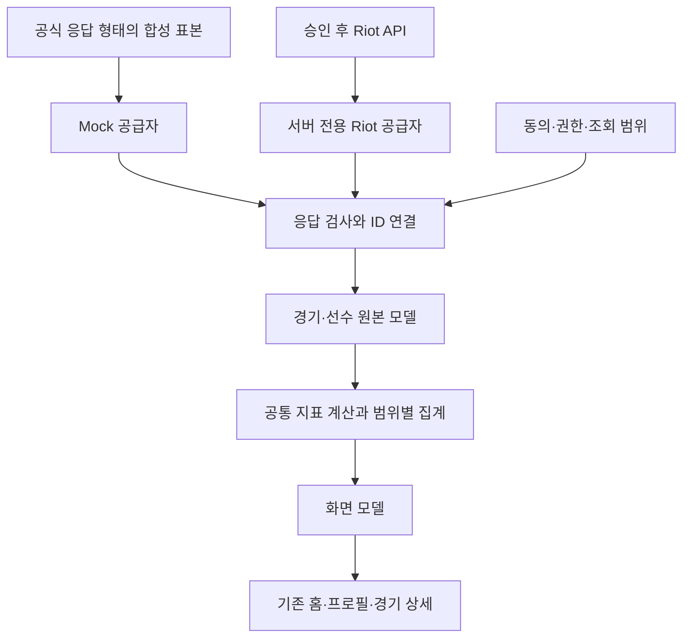

# API 기반 Mock 설계

기준: 2026-09-20 · [TASK-FE-022](../tasks/TASK-FE-022.md) · [화면 데이터 대응표](API-DATA-MAP.md).
설계 당시 경로·함수명은 제안이다. 2026-09-20 [TASK-FE-023](../tasks/TASK-FE-023.md)에서
소비 DTO·합성 4경기·검사/변환/집계를 구현했다. 정확한 파일과 사용법은
[데이터 모듈 설명](../../frontend/src/features/tracker-profile/data/README.md)을 따른다.
기존 화면 전환·공급자·실제 API 연결은 아직 진행하지 않았다.

## 목표와 범위

현재는 화면에 맞춘 표본을 여러 곳에서 만든다. 다음 단계에서는 공식 API 모양의
경기 표본 한 벌을 만들고, 목록·상세·프로필 합계를 같은 원본으로 계산한다.
디자인은 분리한 컴포넌트·테마에서, 데이터 의미는 변환·집계에서 수정한다.
키 발급 후에는 원본을 읽어오는 부분을 교체한다. 인증·권한·호출 제한·실제 응답 검증은
별도 연결 작업이므로 키 한 개만 넣으면 모든 기능이 바로 완성된다고 약속하지 않는다.

첫 대상은 **PC Competitive 프로필 → 경기 목록 → 상세5탭**이다.
홈에는 같은 데모 계정 요약을 연결한다. 기존 이미지와 라인업은 유지한다.
콘솔·Deathmatch·Unrated 등 현재 시연 동작을 이 설계 단계에서 삭제하지 않는다.
새 데이터 흐름으로 전환하는 모드만 지원 범위와 테스트를 별도로 확정한다.

## 흐름과 책임



| 구역 | 할 일 | 하지 않을 일 |
|---|---|---|
| 공식 DTO | Riot 문서의 필드 이름·단위·식별자를 표현 | `rrDelta`, `probeScore`, 임의 이미지 URL을 Riot 응답에 추가 |
| 공급자 | 같은 호출 계약으로 Mock 원본 또는 실제 원본 제공 | JSX 구성·표 숫자 반올림 |
| 검사·변환 | ID 연결, 시간/단위 정규화, 누락과 유효성 판정 | 없는 기록을 적당한 수로 생성 |
| 지표·집계 | 동일 정의로 경기/요원/맵/기간 통계 계산 | 화면마다 다른 K/D·HS 산식 사용 |
| 화면 모델 | 표시 가능한 값·미제공 사유·조회 범위·출처 전달 | 모든 미제공 값을 0이나 빈 배열로 변환 |
| 기존 컴포넌트·훅 | 레이아웃·표시·탭/필터/선택 동작 | Riot 키 취급·API 응답 직접 해석 |

현재 프론트 Mock, 구형 JSON 로더, [TASK-014의 Backend Adapter](../tasks/TASK-014.md)는
서로 다른 경로다. 이미 하나로 연결된 것으로 보지 않는다. 기존 인터페이스의 책임은
참고하되 Spring 연결·새 서버 계약은 이번에 만들지 않는다. 사용자 요청에 따라 Spring
구현은 뒤로 미룬다. Next.js/Vercel 서버는 후속 연결의 후보이며 기존 Backend Adapter의
역할·서버 배치는 연결 Task에서 확정한다. 계산 함수는 React와 네트워크에 의존하지 않게 한다.

### 제안 파일 배치

| 제안 위치 | 사용처 / 책임 |
|---|---|
| `features/tracker-profile/data/contracts/riot.ts` | 공식 원본 필드. Match와 Leaderboard의 동명 PlayerDto는 별도 타입 이름 사용 |
| `data/contracts/view.ts` | UI가 받는 모델·미제공 이유·조회 범위 |
| `data/fixtures/riot/` | 합성 Matchlist/Match/Content JSON. 키·실사용자 데이터 없음 |
| `data/fixtures/scenarios.ts` | 데모 신원·동의·시간·응답 실패 등 앱 전용 시나리오 |
| `data/providers/mock.ts` | 표본을 비동기로 읽음. 실패 시나리오도 동일 경계로 전달 |
| `data/mappers/` | 원본 검사, 선수/팀/콘텐츠 연결, 화면 모델 변환 |
| `data/metrics/` | 정의된 순수 지표와 합산, 근거/분모 보존 |
| `data/selectors/` | 시즌/목록/최근20/날짜 표시 범위 선택 |
| 향후 서버 전용 공급자 | Riot 호출과 비밀키. 브라우저가 import할 수 있는 위 폴더와 분리 |

경로 확정은 다음 구현 Task의 기존 소스 감사 후 진행한다. 파일 개수 자체가 목표는 아니다.
각 함수에 “어느 화면에 쓰이는지 / 어떤 분모인지 / 미제공 조건”을 한국어 주석으로 남긴다.
UI 전용 조회 훅이 필요해져도 FE-021의 화면 선택 훅에 네트워크 상태를 섞지 않는다.

## 원본 표본의 계약

공식 문서 기준은 [MATCH](https://developer.riotgames.com/apis#val-match-v1/GET_getMatch),
[LIST](https://developer.riotgames.com/apis#val-match-v1/GET_getMatchlist),
[CONTENT](https://developer.riotgames.com/apis#val-content-v1/GET_getContent)다.
실제 호출을 검증한 fixture가 아니라 **문서에 맞춰 만든 합성 fixture**라고 표기한다.
문서 확인일과 fixture 버전, 지표 정의 버전은 응답 바깥의 manifest에 둔다.

| 원본 | 포함할 데이터 | 연결 규칙 |
|---|---|---|
| MatchlistDto | `puuid`, `history[]` | 각 matchId는 해당 시나리오의 상세 또는 명시된 조회 실패와 연결 |
| MatchDto | `matchInfo`, `players`, `teams`, `roundResults`, `coaches` | 같은 matchId의 복사본을 화면별로 두지 않음 |
| PlayerDto | PUUID·이름·태그·팀·characterId·stats·경기 tier/level | 조회 선수는 반드시 실제 해당 roster의 PUUID로 찾음 |
| RoundResultDto | 라운드 번호·승리 팀·선수별 킬/피해/경제·설치/해체 정보 | 기본 성공 표본은 전체 라운드 기록을 갖춤. 최소 요약 fixture와 구분 |
| ContentDto | 기존 자산과 연결할 요원/맵/장비/Act 표본 | 맵/게임 모드 assetPath와 characterId 등 ID 종류를 구별 |
| 앱 manifest | 데모 계정 선택, 동의 상태, 고정 시각, 실패 응답, 완전성 정보 | Riot DTO 내부에 데모용 `available`, `isMock`, `consent` 등을 넣지 않음 |

이름은 `DemoPlayer01` 등 합성 값, PUUID는 실사용자와 관계없는 테스트 문자열을 쓴다.
기존 화면의 IED agent와 임의 참가자 전적을 실제 계정 데이터로 주장하지 않는다.
요원/맵/무기 ID와 기존 자산의 연결은 검증하되 이미지 추가·교체는 보류한다.
알 수 없는 ID 표본도 넣고 임의로 Jett/Vandal로 대체하지 않는다.

설명용 LIST 조각(값은 합성, 실제 응답을 저장한 것이 아님):

```json
{
  "puuid": "demo-player-01",
  "history": [
    {
      "matchId": "demo-match-001",
      "gameStartTimeMillis": 1789862400000,
      "queueId": "competitive"
    }
  ]
}
```

해당 상세의 `matchInfo.matchId`와 `gameStartMillis`를 연결한다. 이 조각을 전체 성공
데이터셋으로 간주하지 않는다. 구현 fixture는 문서에 나오는 필드와 사용 여부를 점검하며,
생략·null이 실제로 허용되는지 모르는 경우 정상 표본의 임의 optional 필드로 만들지 않는다.
깨진 응답 시험은 별도의 invalid 시나리오로 분리한다.

## 계산과 누락 계약

원시값은 숫자·밀리초·ID 그대로 유지한다. 합산 후 마지막 표시 단계에서만 반올림하며
시간대는 표시 계층에서 적용한다. 지표별 원본과 보류 사항은 대응표의 지표 표가 기준이다.

화면 모델은 다음 의미를 구분한다(FE-023에서 기본 지표 타입 구현, UI 연결은 후속 Task):

| 상태 | 예시 | 표시 후보 |
|---|---|---|
| 값 있음 | 전체 적중 수가 양수이고 headshots=0 | `0%` |
| 비율 계산 불가 | 완전한 기록이지만 전체 적중 수=0 | `—`, 적중 없음. Head/Body/Legs를 각각0%로 만들지 않음 |
| 미제공 | 무기별 피해에 필요한 연결 정보 없음 | `—`, 사유 설명 |
| 일부만 있음 | 24경기 중 상세21개 성공 | 조회21경기 기준·일부 기록 미제공 |
| 해당 없음 | Deathmatch의 팀 라운드 승률 | 해당 모드 미지원 |
| 정의 대기 | trade 규칙 없는 KAST | 미제공. 임의 계산 금지 |

`Metric<T>`를 쓴다면 `known(value, provenance, sampleSize)`와
`unavailable(reason)`처럼 상태가 구분되는 형태를 제안한다. 기존 코드에 필요한
숫자 자리를 채우기 위해 `unknown ?? 0`을 쓰지 않는다. 정의 대기 지표의 공식
DTO 필드를 새로 만들지 않는다.

조회 범위에는 요청 조건, 반환된 목록 수, 상세 성공/실패 수, 시작/끝 시각,
중복 제거 수, 집계에서 제외한 수와 이유를 남긴다. LIST가 반환하는 전체 보존 기간을
확인하기 전에는 `completeSeason=true`로 간주하지 않는다.
무기 킬만 확인된 경우 무기 HS·Damage까지 확인된 것으로 확장하지 않는다.

## 표본 묶음과 기대값

아래 수치는 설계 당시 표본 목표이며 FE-023에서 라운드 원본과 일치하도록 생성·검증했다.
기존 화면에는 아직 반영하지 않았다. 피해·score는 합성 규칙이고 실제 게임 산식은 아니다.

| 기본 경기 | 조회 선수 | 팀 점수 / 결과 | K / D / A | 목적 |
|---|---|---|---|---|
| demo-match-001 | DemoPlayer01 / Jett | 13:9 승 | 24 / 15 / 5 | 전체 roster·팀·이벤트·피해·경제 연결 |
| demo-match-002 | DemoPlayer01 / Omen | 9:13 패 | 10 / 16 / 8 | 패배, 다른 요원/맵, 선택 선수 전환 |
| demo-match-003 | DemoPlayer01 / Jett | 14:12 승 | 18 / 17 / 6 | 연장전, 공수 변화, 같은 요원 합산 |
| demo-match-004 | DemoPlayer01 / Sova | 13:6 승 | 13 / 8 / 4 | 짧은 경기·요원3종 표시 |

4경기 합계는 **3승1패, 65/56/23**, Jett는 **2경기·42/32/11**이어야 한다.
개별 K/D 평균을 다시 평균 내지 않고 합계65÷56으로 계산한다. 이 승패 표본의 승률은75%다.
같은 원본을 목록 행·상세·P06·P08에서 검사한다. 피해·score·시간·명중 수는 실제로
생성한 라운드 표본과 일치하게 정하고 그때 기대값을 고정한다.

### 추가 시나리오

| ID | 상황 | 검증할 동작 |
|---|---|---|
| F01 | 위4경기 완전한 표본 | 동일 경기/선수 값이 모든 화면에서 일치 |
| F02 | 성공한 목록 `history: []` | 정상적인 전적 없음. 오류나 0% 실력으로 해석하지 않음 |
| F03 | 목록은 있으나 일부 상세 조회 실패 | 나머지 사용 가능, 부분 데이터와 집계 분모 고지 |
| F04 | 이전 정상 조회로 계산한 요약만 캐시에 있고 상세 재조회 실패 | manifest에서 캐시/실패를 설정. 공식 DTO를 임의로 훼손하지 않음. 요약은 시각·출처와 함께 유지하고 상세에는 조회 실패/재시도 표시 |
| F05 | F05a: Head0·전체적중 양수 / F05b: 전체적중0 / F05c: Deaths0 | a는 HS0%, b는 비율—·적중 없음, c는 비율—·사망0(초기 제안). 실제 킬/경제0은0 유지. 운영 표시 확정 후 정렬도 함께 검증 |
| F06 | 알 수 없는 요원/맵/무기 ID | 기존 fallback 사용, 통계 손실/임의 치환 없음 |
| F07 | 잘못된 matchId/누락 roster/같은 ID의 서로 다른 내용/합계 불일치 | invalid로 탐지. 동일 목록 항목의 단순 반복은 제거·건수 기록. 다른 경기 상세를 연결하지 않음 |
| F08 | 무승부·미완료·비경쟁전/콘솔 요청 | 잘못된 승패·두 팀 통계 생성 방지, 지원 범위 표현 |
| F09 | 날짜 경계·Act 변경·21개 이상 고유 경기 | P05/M01 범위, 최근20/스트립8, Load more 및 시간대 |
| F10 | 다른 데모 계정·팀 반전·선수 선택 | 조회 선수 ID가 바뀌면 결과/지표/공수도 올바르게 연결 |
| F11 | 미연결·동의 거절/철회·연결 만료 | 공개 허용 상태와 단순 로그인/HTTP 오류를 구별 |
| F12 | 지연·404·401/403·429·5xx·네트워크 실패 | 로딩/재시도/서비스 오류, 실제 모드에서 Mock으로 조용히 fallback하지 않음 |

전체 UI를 채우기 위한 큰 표본부터 만들지 않는다. F01의 한 경기·한 선수 계산을 먼저
확정하고 나머지를 확장한다. 페이지 표시량 시험은 같은 matchId 복제로 수를 늘리지 않는다.
순간 랜덤·실시간 Date.now에 의존하지 않고 고정 시각/seed를 전달해 재현한다.

## 반드시 맞아야 할 관계

1. 목록의 경기 ID·시작 시각·queue와 상세 matchInfo가 일치한다.
2. 조회 PUUID와 roster가 일치한다. 같은 경기·선수의 K/D/A는 목록/상세/합계에 동일하게 반영된다.
3. 기본 완전 표본에서는 라운드 킬/assist 이벤트와 player.stats 합계를 대조한다.
   부활·환경사 등 예외는 별도 시나리오로 다루며 어긋나는 총계를 임의 보정하지 않는다.
4. 라운드 승리 합계와 팀 roundsWon, 완료된 경기 결과가 일치한다.
   고정 teamId를 경기 내내 Attack/Defense로 취급하지 않는다.
5. 기본 적 처치 이벤트 하나는 killer/victim 쌍과 해당 킬 분류에 한 번만 포함된다.
   중복 이벤트·중복 경기로 합계를 늘리지 않는다.
6. 무기별 확인된 킬 + 능력/기타/미상 분류의 킬은 분류 대상 킬 합계와 맞는다.
7. Head/Body/Legs의 분모는 같은 적중 집합이다. 분모가 양수일 때 부위별 비율은 반올림 오차 외에는100%다. 분모0은 비율 계산 불가다.
8. 경기 합계→요원/맵 합계→프로필 합계가 같은 조회 조건에서 일치한다.
   역할은 메타데이터가 있는 요원 전체를 합산하고 미분류도 숨기지 않는다.
9. 불완전한 표본의 듀얼 빈칸·FK·경제를 0으로 바꾸지 않는다. 참가자를 바꿔도 다른 선수의 값을 복사하지 않는다.
10. 비율 계산 전에 숫자의 유효성·분모를 검사한다. 반올림 문자열을 재집계하지 않는다.

## 조회 상태와 운영 연결 준비

제안 서비스 계약은 `loadProfile(query)`와 `loadMatch(matchId, viewerPuuid)` 정도로
시작한다. 이는 내부 함수 경계이며 공개 HTTP 엔드포인트 설계가 아니다.
프로필 요청에는 플랫폼·게임 shard·PUUID·Act·queue를 구분해 전달한다.
RSO 계정 API의 지역 라우팅과 VALORANT 경기 shard를 하나의 문자열로 가정하지 않는다.

조회 결과는 `loading / ready / empty / partial / unavailable / error`를 구분한다.
뒤늦게 도착한 이전 선수/Act 응답이 새 화면을 덮지 않도록 취소나 요청 ID 검사를 둔다.
401/403은 Riot 키/서비스 권한 문제일 수도 있으므로 무조건 사용자 로그인 만료로 바꾸지 않는다.
429는 재시도 가능 시점 정보를 보존하고 무한 즉시 재요청하지 않는다.
목록→상세 다중 조회는 중복 제거·제한된 동시성·캐시/새로고침 규칙을 연결 Task에서 정한다.
페이지의 +20 표시와 원본 추가 조회는 서로 다른 동작이다.

실제 호출은 향후 서버 전용 영역에서 처리한다. Next.js/Vercel 사용 여부와 기존
Backend Adapter의 역할은 연결 Task에서 확정한다. API 키/RSO 비밀값을
브라우저 번들·공개 환경변수·주소·로그에 넣지 않는다. 지금은 키나 배포 설정을 변경하지 않는다.
원시 경기 전체를 브라우저에 그대로 넘기기 전에 플레이어 공개 동의를 검사해야 한다.
한 선수의 동의가 경기 참가자 전원의 동의를 뜻하지 않는다. 미동의 참가자와 공유/새 탭
경로의 공개 범위는 운영 인증 Task에서 확인하고 서버에서 일관되게 적용한다.

## 신청용 데모와 실제 계정 연결

Riot는 사용자 흐름을 확인할 수 있는 프로토타입·Mock 자료를 검토 대상으로 안내한다.
VALORANT RSO는 Production Key 승인 이후 별도 연결 과정이 필요하다.
[공식 VALORANT 안내](https://developer.riotgames.com/docs/valorant)

따라서 신청 전에는 `데모 시작 → 합성 계정/공유 동의 설명 → 프로필 → 경기 상세`
흐름을 실제로 조작할 수 있게 준비한다. 이것을 실제 Riot 로그인 성공으로 표시하지 않는다.
계정 미연결/거절 상태도 시연하고, 승인 후 실제 RSO로 교체할 위치를 설명한다.
사용 가능한 배포 주소·서비스 설명·약관·개인정보 안내는 별도 신청 준비에서 점검한다.
소스 저장소만으로 신청을 대신하지 않는다.
[Production Key Applications](https://support-developer.riotgames.com/hc/en-us/articles/22801383038867-Production-Key-Applications)

현재 RR·최고 기록·무기별 HS·KAST·Probe Score 운영 정의는 대응표에서 보류한다.
Probe Score는 공식 랭크/MMR를 대체하는 기능으로 확정하지 않는다. 운영 기능 설명과
산식을 정할 때 Riot의 게임 무결성 정책에 맞는지 별도로 검토한다. 디자인이 같다고
Tracker의 모든 지표를 공식 API에서 제공받는 것은 아니다.

## 후속 구현 순서와 완료 기준

| 순서 | 다음 Task 범위 | 완료 기준 |
|---|---|---|
| 1 | 공식 DTO·작은 원본 표본·변환/집계 순수 함수 | FE-023 구현·검증 완료. 소비 필드만의 합성 표본이며 전체 실응답 검증은 아님. 기존 화면 미전환 |
| 2 | 프로필/목록/상세를 공통 Mock 공급자에 연결 | 데이터 의미 변경 비교표 검토, 같은 값 검증, 로딩/빈/부분/오류, 기존 modal/inline 유지, Before/After QA |
| 3 | 신청용 데모 동선·공개 설명 완성 | 데모와 RSO 차이, 계정/동의 흐름, 배포 주소·정책 문서 확인 |
| 승인 후 | 실제 서버 공급자·RSO 연결 | 실제 응답 계약·권한·라우팅·제한·캐시·정책 재검증 |

새 구현 Task는 읽을/바꿀 소스와 HANDOFF 범위를 먼저 확정한다. 정상 데이터부터
커버리지·일관성 테스트를 만들고, UI 전환 전에는 현재 Mock을 비교 기준으로 보존한다.
실데이터 확보 후에는 익명화/보관 허용 범위를 검토한 계약 테스트로 합성 표본의 가정을
다시 확인한다. 이번 문서만으로 API 대응 완료나 키 발급 가능 여부를 확정하지 않는다.

### FE-023 구현 결과와 남은 설계

기본 4경기·89라운드에서 K/D/A 65/56/23, 3승1패, Jett42/32/11을 검증했다.
10인·5:5와 전체 라운드 참가자/이벤트/팀 합계, 목록-상세 연결, 누락/0, 중복/충돌,
빈/부분 조회, 미상 콘텐츠, 무승부·미완료·미지원 범위, 조회 선수 변경을 시험했다.
성공·실패 상세를 받는 순수 `buildProfile` 경계까지 구현했으며 비동기 공급자는 후속 범위다.

현재 원본은 공식 문서의 **소비 필드만** 포함한다. 설치·해체·좌표 등은 포함하지 않으며
콘텐츠 ID는 데모 전용이다. 기존 이미지 매핑 검증, 부활/환경사/이탈/부분 라운드 실제 응답
대응과 상세 5탭 모델 확장은 후속 연결에서 진행한다. 기존 UI/Mock/자산은 유지했다.
F04 캐시·F09 페이지/기간 UI·F11 동의·F12 로딩/취소/재시도는 아직 구현하지 않았다.


### FE-024 화면 연결

`provider → buildProfile → viewModel → 기존 프로필 카드/목록`과
`동일 fixtures → matchDetail → 기존 상세 패널`을 연결했다. 화면 신원은 DemoPlayer01이다.
홈은 실제 Riot ID를 조회하지 않는 데모 진입이라고 명시한다. 기본 데모 보기·Overview·일반 프로필 소개 카드는 기존 ied-agent-allen 경로를 사용하며, 새 데이터 데모 링크/카드에서만 DemoPlayer01로 이동한다.
로딩/빈/부분 실패/오류·재시도, 취소된 응답 차단, 미제공과 실제 0 구별을 포함한다.
직접 경기 링크는 경기 ID와 조회 PUUID를 보존하고 같은 상세 컴포넌트를 재사용한다.

| 이전 예시 | 새 데모의 의미 |
|---|---|
| 경기별 대표 무기에 경기 전체 킬 배정 | finishingDamage의 무기 킬만 집계, 능력/기타 제외 |
| 경기별 HS·시간을 가공한 예시 값 | 원본 적중 합계/전체 적중, playtimeMillis 합계 |
| RR·KAST·Probe Score·등급 임의 표본 | 미제공 `—`, 정의/확보 이후 연결 |
| 고정 Body/Legs | 원본 부위별 적중 / 전체 적중 |
| 이름만 바꾸고 같은 전적 표시 | 기본 새 프로필은 원본 조회 PUUID에 연결된 한 계정 |
| 상세 라운드/경제/교전 미제공 | 원본에 있는 K/D/A·킬 이벤트·경제 합계·상대별 교전만 표시 |

현재 랭크 명칭 매핑, 프로필 First Bloods/Flawless/Aces 합계, 무기 HS/KD/피해, 위치·설치/해체는
연결하지 않았다. 이미지가 없는 콘텐츠는 기존 placeholder를 사용하며 새 자산은 추가하지 않았다.
신청용 계정/동의 설명, 실 API 응답과 운영 예외, 서버 공급자·인증·캐시·수집 페이지 처리는 남아 있다.


### FE-032 계정 공개 동의 시연

`/connect`에서 연결 설명 → 공개 범위 확인 → 체크박스 동의/취소 → 합성 프로필 요약 →
철회 후 비공개 화면을 체험한다. 미선택 체크박스로 시작하며 취소/철회 후에는 새로 동의해야
프로필이 표시된다. 동의한 동안 기존 `createMockProvider`의 DemoPlayer01 집계/경기만 읽고
다른 참가자 정보는 출력하지 않는다.

F11의 **화면 시연**만 구현하며 실제 RSO·동의 저장·서버 공개 범위 제어는 미구현이다.
상태는 /connect 컴포넌트 메모리에만 있고 새로고침/페이지 이탈 시 초기화한다. 이 시연은
기존 디자인/새 데이터 데모·공유 경기 URL의 공개 상태를 변경하지 않는다.
동의 철회는 합성 프로필을 화면에서 숨기는 시연이며 실제 계정의 공개/삭제 완료를 뜻하지 않는다.

운영 전환 시에는 실제 RSO 본인 확인, 동의 범위/보관·철회 정책, 미동의 참가자와 직접/공유
경로의 서버 공개 제한을 별도 Task에서 구현·검증해야 한다. 고지·정책 문서 확정 및 신청용
서비스 안내는 별도 후속 작업이다.
