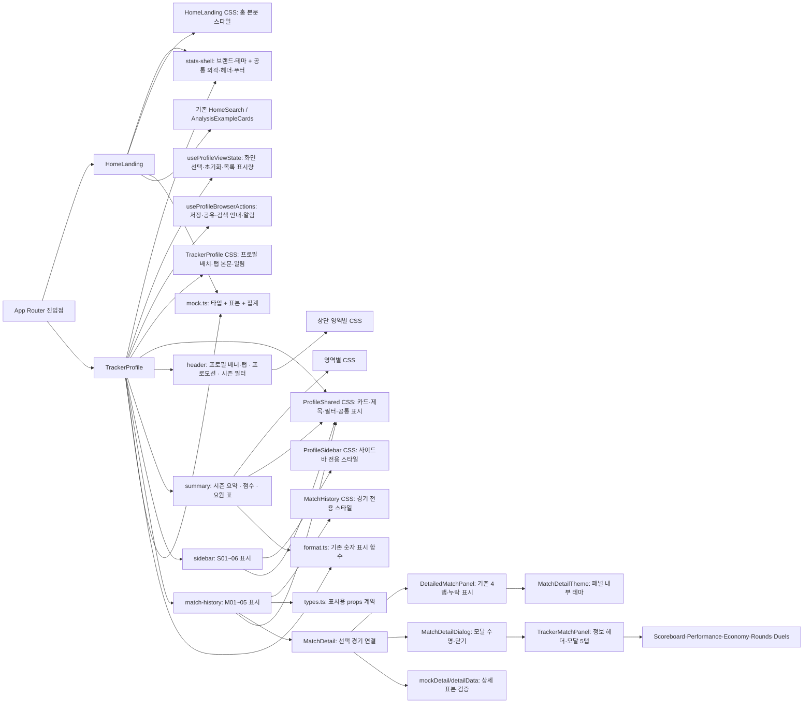
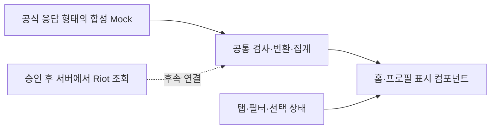

# 홈·프로필 모듈 분리 계획

> [TASK-FE-011](../tasks/TASK-FE-011.md) · 기준 `b016a29` · 2026-09-17
>
> A 단계는 [TASK-FE-012](../tasks/TASK-FE-012.md)에서 구현하고 2026-09-18 브랜드·배경 연결을 보완했다.
> A 단계는 PR #5로 통합 브랜치에 병합됐다(`6cde828`).
> B1은 [TASK-FE-013](../tasks/TASK-FE-013.md)에서 공통 헤더·푸터를 분리하고 PR #6으로 병합됐다(`06076ca`).
> B2a는 [TASK-FE-014](../tasks/TASK-FE-014.md)에서 시즌 요약·점수·요원 표를 분리하고 PR #7으로 병합됐다(`e4f78bf`). [비교 캡처·검증 보고서](../visual-qa/TASK-FE-014.md).
> B2b의 상단 영역은 [TASK-FE-015](../tasks/TASK-FE-015.md)에서 분리하고 PR #8으로 병합됐다(`9e84346`). [비교 캡처·검증 보고서](../visual-qa/TASK-FE-015.md).
> B2b의 사이드바는 [TASK-FE-016](../tasks/TASK-FE-016.md)에서 분리하고 PR #9로 병합됐다(`eac0cbf`). [비교 캡처·검증 보고서](../visual-qa/TASK-FE-016.md).
> B3는 [TASK-FE-017](../tasks/TASK-FE-017.md)으로 M01~M05 전체를 분리하고 PR #10으로 병합됐다(`17da56c`). `eac0cbf`에서 분기한 `codex/profile-match-history-components`에서 진행했다. [비교 캡처·검증 보고서](../visual-qa/TASK-FE-017.md).
> B4 모달 공통 스타일은 [TASK-FE-019](../tasks/TASK-FE-019.md)로 정리하고 PR #12로 병합됐다(`1863a99`).
> B5 프로필 공통 스타일은 [TASK-FE-020](../tasks/TASK-FE-020.md)에서 구현·검증하고 PR #13으로 병합됐다(`45bbd06`).
> C1 화면 상태·전환과 C2 브라우저 동작은 [TASK-FE-021](../tasks/TASK-FE-021.md)에서 두 훅으로 분리했다. 사용자 승인에 따라 같은 브랜치의 두 커밋을 한 PR로 전달한다. D 데이터 경계는 후속 범위다.
> 현재 화면 영역/함수는 [화면 정의서](SCREEN-MAP.md)를 기준으로 한다.

## 목적과 고정 범위

서비스명·문자 로고·테마·화면 구성·상태·데이터를 각각 바꾸기 쉽게 만든다.
분리 전후의 외형과 사용 동작은 동일하게 유지한다. 변경 요구가 있는 기능은
별도 범위로 명시한다. FE-013은 사용자 지정 후 Search의 글자·아이콘 색과
글자 크기·hover·focus를 통일했으며, 그 외 외형·동작은 유지한다.

- 이미지 파일·종류·선택·매핑·표시 방식은 그대로 유지한다. 누락 이미지 보충,
  요원/무기/랭크 카탈로그 확장, 인체 SVG 변경도 이번 순서에 넣지 않는다.
  FE-016에서는 기존 인체 SVG의 path·속성을 그대로 `AccuracyCard`로 옮기며 형상을 바꾸지 않는다.
- 동료의 라인업 소스·공용 레이아웃·전역 CSS·백엔드는 변경하지 않는다.
- 기존 Mock 값·계산식·검색 경로를 유지한다. 실제 API 응답이나 통계 의미는 확정하지 않는다.
- 새 상태 관리/디자인/데이터 라이브러리를 도입하지 않는다. 현재 React와 CSS Modules를 사용한다.
- 각 단계는 사용자 지정 후 하나씩 구현·검증·검토한다. 이 문서의 다음 단계를 자동 실행하지 않는다.

## 현재 연결에서 분리할 부분

브랜드 설정·테마와 공통 외곽·헤더·푸터는 stats-shell로 분리했다. 홈은 프로필 CSS를
직접 가져오지 않으며, Mock의 프로필 예시 데이터는 그대로 사용한다. TrackerProfile에는
집계와 탭별 조합·표시 helper가 남아 있다. 화면 선택 상태와 전환 규칙은
FE-021의 `useProfileViewState`, 저장·클립보드·검색 안내·알림은 `useProfileBrowserActions`가 맡는다. 프로필 상단과
시즌 요약·점수·요원 표·사이드바는 값과 이벤트를 받는 표시 컴포넌트로 이동했고,
경기 목록 M01~05도 같은 경계로 분리했다. 파일을 작은 조각으로만 나누기보다
“무엇을 바꿀 때 어느 파일을 여는가”를 기준으로 경계를 나눈다.

| 수정하려는 것 | 제안 경계 | 포함하지 않을 책임 |
|---|---|---|
| 서비스명·문자 로고·점수 표시명 | 홈·프로필 공통 `branding` 설정 | Mock 경기나 브라우저 저장 키 |
| 색·글꼴·글자 크기·폭·간격 | 범위가 제한된 공통 테마 | API 조회나 필터 |
| 상단 브랜드·검색·내비게이션·푸터 | 구현된 `StatsHeader`·`StatsFooter`와 `StatsShell` | 프로필 검색 결과 판단·메뉴 상태·통계 데이터 |
| 홈 소개·검색 주변 배치 | 홈 기능 영역 | 프로필 전체 스타일 import |
| 랭크/시즌/요원/경기 카드 배치 | 영역별 표시 컴포넌트 | 직접 localStorage·clipboard·네트워크 호출 |
| 탭·필터·펼침·알림 동작 | 프로필 상태와 동작 훅 | JSX 배치나 CSS 값 |
| 경기 필터·집계 | 순수 함수 | React 훅·브라우저 상태 |
| Mock과 향후 API 전환 | 데이터 공급 및 화면용 변환 경계 | API 응답을 화면 컴포넌트에 그대로 전달 |

## 권장 진행 순서

### A. 구현 — 브랜드 설정·테마 기준 분리 (TASK-FE-012)

**홈과 프로필이 함께 쓰는 설정부터 분리한다.** 파일 이동과 import 변경에 집중할
수 있어 검토 범위가 작고, 사용자가 가장 자주 조정한 글자·배치 기준을 한곳에서 찾을 수 있다.

구현한 새 파일:

- `frontend/src/features/stats-shell/branding.ts`: 현재 `branding` 값.
- `frontend/src/features/stats-shell/theme.module.css`: 홈·프로필의 테마 변수/기본 글꼴과 해당 화면이 있는 body 배경.

실제 범위는 [TASK-FE-012](../tasks/TASK-FE-012.md)를 따른다. 두 화면의 import와
루트 테마 클래스를 연결하고, Mock의 브랜드 export를 옮겼다. 설정 사용처와
모바일/화면별 덮어쓰기 위치를 한국어 주석으로 안내한다.

적용한 방식:

1. `branding` 네 값을 옮기고 두 화면의 import를 바꿨다. 9월 18일에는 홈 소개,
   프로필 점수 접근성 이름·툴팁·경기 상세 지표·풋노트의 브랜드 이름도 연결했다.
   기본 표시 문구는 유지하고, 점수 카드 접근성 이름만 `Probe score`에서 설정값인
   `Probe Score`로 대소문자를 맞췄다.
2. 공통 변수 중 25개는 THEME의 `:where(.theme)`로, 기본 글꼴·색·배경은 `.theme`로
   옮겼다. 낮은 변수 우선순위로 기존 홈 제목과 사이드바 반응형 값이 유지되도록 한다.
   `--bg`만 `:where(.theme), :global(body):has(.theme)`의 한 선언으로 main과 body가
   공유한다. body는 이 배경 변수만 받으며, `.theme`가 없는 화면에는 적용하지 않는다.
3. 기존 `.page`는 화면 범위 표식으로 유지했다. `:has(.page)`에 연결된 공용 헤더/푸터
   처리나 전체 CSS 구조는 바꾸지 않았다.
4. More 메뉴·승률 도넛 내부의 직접 색상값은 `--raised`, 시즌 Overview 하단은
   `--panel`로 연결했다. 이미지 오버레이는 변경하지 않았다.
5. 헤더·카드 배치와 동작, 이미지 helper를 유지했다. 저장 키의 `gameprobe:`도 그대로 뒀다.

이 첫 단계에서는 홈의 프로필 CSS 의존이 남아 있었다. 이후 B1에서 헤더 스타일과
공통 외곽을 분리해 해당 의존을 제거했다. 홈·프로필의 브랜드 포함 표시 문구는 설정을 사용하지만,
소개 문장 전체나 개별 고정 스타일까지 설정으로 옮긴 것은 아니다. 이미지 오버레이,
홈·프로필 계정 버튼 색/hover 차이, More 메뉴의 Escape·포커스 처리 차이는 유지했다.
후속 Task에서 시각·동작 의도를 확인한 뒤 다루며 이미지 변경은 토의 전까지 보류한다.

검증 근거는 [FE-012 Visual QA](../visual-qa/TASK-FE-012.md)를 참고한다.
9월 17일 분리 검증과 9월 18일 보완 검증의 범위·결과는 해당 보고서에서 구분한다.

### B. 화면 영역별 컴포넌트 분리

한 번에 전체를 옮기지 않고 단계별로 진행한다. B1과 B2a는 통합 브랜치에 병합했다.
B2b도 검토 범위를 줄이기 위해 상단과 사이드바로 나눴으며, 상단은 PR #8로 병합했다.
사이드바는 FE-016으로 PR #9 병합을 마쳤다. B3는 사용자 승인에 따라 FE-017 한 Task에서
M01~M05 전체를 분리하고 PR #10으로 병합했다.

| 순서 | 화면 ID | 컴포넌트·상태 | 유지할 연결 |
|---|---|---|---|
| B1 — [FE-013](../tasks/TASK-FE-013.md), DONE | H01~02/H06, P01의 브랜드·내비/P09 | `StatsShell`, `StatsHeader`, `StatsFooter` — PR #6 병합 완료 | Search 외형만 명시한 기준으로 통일. 검색 기능·More 키보드 동작·계정 버튼 차이는 유지. P01 Mock 안내는 프로필에 유지 |
| B2a — [FE-014](../tasks/TASK-FE-014.md), DONE | P06~08 | `SeasonOverview`, `ProbeScoreCard`, `AgentStatsTable`와 전용 CSS — PR #7 병합 완료 | 부모의 시즌 집계·상태·이미지 helper·선택 콜백 유지 |
| B2b 상단 — [FE-015](../tasks/TASK-FE-015.md), DONE | P02~05 | `ProfileHeader`, `ProfilePromotion`, `ProfileFilters`와 전용 CSS — PR #8 병합 완료 | 부모의 저장·공유·갱신·탭/시즌 선택·이미지/Select helper 유지 |
| B2b 사이드바 — [FE-016](../tasks/TASK-FE-016.md), DONE | S01~06 | `ProfileSidebar`, `RankCard`, `AccuracyCard`, `RoleStatsCard`, `TopWeaponsCard`, `TopMapsCard`와 전용 CSS — PR #9 병합 완료 | 부모의 상태·집계·이미지/Sparkline helper·선택 콜백 유지. 인체 SVG의 path·속성 그대로 이동 |
| B3 — [FE-017](../tasks/TASK-FE-017.md), DONE | M01~05 전체 | `MatchHistory`, `MatchFilters`, `RecentSummary`, `MatchDayGroup`, `MatchRow`, `MatchDetail`, 표시용 `types.ts`와 전용 CSS — PR #10 병합 완료 | 부모의 상태·effect·필터/집계·이미지/Select/Empty helper·스트립 스크롤 콜백 유지. 펼침1개·일별 집계·최근20개/표시 개수·상세 탭 초기화 보존 |

B1의 실제 경계:

- `stats-shell/StatsShell.tsx`: 페이지당 하나의 main에 기존 테마와 공통 범위 표식을 적용한다.
- `stats-shell/StatsHeader.tsx`: 내부 `BrandBar`·`SearchControl`과 내비게이션·More 표시를 맡는다.
  메뉴 상태와 이벤트는 HOME/PROFILE이, 검색 입력·결과 안내 판단은 PROFILE이 전달한다.
- `stats-shell/StatsFooter.tsx`: 기존 DOM·링크를 공유하고 `mode`로 안내 문구와 홈의 스타일 차이를 유지한다.
- `stats-shell/StatsShell.module.css`: 공통 초기화·헤더·푸터·반응형·공용 헤더/푸터 숨김을 관리한다.
  홈 본문 전역 클래스 덮어쓰기와 프로필 본문 스타일은 기존 파일에 남았다.
- Search는 기본 16px·700, 문구/placeholder/돋보기 `--text`, 전체 hover 밝기 변화 없음,
  키보드 포커스의 `--gold` 외곽선으로 통일했다. 기존 박스와 페이지별 모바일 폭·숨김은 유지한다.
  홈의 `#riot-id` 링크와 프로필의 입력 폼·Mock 토스트도 그대로다.
- P01 Mock 안내와 P10 토스트·타이머는 PROFILE에 남겼다. More의 홈 Escape/포커스 복원과
  프로필 토글 차이, 계정 버튼의 페이지별 색/hover 차이는 유지했다.
- 1500px 이상 `--sidebar-width:288px`는 PROFILE CSS에만 남겼다. 홈은 기본 272px를
  상속하지만 해당 변수를 사용하는 홈 요소가 없어 화면에는 영향이 없다.

B2a의 실제 경계:

- `tracker-profile/summary/SeasonOverview.tsx`: P06 제목·랭크·주요/보조 수치와 Show More 표시.
  부모가 값·`showMore`·토글 콜백을 제공한다. `rankIcon`·`rankGraph`는 기존 Asset·Sparkline
  요소를 받으며 helper와 임시 RR 계산은 부모에 유지한다.
- `summary/ProbeScoreCard.tsx`: P07 점수·지표·등급·막대 표시. 부모가 `score`와
  `metrics`를 제공하고 기존 branding을 사용한다. 점수·등급·막대 비율은 계산하지 않는다.
- `summary/AgentStatsTable.tsx`: P08 표·빈 상태·요원 선택 이벤트. 부모의 `agentTable(all)`이
  상위3/전체 행을 선택하고 기존 Asset을 `portrait`로 제공한다. 요원 필터 변경과 Matches
  이동도 부모 콜백에 유지한다.
- 세 컴포넌트의 `.module.css`: 영역 전용 스타일·반응형만 이동했다. 카드·제목·색·표 스크롤·
  빈 상태는 FE-020에서 `ProfileShared.module.css`로 분리해 직접 재사용한다.
  랭크 그래프의 `.rankGraph > svg`는 부모가 제공하는 기존 단일 SVG를 대상으로 한다.
- `tracker-profile/format.ts`: `number`·`signed` 두 표시 함수를 구현 그대로 공유한다.
  Mock·집계·상태·이미지 매핑은 옮기지 않았고 새 산식이나 포맷 정책도 넣지 않았다.

B2b 상단의 실제 경계:

- `tracker-profile/header/ProfileHeader.tsx`: P02 배너·신원·저장/갱신/공유 표시와 P03 탭을
  기존 한 header 안에 유지한다. 공통 Search 헤더인 `StatsHeader`와 별개다. 부모가 상태·
  콜백·아이콘을 제공하고 `renderHero`·`renderAvatar`는 자식 배치 클래스로 기존 이미지를 반환한다.
- `header/ProfilePromotion.tsx`: P04 브랜드 배너. 기존 branding을 재사용하며 Performance
  이동은 부모가 제공한 `onExplore`로 처리한다. FE-015에서는 사이드바의 S02 프로모션을
  옮기지 않았으며, FE-016에서 `ProfileSidebar` 내부로 이동했다.
- `header/ProfileFilters.tsx`: P05 플랫폼·모드·Act 표시. 부모가 선택지·선택 여부·콜백과
  기존 `actSelect`를 전달한다. 필터 상태·초기화 effect는 FE-021의 상태 훅으로 이동하고 집계는 부모에 유지한다.
- 각 `.module.css`: 상단 영역의 전용 배치·반응형만 이동했다. 기존 Select의 공통 스타일은
  FE-020에서 `ProfileShared.module.css`로 옮겼고, Act 전용 규칙은 기존 label/select 구조에 연결한다.
  이미지·아이콘·Select helper 자체와 데이터 의미는 변경하지 않는다.
  `.actFilter > label`·`.actFilter > label > select`를 사용하되, 모바일에서 원래 덮어써져
  적용되지 않던 Act의 왼쪽 여백 12px 선언은 제거해 공통 Select의 실제 값 10px를 유지한다.

B2b 사이드바의 실제 경계 (FE-016, PR #9 병합 완료):

- `tracker-profile/sidebar/ProfileSidebar.tsx`: S01~06 카드 순서와 배치를 맡고 짧은
  S02 프로모션을 내부에 둔다. Performance 이동은 부모 콜백을 사용한다.
- `sidebar/RankCard.tsx`: S01 현재/최고 랭크 표시. 부모의 고정 프로필 값과 기존 이미지 요소를 받는다.
- `sidebar/AccuracyCard.tsx`: S03 명중 부위 표시. Head와 Body/Legs의 기존 임시 산식은
  부모에 남기고 결과값을 받는다. `Sparkline`도 부모가 만든 요소를 전달하며 helper를 옮기지 않는다.
  인체 SVG만 기존 path·속성 그대로 이 컴포넌트에 이동한다.
- `sidebar/RoleStatsCard.tsx`: S04 역할별 표본 표시. 부모의 `agents.find()`로 선택한
  역할당 요원 1명이라는 기존 의미를 유지하며 역할군 전체 집계로 바꾸지 않는다.
- `sidebar/TopWeaponsCard.tsx`, `sidebar/TopMapsCard.tsx`: S05/S06 통계와 선택 표시.
  대표 무기별 집계·맵 집계, 이미지 요소/배경 선택, 필터 변경·탭 이동은 부모에 유지한다.
  카드 선택과 전체 보기 콜백은 기존 다른 경기 조건을 유지하는 동작을 그대로 따른다.
- `sidebar/ProfileSidebar.module.css`: 사이드바·각 카드 전용 스타일과 반응형을 함께 이동한다.
  `card`·`sectionHeading`·`yellow`는 FE-020에서 분리한 `ProfileShared.module.css`를 직접 재사용한다.
  자식에 새 상태·Mock 조회·브라우저 저장 동작을 추가하지 않는다.

B3 경기 목록의 분리 경계 (FE-017, PR #10 병합 완료; 상세의 현재 변경은 아래 FE-018 참고):

- `tracker-profile/match-history/MatchHistory.tsx`: M01~05 경기 영역과 안내·제목,
  조건/요약/날짜 그룹 조합, 빈 상태와 All Matches·Load more 표시를 맡는다.
- `match-history/MatchFilters.tsx`: M01 조건·More·Reset·날짜 안내 표시.
  부모가 기존 Select 요소와 선택/초기화 콜백을 제공하며 P05 시즌 필터와 분리한다.
- `match-history/RecentSummary.tsx`: M02 최근20경기 요약과 최근8경기 스트립 표시.
  최근 요원 요약·표본 선택은 부모가 계산한다. 스트립 클릭 시 펼침→상세 Overview
  초기화→스크롤 순서는 부모 콜백에 유지한다.
- `match-history/MatchDayGroup.tsx`: M03 날짜별 요약과 행 조합.
  `MatchRow.tsx`는 경기 행과 펼침 버튼, `MatchDetail.tsx`는 M04의 Overview/Performance
  표시를 맡는다. 날짜 묶음·일별 집계는 부모, 한 경기 선택 상태·인라인 상세 탭은 FE-021 상태 훅 소유다.
- `match-history/types.ts`: 표시 컴포넌트가 받을 값·요소·콜백의 props 계약만 정의한다.
  Mock 타입을 재구성하거나 향후 백엔드 API 응답을 정하는 작업은 포함하지 않는다.
- `match-history/MatchHistory.module.css`: M01~05 전용 선언과 반응형 순서를 보존해 이동한다.
  카드·제목·색·Select·빈 상태 등 공통 스타일은 FE-020에서 `ProfileShared.module.css`로 분리했다.
  `content`·`selectWrap` 연결 클래스를 공통 클래스와 함께 적용해 원래 selector의 우선순위를 보존한다.

FE-017 당시 부모에 유지한 화면 상태·초기화 effect는 FE-021 상태 훅으로 이동했다.
필터/집계·날짜/숫자 의미·이미지 선택과 기존 helper는 부모에 유지한다.
표시값·이미지/아이콘/Select/빈 상태 요소·콜백을 전달하고 자식에 새 상태나 조회를 추가하지 않는다.
필터 변경의 펼침 닫기/20개 복원, 탭 변경의 펼침만 닫기, 재펼침의 상세 Overview 초기화,
Load more의 +20과 All Matches의 전체 결과 표시는 그대로다. Deathmatch의 지표/라벨,
다른 프로필 표시명, DOM·문구·ARIA·이미지/SVG도 유지한다.

FE-013~016의 결과·검증 근거는 각 Task에서 관리한다. FE-016은 56조건 화면 비교, 캡처26쌍 픽셀 동일, 46개 동작 및 Mock/타입/Lint/build를 검증했다.
FE-017은 화면86조건·캡처30쌍 픽셀 동일·68개 동작 및 Mock/타입/Lint/build를 검증했다.
공통 표시 스타일은 아래 B4/B5에서 정리한다. 그 이후 분리 범위는
C의 상태·동작은 FE-021에서 분리했다. 다음 후보는 D의 Mock·타입·집계·데이터 공급 경계다. 별도 Task 지정 없이 후속 작업을 시작하지 않는다.

부모가 현재 데이터와 이벤트를 props로 전달하는 형태부터 만든다. 같은 시각 역할이
확인된 경우만 공통화한다. 모든 카드에 거대한 범용 옵션을 넣거나 전역 상태를 만들지 않는다.
기존 `HomeSearch`와 `AnalysisExampleCards`는 재사용하고 스타일 연결을 유지한다.

CSS는 해당 영역이 이동하는 Task에서 함께 정리하되 관련 media query와 selector 순서를
보존한다. 특히 홈 전역 클래스 덮어쓰기, `nth-child` 기반 예시 막대, `.page`의 전역 레이아웃
조정이 영향을 잃지 않도록 확인한다. 이미지 helper와 자산 매핑 통합은 별도 토의까지 보류한다.

### M04 기능 복원과 상세 경계 (TASK-FE-018)

사용자 지정으로 기존 네 탭 복원을 먼저 진행한다. 이 단계는 화면 변화가 있는 작업이다.
현재 목록을 유지하고 필요한 상세 Mock을 보강하는 방향을 승인받았다. 전체 C/D 작업을
동시에 시작한 것은 아니며, 상세 연결에 필요한 범위만 분리한다.

- `MatchDetail.tsx`: 선택 경기·조회 중인 프로필 신원과 상세 공급자 연결.
- `detail/presentation.ts`: 기본 `modal`, `inline`으로 변경하면 기존 펼침 복원. 사용자용 설정 화면은 추가하지 않는다.
- `detail/MatchDetailDialog.tsx`/CSS: native dialog와 목록 위치·포커스·스크롤 잠금의 수명.
  기존 인라인 외곽은 `MatchDetail`에 남고 두 방식은 같은 데이터 공급자를 사용한다.
- `detail/TrackerMatchPanel.tsx`/CSS: 모달의 정보 헤더·고정 5탭·키보드·내부 스크롤.
  Tracker 참고 화면의 파란 헤더·넓은 탭·팀 띠/교차 행을 사용하며 테마 값은 패널 하위로 제한한다.
- `detail/TrackerScoreboard`, `TrackerPerformance`, `TrackerEconomy`, `TrackerRounds`, `TrackerDuels`와 각 CSS:
  모달 탭별 표시·정렬·선수/라운드/경제 보기 선택. Scoreboard는 Economy에서 재사용한다.
  없는 기록을 생성하지 않으며 기존 인라인 4탭은 아래 `DetailedMatchPanel`에 보존한다.
- `detail/mockDetail.ts`: 원본 목록과 같은 ID/요약의 결정적 상세 Mock 공급.
- `detail/detailData.ts`: 표시 입력/결과 계약, 같은 경기·선수·팀 합계·라운드/분포 검증.
- `detail/DetailedMatchPanel.tsx`: 기존 스코어보드·라운드·성과·분석 탭 조합 및 누락 안내.
- `detail/MatchPersonalSummary.tsx`: 기존 목록의 개인 요약/지표를 보존한다. 팀 상세가 없는 Deathmatch에서도 사용한다.
- `detail/MatchDetailTheme.module.css`: 현재 테마와 기존 탭의 전역 클래스 연결을 패널 내부로 제한.
- 기존 `MatchScoreboardTab`/`MatchPerformanceTab`/`MatchAnalysisTab`: 없는 기록을 0으로 보이지 않게
  하며, 선택 선수가 없을 때 다른 팀을 대신 분석하지 않도록 보완한다. 구형 상세 경로도 이 보완을 공유한다.
- 기존 `MatchRoundsTab`/`MatchRoundMapPlotter`: 없는 종료 원인을 제압으로 표시하지 않고,
  좌표가 없으면 지도 도형 대신 미제공 안내를 표시한다. 제공된 기록의 표시는 유지한다.

열린 경기/인라인 탭 상태와 초기화는 FE-021의 `useProfileViewState`가 맡고 `TrackerProfile`이 전달한다. 모달 탭 상태는 `TrackerMatchPanel`이 맡는다. 기본 탭은 스코어보드이며
다시 열기·다른 경기·스트립 선택 시 초기화한다. 현재 목록 수치와 필터/집계는 유지한다.
기본 모달의 제목·탭·닫기는 고정하고 활성 내용만 스크롤한다. 인라인 선택 시 이전 배치와
스트립의 행 이동을 유지한다. 모달 닫기/Escape/배경 클릭 후 목록 위치·원래 포커스를 복원한다.
상세에서 보강한 참가자·라운드 순서·무기/교전 분포는 Mock으로 고지한다. FK/FD·피해 합계·
킬 이벤트·좌표·경제는 제공하지 않으며 0으로 대신하지 않는다. 원본 Mock 파일 및 구형 JSON은
변경하지 않는다. 향후 API를 연결할 때는 실제 계약에 맞춘 공급/변환을 구현해야 한다.

### B4. 경기 상세 모달 공통 스타일 (TASK-FE-019)

`match-history/detail/MatchDetailShared.module.css`에서 모달 안의 반복 규칙을 관리한다.

- `.theme`: `TrackerMatchPanel.module.css`의 `.panel`에서 CSS Module `composes`로 연결한다.
  기본 글자·배경·강조색과 헤더 배경, 팀 A/B 배경, Performance/Duels 보조 문구·포커스 색이 탭에 상속된다.
- `.horizontalScroll`: Performance의 선수 선택·라운드·분포 표와 Duels 매트릭스에서 함께 사용한다.
  기존 세 가지 규칙(max-width, overflow-x, overscroll-behavior-x)만 모았으며 각 탭의 너비·포커스 규칙은 남긴다.
- `.emptyDetail`: Performance/Duels에 경기 또는 조회 선수 기록이 없을 때 쓰는 같은 안내를 공유한다.
  각 모듈의 `.empty`가 이 규칙을 합성하므로 TSX의 사용처를 바꿀 필요가 없다.

같은 색 코드라도 역할이 다르면 묶지 않는다. Scoreboard/Rounds의 스크롤 조건,
Economy/Rounds 안내 박스, 탭별 표 열·배치·간격·반응형·폰트 크기는 각 CSS에 남긴다.
상위에서 물려받던 `--gold`/`--font-section`도 유지한다. 새 공통 색상은 모달 루트에만 적용한다.
사용처와 값을 찾으려면 공통 CSS의 한국어 주석을 먼저 확인한다.

### B5. 프로필 공통 스타일 (TASK-FE-020)

PR #12 병합 후 별도 `codex/profile-shared-styles` 브랜치에서 진행한다.
`tracker-profile/ProfileShared.module.css`를 부모와 11개 표시 컴포넌트가 직접 가져다 쓴다.
공통 카드 색·테두리를 수정하려고 페이지 배치 CSS를 찾을 필요가 없어졌다.

| 수정하려는 것 | 현재 위치 | 사용 영역 |
|---|---|---|
| 카드 기본 배경·테두리·모서리 | `ProfileShared.module.css`의 `card` | 시즌 요약·점수·통계 표·사이드바·날짜별 목록·빈 결과 |
| 제목·설명·더 보기 버튼 | 같은 파일의 `sectionHeading` | P06/P08, S01/S03~06, M01, 프로필 탭 제목 |
| 선택 입력의 기본형·숨긴 이름 | 같은 파일의 `selectWrap`·`srOnly` | P05 Act 및 M01 경기 필터 |
| 공통 강조색·표 스크롤·빈 결과 | 같은 파일의 `yellow`/`green`/`red`·`tableScroll`·`empty` | 통계/경기 강조값, 요원/무기 표, 요원/맵/경기 빈 상태 |
| 그래프 기본 크기·색 | 같은 파일의 `sparkline` | 시즌 랭크·명중률·Performance 그래프 |
| 페이지 열 배치·탭 본문·알림 | `TrackerProfile.module.css` | 전체 열, Maps/Weapons/Performance 탭, Mock 안내와 토스트 |
| 각 영역의 다른 배치·수치 | `header/`, `summary/`, `sidebar/`, `match-history/`의 전용 CSS | 원래의 상세 여백·표 열·모바일 규칙 |

이름과 연결만 옮기며 공통 30개 선언 블록의 값·순서·반응형을 유지한다.
Performance 그래프의 높이 보정은 부모 CSS의 `performanceGraph`에 두고 원래 우선순위를 유지한다.
경기 목록의 `content`/`selectWrap`, 사이드바의 `sectionHeading` 표식도 기존대로 유지한다.
요원 표와 무기 표는 정렬·여백·모바일 너비가 달라 전용 규칙을 합치지 않는다.
FE-020은 Select/Sparkline/Empty helper의 함수·상태·데이터, 모달 테마, 홈·라인업·자산을 그대로 유지했다.

B5 병합 후 C1/C2를 별도 브랜치/Task(FE-021)에서 진행했다.
검증 범위와 Before/After 근거는 [FE-020 Visual QA](../visual-qa/TASK-FE-020.md)를 참고한다.

### C. 상태·동작 분리

C1은 [TASK-FE-021](../tasks/TASK-FE-021.md)에서 `hooks/useProfileViewState.ts`로 분리했다.
`TrackerProfile`이 이 훅을 한 번 호출하고 기존 표시 컴포넌트에 값과 동작을 전달한다.
전역 상태나 새 데이터 공급 계층은 만들지 않는다.

| 수정할 동작 | 수정 위치 | 사용하는 화면 |
|---|---|---|
| 프로필 탭·시즌 조건 | 훅의 `navigate`, `setPlatform/setMode/setAct` | P01/P03/P05와 프로모션 |
| 경기 조건·초기화 | 훅의 하위 필터 setter, `resetFilters/resetAll`, 필터 effect | M01, 빈 결과 |
| 요원·맵·무기에서 경기 보기 | `viewAgentMatches/viewMapMatches/viewWeaponMatches` | P08/S05/S06, Agents/Maps/Weapons 탭 |
| 행 토글·스트립 선택·닫기 | `toggleMatch/selectMatch/closeMatch` | M02~M04 |
| 인라인 상세 탭 | 훅의 `detailTab/setDetailTab` | 보존된 인라인 상세 4탭 |
| 목록 전체/더 보기 | `viewAllMatches/loadMoreMatches` | M05 |
| More/Show More | `toggleFilters/toggleMore` | M01/P06 |

- 필터가 실제로 변경될 때만 경기 닫기·20개 복원이 실행된다. 같은 값 재선택과 이미 기본값인 Reset은 초기화하지 않는다.
- 탭 이동/재선택은 경기만 닫고 표시량·필터·상세 탭과 접힘 상태를 유지한다.
- 행은 토글하고 스트립은 항상 연다. 둘 다 인라인 상세 탭을 스코어보드로 초기화한다.
- `resetFilters`는 하위 다섯 조건만, `resetAll`은 플랫폼·모드·Act까지 복원한다. 현재 탭은 유지한다.
- 기존 초기화 effect의 시점을 유지한다. 더 큰 상태 모델 변경은 이 추출에 섞지 않는다.
- `Mode`/`MatchTabId`는 기존 타입만 참조한다. 훅은 Mock 값이나 API를 조회하지 않는다.
- 모달 내부 5탭/선수/라운드 상태와 포커스·스크롤 잠금은 기존 상세 컴포넌트에 유지한다.
- 통계·Mock 집계·이미지 생성·인라인 DOM 스크롤은 부모에 남는다.

C2도 사용자 승인에 따라 같은 FE-021에서 `hooks/useProfileBrowserActions.ts`로 분리했다.
부모가 `{ playerId, displayName }`으로 한 번 호출하고 기존 UI에 값·콜백을 전달한다.

| 수정할 동작 | 브라우저 동작 훅의 위치 | 사용하는 화면 |
|---|---|---|
| 프로필 저장·재진입 | `saved`, 저장소 읽기 effect, `favorite` | P02 저장 버튼 |
| 현재 주소 공유 | `share` | P02 공유 버튼 |
| 검색 입력·데모 안내 | `search/setSearch`, `submitSearch` | P01 검색 |
| Mock 갱신 안내 | `refreshed`, `refresh` | P02 갱신 버튼 |
| More·Mock 안내·경기 배너 | `menu/notice/banner`, 토글·닫기 콜백 | P01, M01 |
| 알림 표시·자동/수동 닫기 | `toast`, 3200ms effect, `dismissToast` | P10 |

저장 키는 `gameprobe:profile:${playerId}:saved`를 유지한다. 저장 실패 시 현재 방문 상태와
안내를 보존하고 공유 실패 시 주소창 복사를 안내한다. 같은 알림 문구는 타이머를 다시
시작하지 않으며, 다른 문구·닫기·unmount에서는 이전 타이머를 정리한다.
메뉴/배너/검색 상태는 탭 이동 중 유지된다. 실제 검색이나 네트워크 갱신을 추가하지 않았다.
홈 상태와 모달 내부 상태는 각 기능에 유지했다. API 키·Spring·RSO는 범위 밖이다.
D 단계에서는 실제 API 응답과 화면에 필요한 값의 차이를 확인하며 데이터 교체를 준비한다.
이번 훅 분리만으로 운영 API 연결이 완성되는 것은 아니다.

### D. Mock·타입·집계·데이터 공급 경계 분리

FE-021은 PR #14로 병합됐다(`660c6cd`). 후속 [FE-022](../tasks/TASK-FE-022.md)는
이 단계의 설계 문서다. [화면 데이터 대응표](API-DATA-MAP.md)에서 공식 원본·계산·
미확인 값을 구분하고, [API 기반 Mock 설계](API-MOCK-DESIGN.md)에서 공급·변환·집계와
누락/오류의 경계, 작은 표본 및 검증 시나리오를 정의한다. 제품 소스는 아직 전환하지 않았다.

현재 `Match[]`를 Riot 응답이나 서버 계약으로 고정하지 않는다. 공식 경기 응답에는
선수·팀·라운드 기록이 있으며 이를 같은 함수로 집계하는 방향이다. 실제 호출에서의
권한·완전성·응답 예외는 승인 후 검증한다. Spring과 Overwolf 연결은 이번 범위가 아니다.

1. 작은 공식 응답 형태의 합성 표본과 순수 변환·집계 함수를 먼저 구현·검증한다.
2. 기존 Mock을 비교 기준으로 보존하고 프로필/목록/상세를 공통 공급자에 연결한다.
3. 신청용 데모 동선과 설명을 완성하고, 승인 후 실제 서버 공급자·RSO를 연결한다.

이전의 “기존 수치 그대로 파일 이동”과 새 원본에서 계산하는 작업은 구분한다.
대표 무기에 경기 전체 킬 귀속, 임시 명중률·RR 등 기존 표본의 의미가 달라질 수 있으므로
UI 연결 Task에서 변경 전후 수치와 누락 표시를 검토한다. 산식 미정 항목은 0이나
임의 수치로 채우지 않는다. 각 후속 구현은 새 Task 승인 후 시작한다.

## 각 구현 단계의 검증 기준

이 목록은 후속 구현용이다. TASK-FE-011에서 아래 앱 검증을 새로 실행한 것은 아니다.

| 확인 영역 | 기준 |
|---|---|
| 기본 검증 | 해당 Task의 타입 검사·Lint·빌드, 데이터 이동 시 기존 `mock.test.cjs` 검사 |
| 시각 비교 | Task 지침에 따라 Playwright로 동일 조건 Before/After 촬영, 100% 배율. 기존 FE-010은 참고 자료 |
| 반응형 | 320/390/768/1000/1250/1440/1920px와 바뀐 분기점에서 겹침/넘침 확인. 작은 글자 기준 유지 |
| 홈 | 검색은 기존 고정 데모, Overview/프로필 카드는 IED 데모, More 메뉴 Escape/포커스 유지 |
| 프로필 | 6탭, 플랫폼/모드/Act, 복합 필터·빈 결과·Reset, 표 가로 스크롤 |
| 경기 목록 | 필터 범위, 20→23 표시, 최근 요약 20개 유지, 날짜별 요약, 상세 2탭·한 경기만 펼침 |
| 브라우저 동작 | 저장/재진입, 저장 실패 안내, 공유 실패 안내, Mock 갱신·알림 타이머 |
| 경계 | 홈/프로필→라인업 이동 시 공용 스타일 복원. 라인업 소스 및 이미지 변경 없음 |

테스트 파일을 잘게 옮긴 JSX 구조에 맞춰 기계적으로 늘리지 않는다. 상태/집계 의미가
깨질 수 있는 경계와 실제 화면 동작을 확인한다. 산식·값·경로를 바꾸고 싶다면 원래 동작과
비교해 새로운 요구사항인지 구분한다.

## 문서 유지 방식

- 구현한 Task에서 SCREEN-MAP의 “현재 코드”를 실제 새 경로로 갱신한다.
- 위 후보의 진행 상태와 실제 Task 링크를 갱신하고 제안/구현 완료를 구분한다.
- 외형을 변경한 Task는 새 QA 근거를 연결한다. 단순 파일 이동으로 화면 정의를 새로 쓰지 않는다.
- 현재 보류 항목: 이미지 확장/매핑 통합·오버레이, 버튼 색/hover·More 메뉴 동작 차이와
  개별 고정 스타일, 통계 정의 변경, 실제 검색/API/RSO/Overwolf,
  기존 `LAST 20 MATCHES` 문구 문제. 자동으로 이번 범위에 포함하지 않는다.
