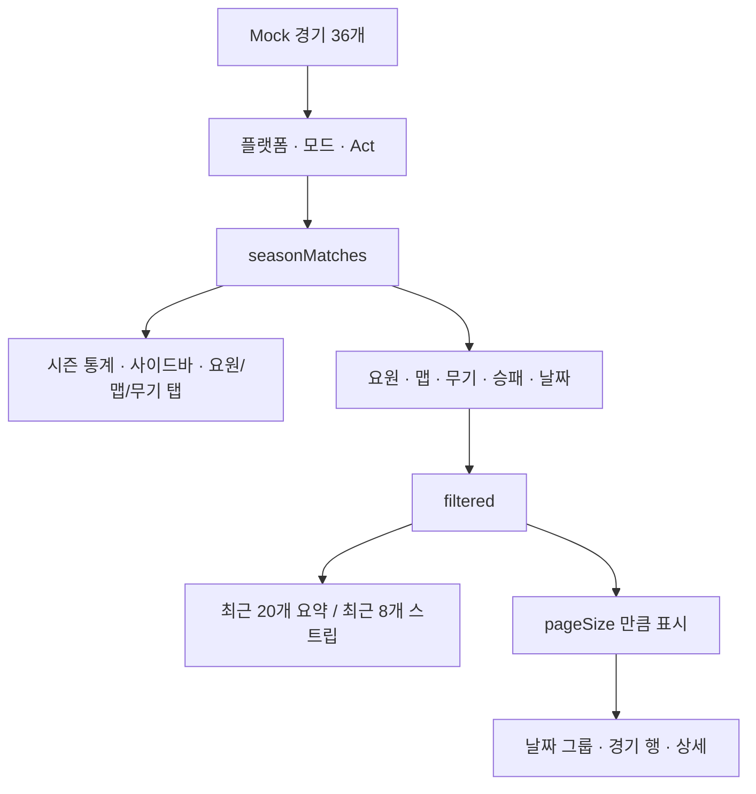

# 홈·프로필 화면 정의서

> 기준: `b016a29` · 2026-09-17 · [TASK-FE-011](../tasks/TASK-FE-011.md)
>
> 공통 설정 경로 및 브랜드·배경 연결 보완: [TASK-FE-012](../tasks/TASK-FE-012.md), 2026-09-18.
> 공통 외곽·헤더·푸터 및 Search 변경: [TASK-FE-013](../tasks/TASK-FE-013.md), PR #6으로 통합 브랜치 병합 완료(`06076ca`). [비교 캡처·검증 보고서](../visual-qa/TASK-FE-013.md).
> 시즌 요약·점수·요원 표 분리: [TASK-FE-014](../tasks/TASK-FE-014.md), PR #7으로 통합 브랜치 병합 완료(`e4f78bf`). [비교 캡처·검증 보고서](../visual-qa/TASK-FE-014.md).
> 프로필 배너·탭·프로모션·시즌 필터 분리: [TASK-FE-015](../tasks/TASK-FE-015.md), PR #8으로 통합 브랜치 병합 완료(`9e84346`). [비교 캡처·검증 보고서](../visual-qa/TASK-FE-015.md).
> 사이드바 분리: [TASK-FE-016](../tasks/TASK-FE-016.md), PR #9로 통합 브랜치 병합 완료(`eac0cbf`). [비교 캡처·검증 보고서](../visual-qa/TASK-FE-016.md).
> 경기 목록 M01~M05 전체 분리: [TASK-FE-017](../tasks/TASK-FE-017.md), PR #10 통합 브랜치 병합 완료(`17da56c`). [비교 캡처·검증 보고서](../visual-qa/TASK-FE-017.md).
> 현재 화면과 코드의 연결을 기록한다. **새 디자인 시안이 아니다.**
> 이미지 파일·종류·선택·경로·표시 방식은 유지하고, 추가·수정은 사용자와
> 동료의 토의 이후로 보류한다. 라인업은 이동 링크만 기록한다.

## 읽는 방법

1. 아래 배치도에서 수정하려는 영역의 ID를 찾는다.
2. 연결표에서 해당 영역의 현재 코드와 데이터를 확인한다.
3. 동작을 바꾸는 경우 상태·필터 범위도 확인한다.
4. 코드를 분리할 때는 [모듈 분리 계획](REFACTORING.md)을 따르고, 완료된 영역의
   실제 파일 위치를 이 문서에 갱신한다. 제안한 미래 파일은 아직 존재하지 않는다.

배치도는 영역과 읽는 순서를 나타내며 픽셀 단위 치수는 표현하지 않는다.
외형 참고는 기존 FE-010의 [홈 데스크톱](../visual-qa/assets/TASK-FE-010/after-home-desktop.jpg),
[홈 모바일](../visual-qa/assets/TASK-FE-010/after-home-mobile.jpg),
[프로필 통계](../visual-qa/assets/TASK-FE-010/after-profile-desktop.jpg),
[프로필 요원 표 모바일](../visual-qa/assets/TASK-FE-010/after-profile-mobile.jpg)을 사용한다.
이는 이전 검증 캡처이며 전체 페이지·모든 상태를 담은 새 캡처가 아니다.

## 현재 코드 위치

| 약칭 | 실제 파일 | 역할 |
|---|---|---|
| HOME | [HomeLanding.tsx](../../frontend/src/features/home/HomeLanding.tsx) | 홈 배치, 메뉴, 프로필 미리보기 |
| HOME CSS | [HomeLanding.module.css](../../frontend/src/features/home/HomeLanding.module.css) | 홈 고유 배치와 재사용 컴포넌트 스타일 |
| SEARCH | [HomeSearch.tsx](../../frontend/src/components/HomeSearch.tsx) | 홈의 Riot ID 입력과 데모 이동 |
| EXAMPLES | [AnalysisExampleCards.tsx](../../frontend/src/components/AnalysisExampleCards.tsx) | 홈 분석 예시 카드 |
| PROFILE | [TrackerProfile.tsx](../../frontend/src/features/tracker-profile/TrackerProfile.tsx) | 프로필 조합·탭별 본문·통계 계산·표시 helper. 상태와 동작은 아래 두 훅에서 받아 전달 |
| VIEW STATE | [useProfileViewState.ts](../../frontend/src/features/tracker-profile/hooks/useProfileViewState.ts) | P01/P03/P05/P06·M01~05의 탭·필터·선택 경기·표시량·초기화 및 통계 카드에서 경기 보기(FE-021) |
| BROWSER ACTIONS | [useProfileBrowserActions.ts](../../frontend/src/features/tracker-profile/hooks/useProfileBrowserActions.ts) | P01/P02/P10·M01의 저장·공유·검색 안내·Mock 갱신·알림 타이머·메뉴/배너 상태(FE-021) |
| PROFILE CSS | [TrackerProfile.module.css](../../frontend/src/features/tracker-profile/TrackerProfile.module.css) | 프로필 배치·남은 탭 본문 스타일과 카드·제목·색·표 스크롤·빈 상태·Select 공통 스타일 |
| PROFILE HEADER | [ProfileHeader.tsx](../../frontend/src/features/tracker-profile/header/ProfileHeader.tsx) / [CSS](../../frontend/src/features/tracker-profile/header/ProfileHeader.module.css) | P02 배너·신원·동작 버튼과 P03 프로필 탭. 공통 Search 헤더와 별개 |
| PROMOTION | [ProfilePromotion.tsx](../../frontend/src/features/tracker-profile/header/ProfilePromotion.tsx) / [CSS](../../frontend/src/features/tracker-profile/header/ProfilePromotion.module.css) | P04 브랜드 프로모션·이동 버튼 표시 |
| PROFILE FILTERS | [ProfileFilters.tsx](../../frontend/src/features/tracker-profile/header/ProfileFilters.tsx) / [CSS](../../frontend/src/features/tracker-profile/header/ProfileFilters.module.css) | P05 플랫폼·모드·Act 선택 표시. 경기 목록 필터와 별개 |
| SIDEBAR | [ProfileSidebar.tsx](../../frontend/src/features/tracker-profile/sidebar/ProfileSidebar.tsx) | S01~06 배치와 내부 S02 프로모션. FE-016 구현·검증 완료 |
| SIDEBAR CSS | [ProfileSidebar.module.css](../../frontend/src/features/tracker-profile/sidebar/ProfileSidebar.module.css) | 사이드바·각 카드 전용 스타일과 반응형. 공통 카드·제목·노란색은 PROFILE CSS 재사용 |
| RANK | [RankCard.tsx](../../frontend/src/features/tracker-profile/sidebar/RankCard.tsx) | S01 현재/최고 랭크 표시 |
| ACCURACY | [AccuracyCard.tsx](../../frontend/src/features/tracker-profile/sidebar/AccuracyCard.tsx) | S03 명중 부위·인체 SVG·그래프 표시 |
| ROLES | [RoleStatsCard.tsx](../../frontend/src/features/tracker-profile/sidebar/RoleStatsCard.tsx) | S04 역할별 요원 표본 표시 |
| TOP WEAPONS | [TopWeaponsCard.tsx](../../frontend/src/features/tracker-profile/sidebar/TopWeaponsCard.tsx) | S05 대표 무기 통계·선택 표시 |
| TOP MAPS | [TopMapsCard.tsx](../../frontend/src/features/tracker-profile/sidebar/TopMapsCard.tsx) | S06 맵 통계·선택 표시 |
| SEASON | [SeasonOverview.tsx](../../frontend/src/features/tracker-profile/summary/SeasonOverview.tsx) / [CSS](../../frontend/src/features/tracker-profile/summary/SeasonOverview.module.css) | P06 제목·랭크·시즌 수치·Show More 표시와 전용 반응형 |
| SCORE | [ProbeScoreCard.tsx](../../frontend/src/features/tracker-profile/summary/ProbeScoreCard.tsx) / [CSS](../../frontend/src/features/tracker-profile/summary/ProbeScoreCard.module.css) | P07 점수·등급·막대 표시와 전용 반응형 |
| AGENT TABLE | [AgentStatsTable.tsx](../../frontend/src/features/tracker-profile/summary/AgentStatsTable.tsx) / [CSS](../../frontend/src/features/tracker-profile/summary/AgentStatsTable.module.css) | P08 요원 표·빈 상태·선택 이벤트와 전용 반응형 |
| MATCH HISTORY | [MatchHistory.tsx](../../frontend/src/features/tracker-profile/match-history/MatchHistory.tsx) | M01~05 영역·안내·제목·자식 조합·빈 상태·더 보기. FE-017 구현·검증 완료 |
| MATCH FILTERS | [MatchFilters.tsx](../../frontend/src/features/tracker-profile/match-history/MatchFilters.tsx) | M01 경기 조건·More·Reset·날짜 안내 표시. P05 시즌 필터와 별개 |
| RECENT SUMMARY | [RecentSummary.tsx](../../frontend/src/features/tracker-profile/match-history/RecentSummary.tsx) | M02 최근20경기 요약·최근8경기 스트립 표시 |
| MATCH DAY | [MatchDayGroup.tsx](../../frontend/src/features/tracker-profile/match-history/MatchDayGroup.tsx) | M03 날짜별 요약·경기 행 조합 |
| MATCH ROW | [MatchRow.tsx](../../frontend/src/features/tracker-profile/match-history/MatchRow.tsx) | M03 경기 행·상세 열기 버튼 표시. 모달일 때 aria-haspopup=dialog |
| MATCH DETAIL | [MatchDetail.tsx](../../frontend/src/features/tracker-profile/match-history/MatchDetail.tsx) | M04 선택 경기·선수와 상세 공급자 연결. 설정에 따라 인라인/모달 표시 조합 선택 |
| DETAIL PANEL | [DetailedMatchPanel.tsx](../../frontend/src/features/tracker-profile/match-history/detail/DetailedMatchPanel.tsx) / [CSS](../../frontend/src/features/tracker-profile/match-history/detail/MatchDetailTheme.module.css) | 기존 네 탭 재사용·현재 테마·누락 안내. 탭 상태는 PROFILE에서 받음 |
| DETAIL PRESENTATION | [presentation.ts](../../frontend/src/features/tracker-profile/match-history/detail/presentation.ts) | M04 표시 방식 한 곳 설정. 기본 modal, inline으로 기존 목록 펼침 복원 |
| DETAIL DIALOG | [MatchDetailDialog.tsx](../../frontend/src/features/tracker-profile/match-history/detail/MatchDetailDialog.tsx) / [CSS](../../frontend/src/features/tracker-profile/match-history/detail/MatchDetailDialog.module.css) | 모달 외곽·배경 스크롤 잠금·닫기·목록 위치/포커스 복귀 |
| TRACKER DETAIL | [TrackerMatchPanel.tsx](../../frontend/src/features/tracker-profile/match-history/detail/TrackerMatchPanel.tsx) / [CSS](../../frontend/src/features/tracker-profile/match-history/detail/TrackerMatchPanel.module.css) | 모달 경기 정보·5탭·누락 안내, 탭 로컬 상태/키보드. 색·글자 기준은 이 패널 안에 제한 |
| TRACKER SCOREBOARD | [TrackerScoreboard.tsx](../../frontend/src/features/tracker-profile/match-history/detail/TrackerScoreboard.tsx) | 팀 승리 타임라인, 두 팀 정렬 표. Economy에서도 같은 표 사용 |
| TRACKER PERFORMANCE | [TrackerPerformance.tsx](../../frontend/src/features/tracker-profile/match-history/detail/TrackerPerformance.tsx) | 10명 선수 선택, 개인 지표·팀 라운드 결과·무기/교전 분포 표 |
| TRACKER ECONOMY | [TrackerEconomy.tsx](../../frontend/src/features/tracker-profile/match-history/detail/TrackerEconomy.tsx) | Bank/Loadout/Total 보기와 경제 미제공 영역, 아래 경기 표 |
| TRACKER ROUNDS | [TrackerRounds.tsx](../../frontend/src/features/tracker-profile/match-history/detail/TrackerRounds.tsx) | 라운드 선택·누적 점수·승리 팀과 미제공 개인/이벤트/위치 기록 |
| TRACKER DUELS | [TrackerDuels.tsx](../../frontend/src/features/tracker-profile/match-history/detail/TrackerDuels.tsx) | 5×5 교전 매트릭스, 제공된 조합만 표시. 전체 라이벌 순위는 만들지 않음 |
| DETAIL PERSONAL | [MatchPersonalSummary.tsx](../../frontend/src/features/tracker-profile/match-history/detail/MatchPersonalSummary.tsx) | 목록의 개인 기록·기존 성과 지표. 팀 상세 없는 Deathmatch에서도 유지 |
| DETAIL MOCK | [mockDetail.ts](../../frontend/src/features/tracker-profile/match-history/detail/mockDetail.ts) | 현재 목록 기준 결정적 상세 표본 공급. 원본 목록/구형 JSON을 수정하지 않음 |
| DETAIL DATA | [detailData.ts](../../frontend/src/features/tracker-profile/match-history/detail/detailData.ts) | 상세 입력/응답 계약 및 경기·선수·수치·합계 검증. 운영 API 계약은 아님 |
| MATCH TYPES | [types.ts](../../frontend/src/features/tracker-profile/match-history/types.ts) | 경기 목록 표시값·요소·콜백의 props 계약. Mock/API 계약과 별개 |
| MATCH CSS | [MatchHistory.module.css](../../frontend/src/features/tracker-profile/match-history/MatchHistory.module.css) | M01~05 전용 스타일·반응형. 공통 스타일은 PROFILE CSS 재사용 |
| FORMAT | [format.ts](../../frontend/src/features/tracker-profile/format.ts) | 기존 `number`·`signed` 표시 함수. 통계 집계나 새 반올림 정책 없음 |
| SHELL | [StatsShell.tsx](../../frontend/src/features/stats-shell/StatsShell.tsx) | 두 화면의 main에 공통 테마·초기화 범위를 적용하는 외곽 |
| HEADER | [StatsHeader.tsx](../../frontend/src/features/stats-shell/StatsHeader.tsx) | 내부 `BrandBar`·`SearchControl`, 내비게이션·More 표시. 상태·이벤트는 부모가 제공 |
| FOOTER | [StatsFooter.tsx](../../frontend/src/features/stats-shell/StatsFooter.tsx) | 공통 푸터 구조. `mode`에 따라 기존 문구·스타일 차이 유지 |
| SHELL CSS | [StatsShell.module.css](../../frontend/src/features/stats-shell/StatsShell.module.css) | 공통 초기화·헤더·푸터·반응형과 해당 화면이 있을 때의 공용 헤더/푸터 숨김 |
| MOCK | [mock.ts](../../frontend/src/features/tracker-profile/mock.ts) | 프로필 표본, 타입, 필터·집계 |
| BRAND | [branding.ts](../../frontend/src/features/stats-shell/branding.ts) | 홈·프로필 브랜드 네 값과 사용처 주석 |
| THEME | [theme.module.css](../../frontend/src/features/stats-shell/theme.module.css) | 공통 색상·글자 크기·폭·간격·기본 글꼴과 사용처 주석 |
| DEMO | [mock-data.ts](../../frontend/src/lib/mock-data.ts) | 기존 데모 플레이어 조회 |

홈 진입점은 [app/page.tsx](../../frontend/src/app/page.tsx), 프로필 진입점은
[players/[puuid]/page.tsx](../../frontend/src/app/players/[puuid]/page.tsx)다.
기존 데모 PUUID 또는 `ied-agent-allen`만 새 프로필에 연결하며, 다른 값은
“플레이어를 찾을 수 없음” 안내를 표시한다. 별도의 실시간 검색은 하지 않는다.

## 홈 배치도

```text
┌──────────────────────────────────────────────────────┐
│ H01  GP / GAMEPROBE · 게임 라벨 · Connect account     │
├──────────────────────────────────────────────────────┤
│ H02  Search · Home · Overview · Lineups · More         │
├─────────────────────────────┬────────────────────────┤
│ H03  제목·소개·Riot ID 검색  │ H04  Jett 프로필 예시   │
│      Mock 안내·바로가기     │      랭크·RR·이동      │
├─────────────────────────────┴────────────────────────┤
│ H05  서비스 소개 / 분석 예시                          │
├──────────────────────────────────────────────────────┤
│ H06  브랜드·Mock 안내·Privacy / Terms                 │
└──────────────────────────────────────────────────────┘
```

800px 이하에서는 H04의 랭크 카드와 장식 캡션을 숨기고 H03의 검색을 유지한다.
700px 이하에서는 탐색 카드가 1열, 분석 예시는 2열로 바뀐다.

| ID | 현재 코드·스타일 | 데이터·상태 | 동작과 유지할 점 |
|---|---|---|---|
| H01 | HEADER의 `BrandBar`, SHELL CSS | BRAND의 `branding`, `mode="home"` | 로고는 홈, 계정 링크는 `/connect`. 게임 라벨은 표시용. 계정 버튼 색/hover는 FE-025의 공통 action 토큰 사용 |
| H02 | HEADER의 `SearchControl`·내비게이션·More, SHELL CSS | HOME의 `menuOpen`, `menuButtonRef`와 메뉴 이벤트 | Search는 `#riot-id`로 이동. Overview는 데모 프로필, Lineups는 `/lineups`. More 메뉴의 Escape 닫기·포커스 복원 유지 |
| H03 | HOME의 소개·검색 영역 + SEARCH | `demoPlayers`, 입력·검색 상태 | 아래 홈 검색 흐름 참조. 실제 Riot 조회로 오인하지 않도록 기존 Mock 안내 유지 |
| H04 | HOME의 프로필 미리보기 | MOCK의 `profile`, 고정 Jett/랭크 이미지 | `/players/ied-agent-allen`로 이동. 표시 이미지와 수치 유지 |
| H05 | HOME의 `explore`/`analysisArea` + EXAMPLES | `branding.name`, `analysisExamples`의 87/74/68/91 | 소개의 EXPLORE 서비스명은 BRAND 사용. 프로필/라인업 링크와 정적 분석 예시 유지. 분석 카드에는 클릭 동작 없음 |
| H06 | FOOTER, SHELL CSS. HOME의 container 안에 배치 | `branding`, `mode="home"` | 기존 한국어 안내와 `/privacy`, `/terms` 링크, 홈의 여백·글자 스타일 유지 |

### 홈 검색 흐름

HOME은 진입점이 받은 `demoPlayers`를 SEARCH로 전달하지만, SEARCH는 현재
그 prop을 사용하지 않는다. `riotId`로 입력값을 보관하며 `handleSubmit()`은
입력값이나 빈값 여부와 관계없이 `/players/demo-puuid-seoul-duelist-001`로 이동한다.
Overview·히어로 랭크 카드·프로필 소개 카드는 `/players/ied-agent-allen`로 이동한다.
두 경로를 통합하거나 실제 검색으로 바꾸는 것은 별도 기능 변경이다.

바로 둘러보기에는 `profile.name/tag`와 `demoPlayers.slice(0,1)`의 사용자 링크가
표시된다. HOME CSS는 SEARCH·EXAMPLES의 전역 클래스에 홈 범위의 스타일을
씌우고 있다. 분석 예시 막대의 87/74/68/91 비율도 CSS에 수동으로 중복되어 있다.
컴포넌트를 옮길 때 이 연결과 현재 예시 의미를 함께 확인한다.

## 프로필 배치도 — Overview

```text
┌───────────────────────────────────────────────────────────────────┐
│ P01  브랜드 바 · 검색/내비게이션 · More · Mock 안내                 │
├───────────────────────────────────────────────────────────────────┤
│ P02  Jett 배너 · 이름#태그 · 저장 · Mock 갱신 · 공유                │
│ P03  Overview / Matches / Performance / Agents / Maps / Weapons   │
├───────────────────────────────────────────────────────────────────┤
│ P04  프로모션                                                     │
│ P05  PC / Console · 게임 모드 · Act                                │
├───────────────────┬───────────────────────────────────────────────┤
│ S01 현재/최고랭크 │ P06 시즌 통계 · 랭크 그래프 · Show More        │
│ S02 프로모션      │ P07 Probe Score · 지표별 등급                  │
│ S03 명중 부위     │ P08 Top Agents                                 │
│ S04 역할군       ├───────────────────────────────────────────────┤
│ S05 Top Weapons   │ M01 안내 배너 · 경기 조건 · Reset filters     │
│ S06 Top Maps      │ M02 최근 20경기 요약 · 최근 8경기 스트립      │
│                   │ M03 날짜별 요약 · 경기 행                     │
│                   │   M04 상세: 모달 기본 / 인라인 복원 가능       │
│                   │ M05 Load more / All Matches                   │
├───────────────────┴───────────────────────────────────────────────┤
│ P09  푸터                       P10 알림(필요할 때 화면에 표시)    │
└───────────────────────────────────────────────────────────────────┘
```

공통 영역(P01~05, S01~06, P09~10)은 탭을 바꿔도 유지된다.
중앙 본문은 다음과 같이 교체된다.

| 탭 | 표시 영역 | 주요 동작 |
|---|---|---|
| Overview | P06~08 + M01~05 | 시즌 전체와 최근 경기 확인 |
| Matches | M01~05 | 경기 필터, 상세 펼침, 더 보기 |
| Performance | P06~08 + ACS 추세 그래프 | `seasonMatches`의 ACS를 오래된 경기부터 표시 |
| Agents | P08의 전체 요원 표 | 요원 클릭 → 해당 요원 조건을 넣고 Matches 이동 |
| Maps | 맵별 카드 | 맵 클릭 → 해당 맵 조건을 넣고 Matches 이동 |
| Weapons | 무기별 표 | 무기 클릭 → 해당 무기 조건을 넣고 Matches 이동 |

현재 이 여섯 탭은 URL 경로가 아니라 `tab` 상태다. 새로고침하면 Overview로
돌아온다. `navigate()`는 펼친 경기를 닫으며 다른 필터나 표시 개수는 직접
초기화하지 않는다. 카드 클릭도 기존 다른 필터를 유지한 채 해당 조건만 바꾼다.

### 영역과 현재 코드 연결

아래 함수·변수는 별도 표기가 없으면 PROFILE 안에 있다.

| ID | 관련 코드·상태 | 데이터 / 영향 범위 |
|---|---|---|
| P01 | HEADER의 `BrandBar`·`SearchControl`·내비/More. BROWSER ACTIONS의 `search`, `menu`, `notice`와 VIEW STATE의 `navigate()` | 검색 입력·결과 판단과 메뉴 상태는 BROWSER ACTIONS 소유. 토스트 안내만 표시하며 이동/조회 없음. Mock 안내 JSX는 PROFILE, 닫기 동작은 훅이 제공 |
| P02 | PROFILE HEADER. PROFILE이 이름·태그·조회수와 BROWSER ACTIONS의 `saved/refreshed`·저장/갱신/공유 콜백, 아이콘·이미지를 전달 | 이름 결정은 PROFILE, `favorite/share/refresh`는 BROWSER ACTIONS. `renderHero`·`renderAvatar`는 기존 Jett 이미지/Asset을 같은 속성으로 표시 |
| P03 | PROFILE HEADER. PROFILE이 `tabs`의 라벨·활성 여부·선택 콜백을 전달 | `tab`·`navigate()`는 VIEW STATE 소유. 기존 배너 아래 nav 구조와 `/lineups` 링크 유지 |
| P04 | PROMOTION. BRAND와 부모의 `onExplore`·화살표 아이콘 사용 | PROFILE이 VIEW STATE의 `navigate("Performance")`를 전달. 통계 변화 없이 탭 이동 |
| P05 | PROFILE FILTERS. PROFILE이 플랫폼/모드 선택지·선택 상태·콜백, All Acts 상태/콜백, `actSelect`를 전달 | `platform`·`mode`·`act`는 VIEW STATE, 기존 `Select`는 PROFILE 유지. 시즌 전체 통계·사이드바·경기 목록 갱신과 펼침/표시 개수 초기화 의미 유지 |
| P06 | SEASON. PROFILE이 `primary`, `secondary`, 랭크·승패 수치, `showMore`·토글 콜백을 전달 | `stats = summarize(seasonMatches)`. 고정 랭크·레벨과 `rankValues` 계산은 PROFILE 유지. `rankIcon`·`rankGraph`로 기존 Asset·Sparkline 제공. Show More는 VIEW STATE의 `showMore/toggleMore`로 설명 문구만 펼침 |
| P07 | SCORE. PROFILE이 `score`와 `metrics`를 전달, 컴포넌트는 BRAND 사용 | `roundWin`·`scoreMetrics`의 점수·등급·막대 비율 산식은 PROFILE 유지. 제목·접근성 이름·툴팁도 기존 문구 유지. 실제 모집단 백분위가 아님 |
| P08 | AGENT TABLE. PROFILE의 `agentTable(all)`이 행·초상화·`onSelectAgent`를 전달 | `agents = agentStats(seasonMatches)`와 상위3/전체 선택은 PROFILE 유지. 요원 선택 시 VIEW STATE의 `viewAgentMatches()`로 조건 변경 후 Matches 이동, 기존 다른 조건 유지 |
| S01 | RANK. PROFILE이 고정 랭크 값과 기존 이미지 요소를 전달 | `profile.rank/rr/peakRank/peakRR/regionRank` 유지. 경기 필터와 독립 |
| S02 | SIDEBAR 내부 프로모션. PROFILE의 이동 콜백 사용 | P04 PROMOTION과 별개. `navigate("Performance")`로 통계 변화 없이 탭 이동 |
| S03 | ACCURACY. PROFILE이 명중 수치와 기존 `Sparkline` 요소를 전달 | Head는 `stats.hs`, Body/Legs 임시 산식은 PROFILE 유지. 인체 SVG만 기존 path·속성 그대로 ACCURACY로 이동 |
| S04 | ROLES. PROFILE이 `agents.find()`로 만든 역할별 표시값을 전달 | 현재 표본은 역할당 요원 1명. 전체 역할군 집계로 일반화된 구현은 아님 |
| S05 | TOP WEAPONS. PROFILE이 `weapons` 표시값·이미지 요소·선택/전체 보기 콜백을 전달 | 대표 무기로 경기를 묶는 `summarize()`는 PROFILE, `viewWeaponMatches()`는 VIEW STATE. 무기별 실제 명중 로그가 아님 |
| S06 | TOP MAPS. PROFILE이 `maps` 표시값·기존 맵 배경·선택/전체 보기 콜백을 전달 | `mapStats(seasonMatches)`는 PROFILE, `viewMapMatches()`는 VIEW STATE. 기존 이미지 선택과 필터 동작 유지 |
| M01 | MATCH HISTORY의 안내·제목과 MATCH FILTERS. PROFILE이 `banner`, `showFilters`, 조건별 기존 Select 요소·콜백·날짜 안내를 전달 | 배너·닫기는 BROWSER ACTIONS. `agent/map/weapon/result/date`, `resetFilters()`·More 상태는 VIEW STATE, 필터 집계는 PROFILE 유지. 경기 목록과 최근 요약만 필터링하며 More는 승패 선택기를 표시/숨김 |
| M02 | RECENT SUMMARY. PROFILE이 `recent`, 최근 요원 요약·이미지 요소, 스트립 표시값·선택 콜백을 전달 | `agentStats(filtered.slice(0,20))` 등 집계는 PROFILE 유지. 요약은 최대20경기, 스트립은 최대8경기. 클릭 시 VIEW STATE의 `selectMatch()`로 상세 열기→스코어보드 초기화. 모달은 현재 위치 유지, 인라인 행 스크롤은 PROFILE이 처리 |
| M03 | MATCH DAY·MATCH ROW. PROFILE이 날짜별 요약·경기 표시값·이미지/아이콘 요소·펼침 상태·콜백을 전달 | `visible`, `groups`, `summarize(rows)`는 PROFILE, `toggleMatch()`는 VIEW STATE. 표시 중인 행만 날짜로 묶어 집계하며 한 번에 경기 하나 펼침 |
| M04 | MATCH DETAIL이 선택 경기·프로필을 DETAIL MOCK에 연결, 기본 TRACKER DETAIL 또는 인라인 DETAIL PANEL에 전달 | `expanded`·인라인 `detailTab`은 VIEW STATE 소유. 모달 5탭 상태는 TRACKER DETAIL 소유. 재열기/다른 경기/스트립은 스코어보드 초기화. 없는 FK/FD·랭크·경제·라운드 개인 기록 등은 —/미제공. Deathmatch는 개인 요약/지표와 팀 상세 미지원 안내 |
| M05 | MATCH HISTORY의 All Matches·Load more. PROFILE이 표시 조건·콜백을 전달 | VIEW STATE의 `pageSize`·`loadMoreMatches()`·`viewAllMatches()` 사용. 처음20개, Load more는 +20. All Matches는 Matches 이동 후 필터 결과 전체 표시 |
| P09 | FOOTER, SHELL CSS. PROFILE의 container 안에 배치 | `mode="profile"`로 기존 영문 안내·푸터 링크·배치 유지 |
| P10 | BROWSER ACTIONS의 `toast`·타이머·`dismissToast`, PROFILE의 알림 JSX | 알림은 3.2초 후 닫힘, 직접 닫기 가능. 같은 문구는 타이머를 재시작하지 않음. 교체/닫기/unmount 시 타이머 정리 |

P06~08의 표시 컴포넌트에는 Mock 직접 조회나 새 상태가 없다. `rankIcon`, `rankGraph`,
행의 `portrait`는 PROFILE이 기존 helper로 만든 요소이므로 이미지 선택·출력과 그래프
산식도 그대로다. 숫자 표시는 FORMAT의 기존 함수를 공유한다.

P02~05도 표시만 분리했다. `renderHero`·`renderAvatar`는 자식의 배치 클래스를 받아
부모가 기존 이미지 요소를 반환한다. `actSelect`는 기존 Select 요소이며 경기 필터와
동일한 helper를 쓴다. 자식은 저장소·클립보드·Mock에 직접 접근하지 않는다.

사이드바(S01~06)는 FE-016에서 SIDEBAR와 다섯 카드로 표시를 분리하고 외형·동작 보존을 검증했다.
S02 프로모션은 짧은 표시 영역으로 SIDEBAR 내부에 둔다. 집계·이미지 helper·
Sparkline helper는 PROFILE에 남기고 값·ReactNode·콜백을 전달한다. 상태 전환은 FE-021의 VIEW STATE를 사용한다. 인체 SVG의
path·속성, 역할당 요원 1명 표본, Body/Legs 임시 산식과 대표 무기 집계 의미는 바꾸지 않는다.
전용 스타일·반응형은 SIDEBAR CSS로 이동하고 `card`·`sectionHeading`·`yellow`는
PROFILE CSS를 재사용한다.

경기 목록은 FE-017에서 M01~05 전체를 한 Task로 분리했고 외형·동작 유지 검증을 마쳤다.
MATCH HISTORY가 조건·최근 요약·날짜 그룹·경기 행·상세를 조합하고, MATCH TYPES는
표시용 props만 정의한다. FE-021에서 화면 상태·필터 초기화 effect는 VIEW STATE로 옮겼다.
필터/집계·날짜/숫자 의미·이미지 선택과 Select·Empty helper는 PROFILE에 남긴다. 기존 요소와 콜백을 전달하며 스트립의
스크롤도 부모 콜백이 처리한다. 필터 변경 시 펼침 닫기/20개 복원, 탭 변경 시 펼침만
닫기, 상세 탭 초기화와 기존 빈 상태의 Reset 범위를 유지한다. 공통 CSS는 FE-019/020에서,
화면 상태와 브라우저 동작 훅은 FE-021에서 분리했다. Mock/타입/집계 재구성은 후속 범위다.
FE-018은 M04의 기능 복원·디자인 변경을 별도 범위로 진행한다. 상세 공급은 현재 목록의
경기 ID·선수·날짜·점수·KDA/ACS/ADR/HS를 검증하고 34개 팀 경기의 참가자·라운드 순서·
무기/교전 분포를 시연용으로 보강한다. 두 Deathmatch에는 팀 상세를 만들지 않는다.
선택 선수 외 요원 정보는 미제공이며 기존 placeholder를 사용한다. 현재 원본 목록의 수치와
상단/사이드바 통계는 유지한다. 구형 MatchScoreboardTab/MatchRoundsTab/MatchPerformanceTab/
MatchAnalysisTab을 재사용하고 미제공 수치를 0으로 표시하지 않도록 필요한 부분만 보완한다.
상세 CSS는 패널 아래에만 적용한다. 라인업·전역 CSS·자산은 변경하지 않는다.
사용자 추가 승인으로 기본은 모달이며 `presentation.ts`를 `inline`으로 바꾸면 기존 펼침을 사용한다.
모달은 경기 정보·탭을 고정하고 내용만 내부 스크롤한다. 닫기/Escape/배경 클릭으로 닫으면 목록 위치와
원래 버튼 포커스를 복원한다. 최근 경기 스트립도 모달일 때 목록으로 자동 스크롤하지 않는다.
Tracker 캡처에 맞춘 추가 디자인 요청으로 모달은 Scoreboard/Performance/Economy/Rounds/Duels 5탭을 사용한다.
기존 인라인 4탭은 DetailedMatchPanel에 남으며 두 방식은 같은 상세 공급자/검사를 사용한다.
미제공 데이터를 채우는 작업은 하지 않았다. 현재 Economy의 금액/그래프와 Rounds의 개인 지표/이벤트/위치는 미제공이다.
구현·검증 결과는 [TASK-FE-018](../tasks/TASK-FE-018.md)과
[Visual QA](../visual-qa/TASK-FE-018.md)에 기록했다. 구현 완료 후 사용자 검토 대기 상태다.

MATCH CSS의 `content`·`selectWrap` 연결 클래스를 공통 클래스와 함께 적용해
Matches 첫 영역 여백과 조건별 Select 스타일의 기존 우선순위를 보존한다.

Act 전용 CSS는 `.actFilter > label`과 `.actFilter > label > select`로 기존 Select의
구조에 연결한다. 모바일 왼쪽 여백은 기존 실제 적용값인 공통 Select의 10px를 유지한다.

### 필터가 영향을 주는 범위



- 하위 경기 필터는 상단 시즌 통계·Top Agents·사이드바를 바꾸지 않는다.
- 플랫폼/모드/Act/하위 필터가 바뀌면 펼친 경기가 닫히고 `pageSize`가 20으로
  돌아간다. `resetFilters()`는 하위 조건만, `resetAll()`은 PC/Competitive/A5까지 복원한다.
- 날짜 범위는 오늘이 아니라 선택 시즌 표본의 최신 날짜를 기준으로 한다.
- 일부 조건은 결과가 없다. 시즌에 경기 자체가 없으면 `Empty`의 Reset은 전체를,
  하위 조건만 비어 있으면 하위 필터만 복원한다. Agents는 별도 빈 안내,
  Weapons는 고정 3개 무기의 0 통계 행을 유지한다.
- 기본 PC/Competitive/A5는 23경기(16승/7패)다. 첫 화면 목록은 20경기이며
  `LAST 20 MATCHES`는 더 보기 후에도 고정인 기존 P3 이슈가 있다. 이번에는 변경하지 않는다.

### 상태의 수명과 실패 처리

| 상태/상황 | 현재 처리 | 리팩터링 때 확인 |
|---|---|---|
| 저장 프로필 | BROWSER ACTIONS에서 `gameprobe:profile:${playerId}:saved`로 브라우저 저장 | 서비스명 변경과 저장 키를 분리. 키를 바꿔 기존 저장을 잃지 않기 |
| 브라우저 저장 실패 | 현재 방문 동안 상태 유지, 안내 토스트 | 예외로 화면이 중단되지 않기 |
| 공유 | 현재 URL을 클립보드에 복사 | 실패 시 주소창에서 복사하라는 안내 유지. 탭/필터 상태까지 공유하지는 않음 |
| 갱신 | Mock 갱신 안내와 `refreshed` 문구만 변경 | 표본은 동일. 네트워크 재조회 기능으로 표시하지 않기 |
| 탭·필터·선택 경기·표시량 | PROFILE이 한 번 호출하는 VIEW STATE 훅 | 필터가 실제 바뀔 때만 경기 닫기·20개 복원. 탭 재선택은 경기만 닫기. 페이지 재진입 시 기본값 |
| 메뉴·배너·안내 | PROFILE이 한 번 호출하는 BROWSER ACTIONS 훅 | 탭 변경 중 유지. URL/서버 저장으로 임의 확장하지 않기 |
| 로딩·API 오류 | 새 프로필은 로컬 Mock 직접 사용 | 아직 실제 조회 로딩/오류 화면은 없음. API Task에서 정의할 항목 |

## 크기·색상 수정 위치

홈·프로필은 BRAND와 THEME의 공통 설정을 사용한다. SHELL이 THEME의 `.theme`와
SHELL CSS의 `.page`를 두 화면의 main에 붙인다. `--bg`만 `:where(.theme), :global(body):has(.theme)`의
한 선언으로 main과 바깥 body 배경이 공유한다. 다른 25개 변수는 main 범위에
유지하며, `.theme`가 사라지면 body 배경 규칙도 해제된다. HOME의 PROFILE CSS import는
제거했고, 헤더·푸터·초기화는 SHELL CSS를 사용한다. 홈 본문과 프로필 본문은 각자의
CSS를 사용한다. P02~08과 S01~06의 전용 CSS는 표시 컴포넌트 옆으로 이동했고,
M01~05의 전용 CSS는 FE-017에서 MATCH CSS로 분리했다. 카드·제목·색·표 스크롤·
빈 상태·Select는 PROFILE CSS를 재사용한다. 프로필의 별도 `.page`에는
1500px 이상 사이드바 변수 덮어쓰기만 남았다.

| 바꾸려는 것 | 현재 기준 | 위치 |
|---|---|---|
| 서비스명·문자 로고·점수명 | `branding` | BRAND. 상단/하단·홈 소개·프로필 점수 접근성 이름/툴팁/상세/풋노트까지 연결. 저장 키는 별개로 유지 |
| 보조/본문/강조 글자 | caption 12 / meta 13 / body 14 / value 16 / section 18 / heading 20 / feature 24 / title 28px | THEME `:where(.theme)`의 `--font-*` |
| 홈 큰 제목 | 38px, 홈 반응형 36/30px | THEME `--font-home-title` 및 HOME CSS의 1100/700px 이하 규칙 |
| 글꼴·본문 줄 간격 | Arial, Helvetica, sans-serif / 1.35 | THEME `.theme` |
| 화면 밀도 | 최대 폭 1440px, 기본 카드 여백 14px, 섹션/간격 18px | THEME의 `--content-max`, `--space-*`, `--gap`. 사이드바 1500px 이상 값은 PROFILE CSS |
| 기본 색 | 배경 `#0e141a`, 본문 `#e9edef`, 보조 `#b4c2cf`, 강조 `#f05260` | THEME의 `--bg`, `--text`, `--muted`, `--accent`. 홈 설명 색은 HOME CSS |
| 주요 행동 버튼 | 기본 `#c93648`, hover `#b52d3e`, 글자 `#fff` | THEME의 `--action-bg`, `--action-hover`, `--action-text`. 계정·홈 데모·미저장·기록 없음 복귀에 적용. 저장 완료·비활성·필터·승패 색은 각 의미 유지 |
| 상단 Search | 기본 박스 180×44px·배경 `#2a3c4f`, 문구 16px/700, 문구·placeholder·돋보기 `--text` | HEADER의 `SearchControl`, SHELL CSS. hover 밝기 변화 없음, 키보드 focus는 `--gold` 외곽선. 기존 페이지별 모바일 폭·숨김 유지 |
| 공통 표면 색 | `--raised: #202b37`, `--panel: #111d26` | SHELL CSS의 More 메뉴·SEASON CSS의 승률 도넛 내부는 `--raised`, 시즌 Overview 하단은 `--panel` |
| 프로필 배너·탭·프로모션·시즌 선택 배치 | 기존 치수·이미지·조건 유지 | PROFILE HEADER·PROMOTION·PROFILE FILTERS 전용 CSS. Act Select 기본 스타일은 PROFILE CSS |
| 시즌 요약·점수·요원 표의 개별 배치 | 기존 치수·조건 유지 | SEASON·SCORE·AGENT TABLE의 전용 CSS. 공통 카드·제목·색·표 스크롤은 PROFILE CSS |
| 경기 조건·최근 요약·경기 행·상세 배치 | 기존 치수·조건·반응형 순서 유지 | MATCH CSS로 분리(FE-017). 공통 카드·색·Select·빈 상태 스타일은 PROFILE CSS |
| 반응형 배치 | 표는 가로 스크롤, 작은 화면의 경기 행은 여러 줄 | 각 CSS의 media query. 치수 일부는 아직 개별 규칙에 있음 |

글자 크기와 카드 폭/여백은 따로 조절한다. 전체 `zoom`/`scale`이나 사용자
브라우저 배율 변경으로 크기를 맞추지 않는다. SHELL CSS에는 공통 `.page`가 있을
때만 기존 공용 헤더/푸터를 숨기는 `:has(.page)` 규칙이 있다. 홈·프로필에서
라인업으로 이동했을 때 이 스타일이 남지 않는지 확인해야 한다.

1500px 이상 프로필 사이드바의 `--sidebar-width:288px`는 PROFILE CSS에만 적용한다.
홈은 더 이상 이를 상속하지 않고 THEME의 기본 272px를 받는다. 홈에 이 변수를
사용하는 요소는 없으므로 홈 레이아웃은 그대로다.

2026-09-18 보완으로 브랜드를 포함한 기존 표시 문구를 설정에 연결했다. 기본값에서
화면 문구는 유지되며, 종합 점수 카드의 접근성 이름만 `Probe score`에서 설정값인
`Probe Score`로 대소문자가 맞춰졌다. `gameprobe:profile:${playerId}:saved` 저장 키는
기존 저장을 보존하기 위해 변경하지 않았다. 검증 근거는
[FE-012 Visual QA](../visual-qa/TASK-FE-012.md)를 따른다.

FE-013에서 상단 Search의 문구·아이콘 색, 문구 크기, hover·focus만 명시적으로 변경했다.
홈은 본문 검색으로 이동하는 앵커, 프로필은 Mock 안내를 표시하는 입력 폼이라는 차이를 유지한다.
이미지 오버레이·본문 고정 스타일은 그대로다. FE-025에서 계정 버튼의 페이지별 색/hover 차이는
THEME의 공통 토큰으로 통일했다. More는 HOME의 Escape 닫기·포커스 복원과 PROFILE의 토글
차이가 남아 있다. 홈 메뉴·검색 상태는 HOME, 프로필 메뉴·검색·Mock 안내·토스트는
BROWSER ACTIONS 훅이 소유하고 PROFILE이 표시 컴포넌트로 전달한다.
이 차이를 바꾸는 기능 개선과 이미지 관련 변경은 후속 토의 전까지 보류한다.

## 실제 데이터 연결 전 남아 있는 정의

FE-022의 [화면 데이터 대응표](API-DATA-MAP.md)에 공식 API 필드와 계산 가능 여부를,
[Mock 설계](API-MOCK-DESIGN.md)에 표본·공급·검증 계획을 기록했다.
아래는 현재 화면의 표본 구현에 대한 설명이며 실제 API 연결 완료를 뜻하지 않는다.

| 지금 화면에 있는 것 | 현재 만드는 곳 | 아직 확정되지 않은 것 |
|---|---|---|
| K/D·승률·요원/맵 집계 | MOCK의 `summarize`, `agentStats`, `mapStats` | 공식 선수/팀/라운드 원본에서 공통 집계할 계획. 실제 응답 완전성·기간 범위는 검증 필요 |
| 총기 Kills·HS | 경기의 대표 `weapon`으로 전체 경기 통계 묶음 | 실제 무기별 킬·명중 분포와 다름. 현재 표에는 총기 승률 열이 없음 |
| KAST·플레이 시간·RR | MOCK의 `fixture()` | 표본 생성식이며 운영 API 근거가 아님 |
| 선취점·Flawless·Ace | MOCK의 `summarize()` 임시 산식 | 실제 이벤트 정의/데이터 |
| Body/Legs | PROFILE에서 Head를 빼거나 7% 고정 | 실제 부위별 적중 데이터 |
| Probe Score·등급 | 표본 점수와 PROFILE의 `scoreMetrics` | 운영 점수 산식과 등급 기준 |
| 다른 데모 플레이어 | 진입점의 이름/태그 + 같은 프로필 경기 표본 | 플레이어별 실제 데이터 조회 |

이번 문서 설계에서 위 수치·산식은 변경하지 않았다. Mock의 파일 분리와 실제 통계 정의는
서로 다른 작업이다. 새 데이터 흐름은 미제공을 임의 계산으로 채우지 않는 방향이며,
화면 연결과 수치 변경은 후속 Task에서 별도로 검토한다.


## FE-024: 새 합성 데모 데이터 연결

기존 화면 ID와 컴포넌트 배치는 유지한다. 위 표의 이전 MOCK 산식은
`/players/ied-agent-allen` 기본 화면에 남아 있고 명시적으로 선택하는 새 데이터 데모에는 적용하지 않는다.

| 수정 목적 | 현재 위치 |
|---|---|
| 홈 기본 데모 진입 | `HomeLanding` Overview·일반 프로필 카드, `HomeSearch` → `/players/ied-agent-allen` |
| 새 데이터 데모 선택/신원 | `HomeLanding`의 명시적 새 데이터 링크·카드 → `tracker-profile/data/provider.ts` |
| 조회/로딩/재시도/취소 | `tracker-profile/hooks/useProfileData.ts` |
| P06~P08, S03~S06, M02~M03 수치/필터 연결 | `tracker-profile/data/viewModel.ts` → 기존 컴포넌트 |
| M04 10인·라운드·경제·교전 연결 | `tracker-profile/data/matchDetail.ts` → 기존 5탭/보존된 4탭 |
| 경기 직접 링크 | `tracker-profile/SyntheticMatchPage.tsx` → 같은 TrackerMatchPanel |
| 미제공 값 표시 | `tracker-profile/format.ts`의 number/percent/signed(null) = `—` |

새 데모는 4경기·65/56/23·3승1패이며 원본에 없는 수치를 예전 데이터에서 가져오지 않는다.
원본/한계/변경 위치는 [데이터 README](../../frontend/src/features/tracker-profile/data/README.md),
검증은 [FE-024 보고서](../visual-qa/TASK-FE-024.md)를 따른다.

## FE-025: 보조 화면·버튼·안내·탭 사이드바

홈·프로필과 같은 헤더·푸터·테마를 사용하며, 본문 폭과 문서용 여백만 보조 화면에서 조절한다.
라인업과 정상 경기 상세의 외곽은 이번 변경 대상이 아니다.

| 수정 목적 | 현재 위치 |
|---|---|
| 연결·정책·기록 없음 외곽 | [SupportPage.tsx](../../frontend/src/features/stats-shell/SupportPage.tsx)의 `SupportPage` → 기존 StatsShell/Header/Footer |
| 보조 문서 폭·제목·본문·간격 | [SupportPage.module.css](../../frontend/src/features/stats-shell/SupportPage.module.css). 문서 최대920px, 안내720px, 제목28px, 본문14px |
| 기록 없음 문구·복귀 링크 표시 | `SupportPage.tsx`의 `MissingRecordPage`. 조회와 복귀 주소 선택은 호출자가 소유 |
| 플레이어/기존 경기 없음 | `app/players/[puuid]/page.tsx`, `app/matches/[matchId]/page.tsx` → 기존 디자인 데모로 복귀 |
| 합성 경기 없음 | `tracker-profile/SyntheticMatchPage.tsx` → 새 데이터 데모로 복귀 |
| 연결·정책 본문 | `app/connect/page.tsx`, `app/privacy/page.tsx`, `app/terms/page.tsx`. 연결 안내는 기존 RiotConnectNotice 유지 |

보조 화면 Search는 `/#riot-id`로 이동하고 Overview는 기존 디자인 데모를 연다.
More의 상태·Escape 초점 복귀는 SupportPage가 소유한다. 홈의 기본 검색 앵커와 프로필 입력 동작은 유지한다.
사용자 승인 확장에서 정책 의미와 비활성 연결 상태를 유지하면서 예전 서비스명·TASK/Phase 표현을 정리했다.
홈·프로필·보조 화면의 설명·오류·빈 상태·저장/공유 피드백은 기본 한국어이며, 추가 요청으로 헤더의 Language 목록에서 전환할 수 있다. 메뉴·통계·필터 이름은 기존 영문을 유지한다.

| 수정 목적 | 현재 위치 |
|---|---|
| 반복되는 데모·미연결·푸터·미제공·복귀·법률 검토 안내 | [copy.ts](../../frontend/src/features/stats-shell/copy.ts)의 한국어/영어 `statsCopies`. `useLocale().copy`로 선택. 사용처 주석 참고. 개별 설명은 해당 컴포넌트의 `t(한국어, 영어)`에 유지 |
| 주요 행동 버튼 색 | THEME의 action 토큰 → SHELL CSS, HOME CSS, PROFILE HEADER CSS, SupportPage CSS |
| Agents/Maps/Weapons의 짧은 사이드바 | PROFILE이 `compact`와 `onViewOverview`를 SIDEBAR에 전달. S01 랭크와 전체 통계 복귀 버튼만 표시 |
| 전체 사이드바 | Overview/Matches/Performance에서는 기존 S01~06 표시. 데이터 계산과 필터는 PROFILE/VIEW STATE에 유지 |

축약 사이드바의 Overview 복귀는 현재 선택 조건을 보존한다. 모바일은 기존처럼 본문 아래에 배치하고
표의 가로 스크롤은 유지한다. 기본 데모 진입은 기존 디자인 데모이며 새 데이터 데모는 명시적으로 선택할 때만 연다.
브랜드 슬로건과 경기 상세 5탭의 개별 문구는 이번 안내 정리 범위에 포함하지 않았다.
검증과 화면 비교는 [FE-025 보고서](../visual-qa/TASK-FE-025.md)를 따른다.

### 한국어·영어 전환

- [locale.tsx](../../frontend/src/features/stats-shell/locale.tsx)의 `useLocale()`이 표시 언어만 구독한다. StatsShell 내부 Provider에 의존하지 않아 그 바깥의 프로필 상태 훅·정책 페이지에서도 같은 선택을 사용한다.
- `locale.tsx`의 `supportedLanguages`가 메뉴 이름/코드와 저장값 검증의 공통 목록이다. 새 언어를 제공하려면 이 목록뿐 아니라 `statsCopies`와 각 화면의 번역도 확장해야 한다. 현재 `t(한국어, 영어)`는 두 언어용이며 자동 번역하지 않는다.
- 기본값과 서버 최초 출력은 `ko`다. 브라우저의 `gameprobe:locale` 값을 읽어 새로고침·페이지 이동에서도 선택을 유지하며 다른 탭의 변경도 반영한다. 저장이 차단되면 현재 방문 동안 메모리로 유지한다.
- 공통 셸 밖에 머무는 동안 놓친 저장소 변경은 첫 재구독 시 읽는다. 저장 실패로 메모리에만 남긴 선택은 오래된 저장값으로 덮지 않는다.
- HEADER의 `LanguageMenu`가 브랜드 바에 Language 박스를 표시한다. 마우스를 올리거나 클릭/터치하면 한국어·English 목록이 열리고 현재 언어에 체크가 표시된다. 화살표/Home/End로 이동하고 Enter로 선택, Escape로 닫아 버튼에 초점을 돌린다. 바깥 클릭과 Tab 이동도 닫는다. 모바일에도 노출한다. 모바일 계정 링크는 짧은 `Connect`로 표시하고 접근성 이름/목적지는 그대로다. StatsShell의 `main lang`도 바뀐다.
- 홈 소개·데모 링크·분석 예시, 프로필 안내/빈 상태/알림, 연결·정책·기록 없음 문구를 번역한다. 법적 문서는 기존 초안 의미를 번역만 한다. 조회 route는 서버에 남기고 기록 없음 UI로 `{ko, en}` 문자열만 전달한다.
- BROWSER ACTIONS는 알림 동작 코드를 보관하므로 열린 알림도 번역된다. 언어 변경이 알림 만료 시간을 연장하거나 탭·필터·저장·선택 경기 상태를 초기화하지 않는다.
- 라인업·관리자 화면과 RootLayout/전역 CSS·데이터·인증에는 적용하지 않는다. 기존 영문 게임명·통계명·메뉴·경기 상세5탭은 유지한다.


## FE-027: 라인업·스모크 탐색 테마

`/lineups`와 `/smokes`는 `features/strategy-explorer/StrategyExplorerShell.tsx`에서
기존 StatsShell·StatsHeader·StatsFooter를 함께 사용한다. 홈·프로필 본문은 변경하지 않는다.

| 수정하려는 부분 | 담당 위치 | 영향 범위 |
|---|---|---|
| 홈과 공유하는 색·폰트 기준 | `features/stats-shell/theme.module.css` (이번 작업에서는 수정하지 않음) | 공통 테마 사용 화면 |
| 탐색 화면 헤더 연결·제목·안내 배치 | `StrategyExplorerShell.tsx` | 라인업·스모크 두 페이지 |
| 맵 카드·필터·지도 주변·가이드의 색·크기·반응형 | `StrategyExplorerShell.module.css` | 위 셸 내부의 탐색 클래스만 |
| 페이지 제목·설명·공개 목록 상태 안내 | `app/lineups/page.tsx`, `app/smokes/page.tsx` | 해당 페이지 |
| 라인업 요원·스킬·공수·맵 선택과 좌표 | `components/LineupSearchFilter.tsx` (변경 없음) | 라인업 탐색 |
| 스모크 진영·사이트·유형·가이드 선택과 좌표 | `components/SmokeSearchFilter.tsx` (변경 없음) | 스모크 탐색 |

- 검색은 홈의 `/#riot-id`로 이동한다. Overview는 기존 디자인 데모를 유지한다.
- 헤더에는 Home / Overview / Lineups / Smokes와 현재 위치가 표시된다.
- Language는 기존 공통 헤더·푸터 범위에 적용한다. 탐색 본문은 `lang="ko"`로 유지하며 이번 작업에서 번역 범위를 늘리지 않는다.
- 지도 회전·좌표 값·필터 상태·API 응답 변환은 원래 코드를 사용한다. 경로는 지도 이미지 위, 핀 아래에 표시한다.
- 스모크 수치와 좌표는 기존 Preview 상태다. 관리자가 공개한 라인업/API 실패 시 데모 전환 의미도 유지한다.
- 라인업 독립 상세와 관리자 화면은 이번 테마 작업 범위에서 제외된다.

구현 범위는 [Task](../tasks/TASK-FE-027.md), 실제 전후 화면과 검증은
[Visual QA](../visual-qa/TASK-FE-027.md)를 따른다.

## FE-028: Search 옆 공통 메뉴

- `features/stats-shell/navigation.ts`: 공통 이동 주소/문구와 Lineups→Smokes 순서를 관리한다. `createMainNavigation`은 홈·라인업·스모크에서, `createProfileNavigation`은 프로필에서 사용한다.
- 홈/탐색: Home → Overview → Lineups → Smokes. 일반 Overview 링크는 기존 디자인 데모다.
- 프로필: Home → Overview → Matches → Performance → Agents → Maps → Weapons → Lineups → Smokes. 전적 6탭은 기존 VIEW STATE의 navigate 콜백을 호출하여 현재 플레이어를 유지한다.
- `StatsHeader.tsx`와 `StatsShell.module.css`: 현재 메뉴의 밑줄/aria-current, 메뉴 내부 가로 스크롤, More의 Escape/초점 복원을 맡는다. 프로필 본문 탭과 상단 브랜드 바 구성은 별개이며 이번 작업에서 변경하지 않았다.
- 좁은 화면에서도 항목을 숨기지 않는다. 가로 이동 또는 Tab으로 마지막 두 링크에 접근하며 More는 기존 정책/계정 링크를 유지한다.
- 후속 메뉴 수정은 위 공통 설정과 각 화면의 호출부를 먼저 확인한다. 상세 구현/검증은 [Task](../tasks/TASK-FE-028.md)와 [Visual QA](../visual-qa/TASK-FE-028.md)를 따른다.
