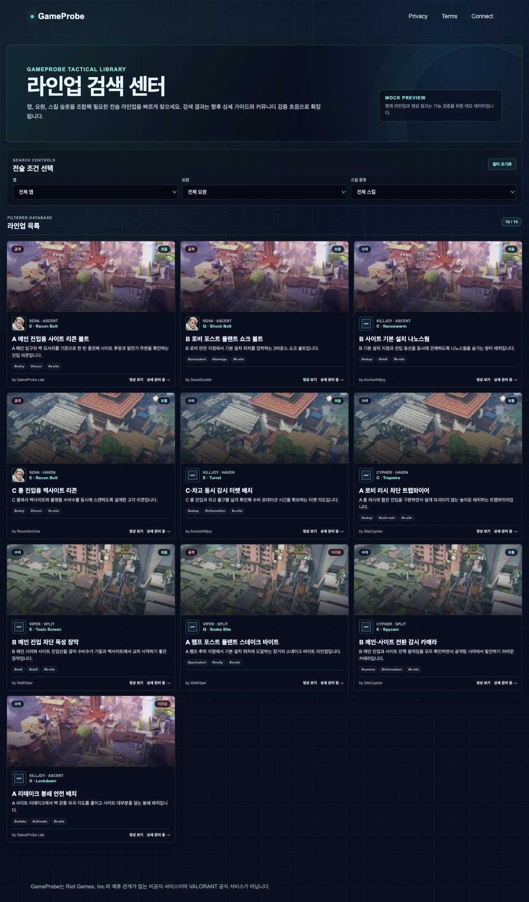
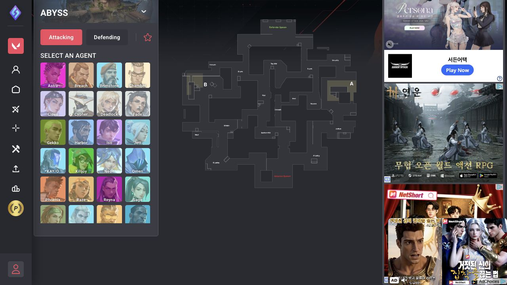
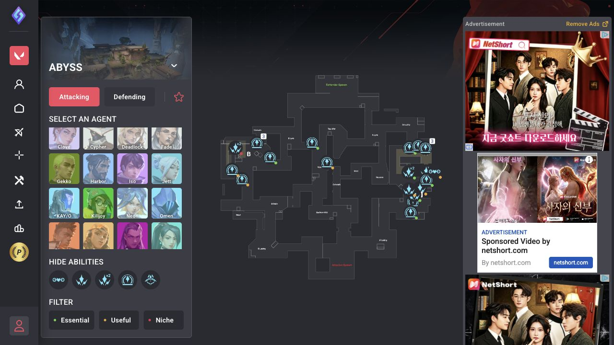

# GameProbe Lineups vs Strats.gg 사용성 비교

- 작성일: 2026-06-25 KST
- 비교 대상:
  - GameProbe `/lineups` (로컬 개발 버전)
  - [Strats.gg Valorant Lineups](https://strats.gg/valorant/lineups)
- 평가 범위: 라인업을 찾는 과정의 이해도, 필터 효율, 위치 탐색, 결과 스캔성,
  상세 정보 진입, 화면 집중도
- 주의: GameProbe는 10건의 Mock Preview 데이터로 동작하는 초기 구현이며,
  Strats.gg는 운영 중인 대규모 서비스다. 데이터 규모 자체보다 정보 구조와 탐색
  경험을 중심으로 비교한다.

## 화면 캡처

### GameProbe 현재 라인업 페이지

### Strats.gg 초기 탐색 화면

### Strats.gg 요원 선택 후 위치 기반 결과 화면

## 요약 결론

GameProbe는 **조건을 이미 알고 있는 사용자가 빠르게 목록을 좁히는 과정**에서는
Strats.gg보다 단순하고 편하다. 맵, 요원, 스킬 슬롯을 상단 드롭다운에서 선택하면
결과 수와 카드 목록이 즉시 갱신되고 광고나 계정 기능이 탐색을 방해하지 않는다.

반면 실제 경기 상황에서 자주 발생하는 질문인 **“어디에서 어디로 사용해야 하는가”**,
**“이 설치 위치를 커버하는 라인업은 무엇인가”**를 해결하는 능력은 Strats.gg가
크게 앞선다. Strats.gg는 맵 위에 시작점과 목표점을 표시하고 라인업의 공간적
관계를 직접 탐색하게 한다. 현재 GameProbe 카드는 맵 전체 이미지와 텍스트 설명만
제공하므로 정확한 위치 관계를 목록 단계에서 판단하기 어렵다.

따라서 현재 상태는 다음과 같이 정의할 수 있다.

> GameProbe는 검색 UI는 더 간단하지만, 전술 위치를 찾는 도구로서는 아직
> Strats.gg보다 불편하다.

## 비교 점수

| 평가 항목 | GameProbe | Strats.gg | 판단 |
|---|---:|---:|---|
| 첫 화면 이해 | 8/10 | 5/10 | GameProbe 우세 |
| 조건 기반 검색 속도 | 8/10 | 6/10 | GameProbe 우세 |
| 위치 기반 탐색 | 3/10 | 9/10 | Strats.gg 크게 우세 |
| 결과 카드 스캔성 | 8/10 | 6/10 | GameProbe 우세 |
| 실제 전술 정보 완결성 | 4/10 | 9/10 | Strats.gg 크게 우세 |
| 광고·방해 요소 | 9/10 | 3/10 | GameProbe 크게 우세 |
| 데이터 범위·신뢰 신호 | 3/10 | 9/10 | Strats.gg 크게 우세 |
| 초보자 친화성 | 7/10 | 6/10 | 목적에 따라 다름 |

## 사용 흐름 비교

### GameProbe

1. `/lineups`에 진입한다.
2. 맵, 요원, 스킬 슬롯을 드롭다운으로 선택한다.
3. 카드 목록이 즉시 필터링된다.
4. 카드에서 공격/수비, 난이도, 요원, 스킬, 설명, 태그를 읽는다.
5. 영상 링크 또는 상세 페이지 링크를 선택한다.

장점은 흐름이 선형적이고 예측 가능하다는 점이다. 실제 브라우저 검증에서
`전체 10건 → Split 3건 → Viper 2건 → Q 슬롯 1건`으로 즉시 축소됐고,
일치하지 않는 조합에서는 빈 결과 안내와 초기화 버튼이 정상적으로 제공됐다.

단점은 검색 조건에 **위치**가 없다는 점이다. 사용자는 카드 제목과 설명을 읽으며
원하는 사이트·시작점·착탄점을 추론해야 한다.

### Strats.gg

1. 맵을 선택한다.
2. 공격/수비를 선택한다.
3. 요원을 이미지 목록에서 선택한다.
4. 스킬과 중요도(Essential/Useful/Niche)를 선택한다.
5. 중앙 맵의 위치 마커를 탐색한다.
6. 마커를 선택해 시작점·목표점 경로와 영상을 확인한다.

장점은 전술의 핵심인 공간 관계를 맵 위에서 직접 보여준다는 점이다. “B Lobby에서
B Site로” 같은 정보를 텍스트를 읽기 전에 위치로 판단할 수 있다.

단점은 초기 화면에 요원 전체 목록, 사이드바 메뉴, 계정 기능, 광고가 동시에
표시돼 인지 부하가 높다는 점이다. 특히 광고 영역이 화면 오른쪽을 크게 점유해
맵 탐색 공간과 집중도를 떨어뜨린다.

## GameProbe가 상대적으로 편한 부분

### 1. 처음 봐도 검색 방법을 이해하기 쉽다

필터가 `맵 / 요원 / 스킬 종류` 세 가지로 명시되어 있고 모두 일반적인 select
형식이다. 별도의 학습 없이 사용할 수 있다.

Strats.gg는 요원 이미지가 많고, 맵 마커·스킬 아이콘·중요도 색상의 의미를 처음
사용하는 사람이 스스로 파악해야 한다.

### 2. 특정 조건을 알고 있을 때 빠르다

“Split에서 Viper의 Q 스킬”처럼 이미 조건이 명확한 검색은 GameProbe가 효율적이다.
모든 필터가 한 행에 있고 결과 수가 즉시 표시된다.

### 3. 목록의 정보 밀도가 균형적이다

GameProbe 카드는 다음 정보를 한 번에 보여준다.

- 맵과 요원
- 스킬 슬롯과 이름
- 공격/수비
- 난이도
- 제목과 짧은 설명
- 태그
- 작성자
- 영상·상세 링크

Strats.gg는 목록보다 맵 탐색에 초점을 맞추기 때문에 여러 라인업의 제목과 설명을
동시에 비교하기는 어렵다.

### 4. 광고와 계정 기능이 탐색을 방해하지 않는다

GameProbe 화면은 라인업 검색에 필요한 영역만 제공한다. Strats.gg는 오른쪽 광고,
좌측 글로벌 메뉴, 상단 플레이어 검색·계정 기능이 라인업 탐색과 경쟁한다.

## GameProbe가 상대적으로 불편한 부분

### 1. 시작 위치와 목표 위치가 보이지 않는다

가장 큰 문제다. 현재 카드의 맵 이미지는 분위기와 맵 구분에는 도움이 되지만,
라인업의 출발점과 착탄점을 알려주지 않는다.

Strats.gg는 중앙 맵에서 다음 정보를 즉시 제공한다.

- 라인업 시작 위치
- 목표 위치
- 같은 위치에 존재하는 라인업 수
- 위치 간 연결과 방향

GameProbe 사용자는 카드 제목과 설명을 읽고 영상을 열기 전까지 공간 관계를
확인할 수 없다.

### 2. 사이트·위치 조건으로 검색할 수 없다

현재 필터에는 아래 조건이 없다.

- A/B/C 사이트
- 시작 위치
- 목표 위치
- 포스트 플랜트/진입/리테이크 목적
- 공격/수비
- 난이도

태그 데이터에는 일부 목적이 포함돼 있지만 필터나 검색 입력으로 노출되지 않는다.

### 3. 스킬 슬롯은 실제 스킬 탐색에 충분하지 않다

`C/Q/E/X`는 키 배치를 알고 있는 사용자에게는 짧고 편하지만, 같은 슬롯에서도
원하는 스킬명을 직접 고르지 못한다. “Recon Bolt”, “Shock Bolt”처럼 스킬 이름
기준 선택이 더 명확하다.

### 4. 상세 정보가 아직 완결되지 않았다

현재 상세 링크는 구조만 준비된 상태다. 카드에서 영상 링크를 열 수 있지만 다음
정보는 GameProbe 내부에서 확인할 수 없다.

- 조준점 이미지
- 정확한 서 있는 위치
- 발사 강도·바운스 횟수
- 착탄 위치
- 단계별 이미지
- 실제 성공 영상
- 검증 수·조회 수·추천 수

Strats.gg는 마커를 선택하면 맵 경로와 YouTube 플레이어를 같은 흐름에서 제공한다.

### 5. 데이터 신뢰도를 판단할 근거가 없다

현재는 Mock Preview임을 명확히 고지하는 점은 좋지만, 실제 운영 단계에서는 다음
신뢰 신호가 필요하다.

- 작성·수정 날짜
- 패치 버전
- 사용자 검증 수
- 추천/즐겨찾기 수
- 현재 패치에서 유효한지 여부
- 작성자 신뢰도

## 정보 탐색 시나리오 평가

| 사용자 질문 | 더 편한 서비스 | 이유 |
|---|---|---|
| Split에서 Viper Q 라인업을 모두 보고 싶다 | GameProbe | 3개 드롭다운으로 즉시 축소 |
| B 사이트에 도착하는 라인업을 찾고 싶다 | Strats.gg | 맵의 B 영역 마커를 직접 탐색 |
| 내 현재 위치에서 사용할 수 있는 라인업을 찾고 싶다 | Strats.gg | 시작점이 맵 위에 표시됨 |
| 여러 라인업의 난이도와 설명을 비교하고 싶다 | GameProbe | 카드 목록 비교가 쉬움 |
| 실제 사용법과 영상을 바로 확인하고 싶다 | Strats.gg | 맵 경로와 영상이 상세 흐름에 통합됨 |
| 광고 없이 빠르게 훑어보고 싶다 | GameProbe | 검색 콘텐츠에 집중된 화면 |

## 개선 우선순위

### P0 — 검색 가능한 위치 데이터 도입

라인업 데이터 모델에 다음 필드를 추가하는 것이 우선이다.

- `site`: A/B/C/Mid
- `startLocation`
- `targetLocation`
- `purpose`: entry/post-plant/retake/setup/stall
- 정규화된 `startPoint`·`targetPoint`

이 데이터가 없으면 맵 기반 UI를 만들어도 실제 검색 기능으로 이어지지 않는다.

### P0 — 카드에 시작점 → 목표점 표시

카드 제목 위 또는 썸네일 하단에 다음과 같은 한 줄을 제공한다.

> B Lobby → B Default

사용자가 영상을 열기 전에 공간 관계를 판단할 수 있어야 한다.

### P1 — 필터 확장

맵·요원·스킬에 아래 조건을 추가한다.

1. 공격/수비
2. 사이트
3. 목적
4. 난이도
5. 정확한 스킬 이름

필터 수가 늘어날 경우 데스크톱은 상단 2행, 모바일은 접히는 필터 패널을 권장한다.

### P1 — 맵 위치 미리보기

Strats.gg 전체 구조를 복제할 필요는 없지만 카드 또는 상세 페이지에 작은 전술
맵을 제공해야 한다.

- 시작점 도트
- 목표점 도트
- 방향선
- 사이트 레이블

GameProbe 기존 2D 플로터 패턴을 재사용하면 외부 미니맵 자산 없이도 초기 검증이
가능하다.

### P1 — 실제 상세 페이지 구현

상세 페이지의 최소 구성은 다음과 같다.

1. 맵 경로 미리보기
2. 시작 위치 이미지
3. 조준점 이미지
4. 단계별 설명
5. 영상
6. 패치·검증 정보

### P2 — 검색·정렬·신뢰 기능

- 제목·위치·태그 텍스트 검색
- 인기순/최신순/쉬운 순 정렬
- 즐겨찾기
- 검증 완료 필터
- 패치 만료 경고

## 권장 제품 방향

GameProbe가 Strats.gg와 동일한 맵 중심 UI를 그대로 복제할 필요는 없다. 현재의
장점인 **깔끔한 조건 필터 + 비교 가능한 카드 목록**을 유지하면서, Strats.gg의
강점인 **시작점·목표점의 공간 정보**를 결합하는 방향이 적합하다.

권장 구조는 다음과 같다.

1. 상단: 맵·요원·스킬·사이트·공수 필터
2. 본문 좌측 또는 상단: 선택 맵의 시작점/목표점 미니맵
3. 본문 우측 또는 하단: 현재 카드 그리드
4. 카드: `시작 위치 → 목표 위치`와 위치 도트 미리보기
5. 상세: 단계별 조준 이미지와 영상

이 구조라면 GameProbe는 Strats.gg보다 광고와 인지 부하가 적으면서도, 현재
부족한 위치 기반 탐색 능력을 확보할 수 있다.

## 최종 판단

현재 GameProbe는 **검색 인터페이스의 명료성, 결과 카드 비교, 집중도**에서는
Strats.gg보다 사용하기 편하다. 그러나 사용자가 실제로 원하는 라인업을 찾는
핵심 기준이 위치와 목적이라는 점에서, 현재 정보 탐색 완성도는 Strats.gg보다
낮다.

단기적으로는 “카드 검색 서비스”로 충분히 사용할 수 있지만, 라인업 전용
제품으로 경쟁하려면 시작점·목표점·사이트·목적을 데이터와 UI의 핵심 축으로
승격해야 한다.
