# TASK-FE-002 Visual QA

검증일: 2026-09-16. 브라우저: Codex in-app browser, Playwright locator 기반 검증과
브라우저 screenshot 캡처. After 데스크톱 1440×1000, 모바일 390×844,
추가 태블릿 768×1024. Before 데스크톱은 1280×720, 레퍼런스 캡처는
브라우저에서 실제 반환한 1424×989이므로 배치 비율 중심으로 대조했다.
스크린샷 반환 형식은 JPEG이며 확장자를 일치시켰다.

## 기준과 범위

[Tracker 원본](https://tracker.gg/valorant/profile/riot/IED%20agent%23Allen/overview?platform=pc&playlist=competitive&season=8102cd81-43a0-d0d7-bd59-47b8fe9bed1b)의
실제 표시 화면을 직접 열어 비교했다. 제공 URL에서 현재 표시된 시즌은 V26: A5다.
원본 광고는 로딩에 따라 내용이 바뀌며 오른쪽 하단 영상 광고가 일부 내용을 가린다.

비교용 구현: `/players/ied-agent-allen`.
Before는 기존 `/players/demo-puuid-seoul-duelist-001`이며, After도 이 기존 경로에서
동일한 새 UI를 사용하되 기존 플레이어 이름을 유지한다.

## 화면 비교

| 영역 | Before | After 및 평가 |
|---|---|---|
| 상단 | 공용 헤더, 요약 수치 중심의 프로필 | 네트워크 바·내비게이션·배너·프로필 탭·배너 영역·필터 순서 재현 |
| 본문 | 좌측에 시즌 요약까지 배치 | 296px 좌측 통계 + 넓은 우측 시즌/점수/요원/전적, 간격 24px |
| 통계 | 개별 요약 카드, 비활성 필터 | 4개 주요 지표 + 12개 보조 지표, 집계와 작동하는 필터 |
| 경기 | 3개 경기와 큰 요약 | 기본 23개 시즌 경기, 최근 20개/더 보기, 날짜별 밀집 행과 펼침 |
| 모바일 | 기존 요약 중심 화면 | 1열 주요 콘텐츠 우선, 탭·표 내부 가로 스크롤, 경기 상세 접근 가능 |

### 데스크톱 상단

레퍼런스:
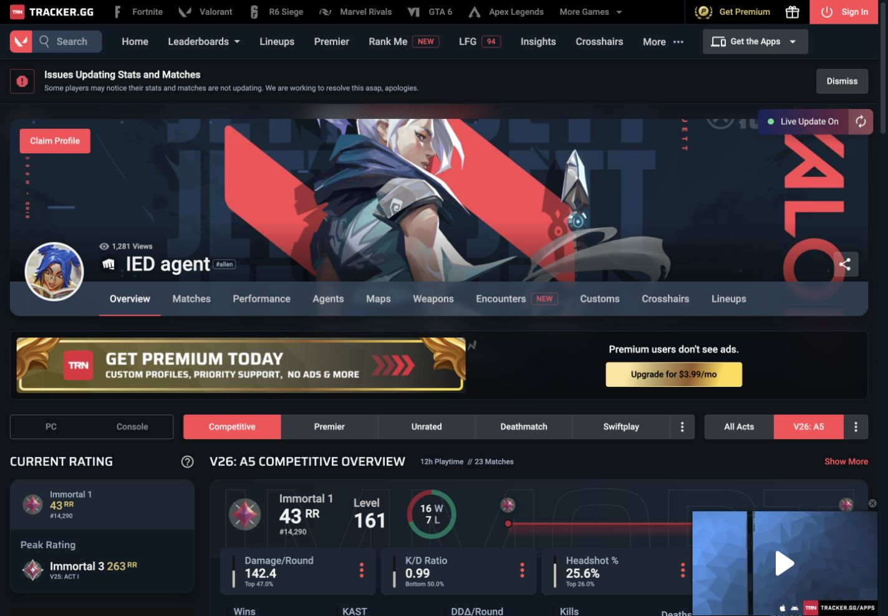

Before:
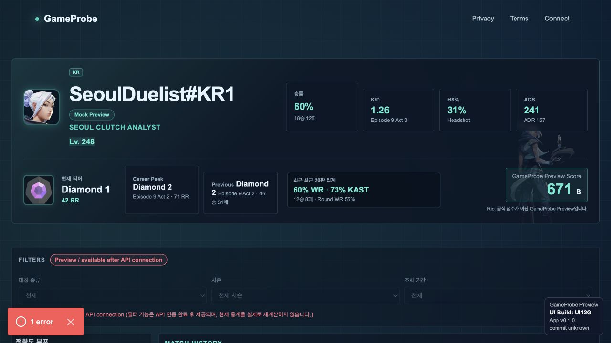

After:
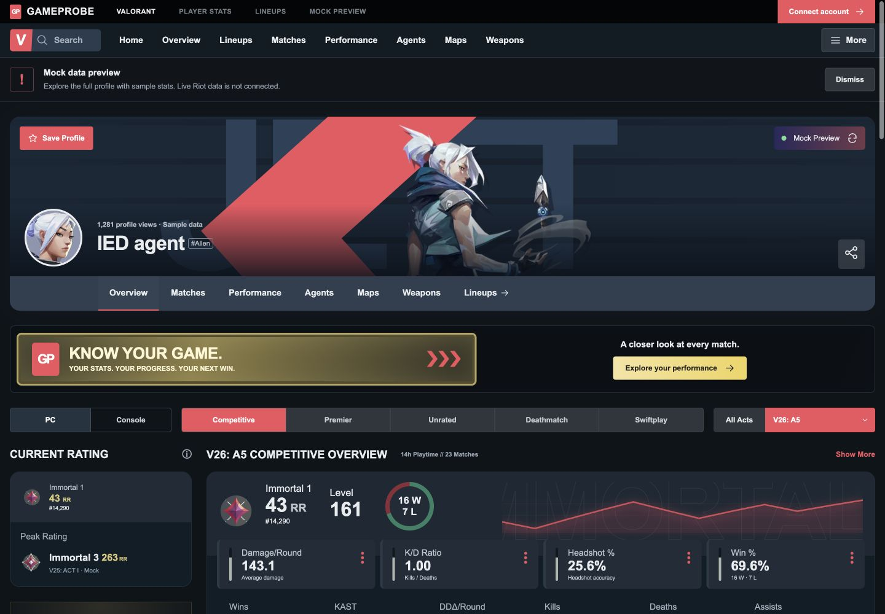

### 통계 및 경기

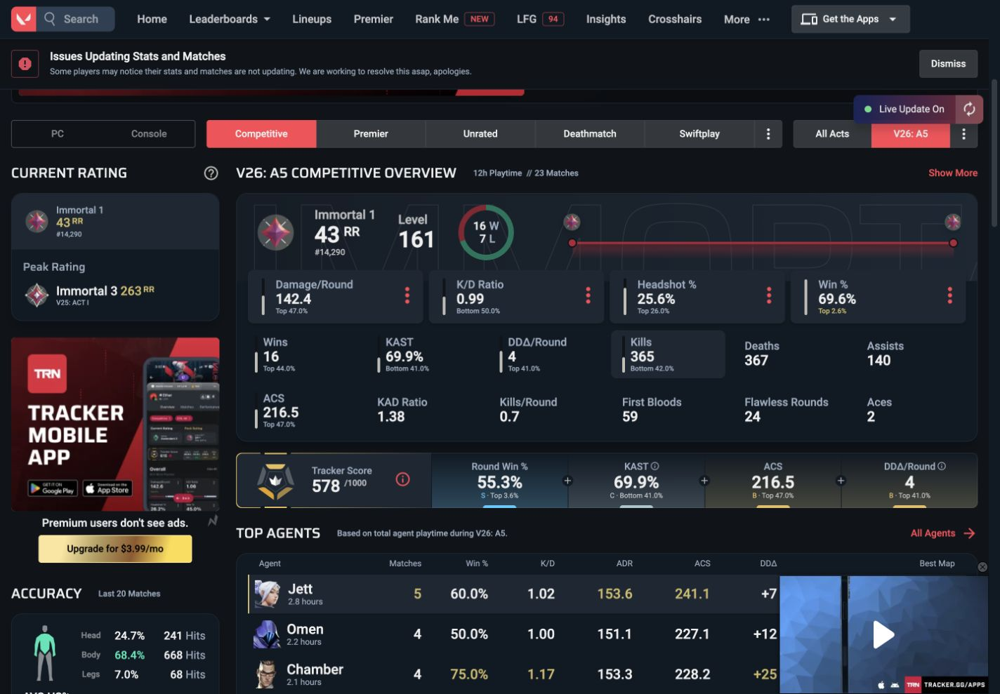
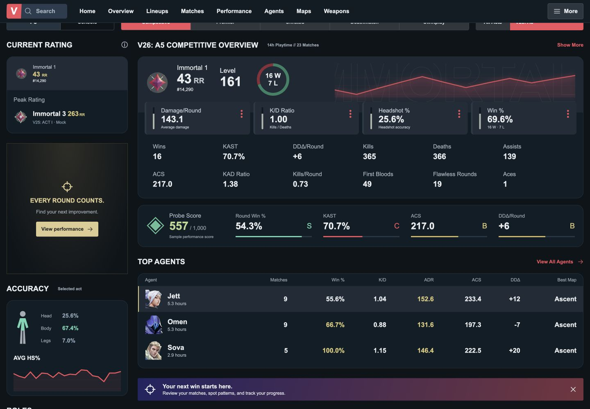
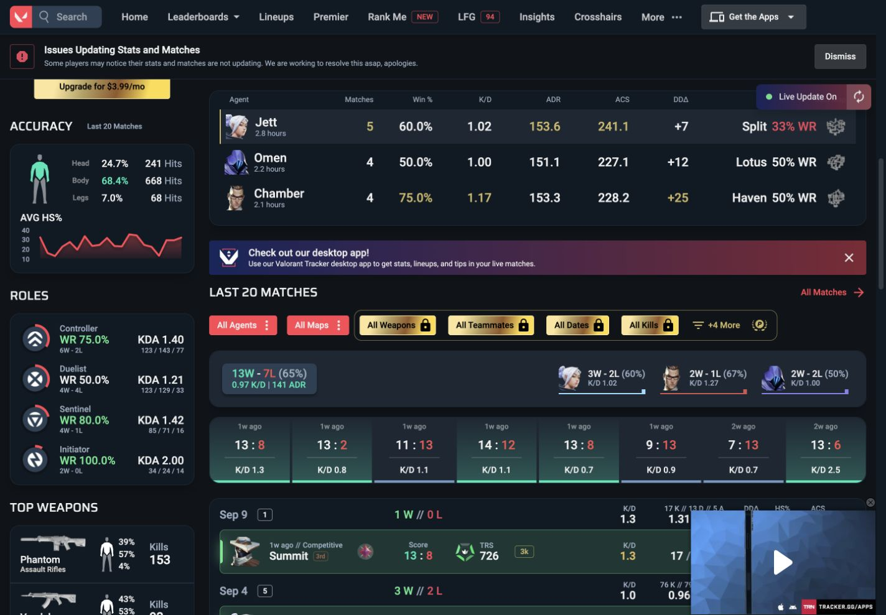
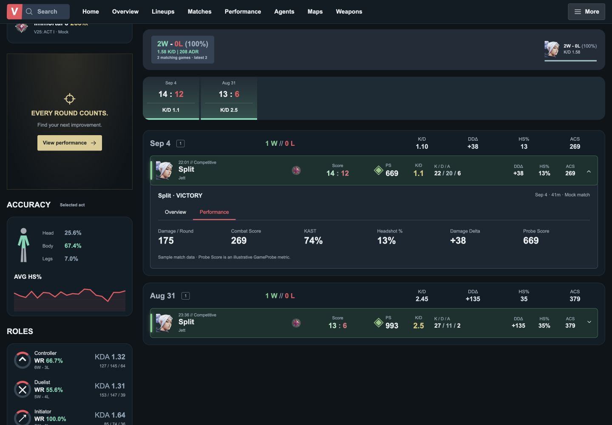

### 모바일

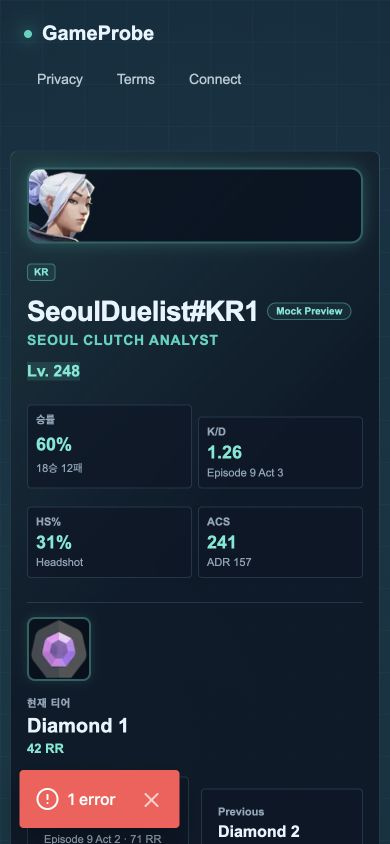
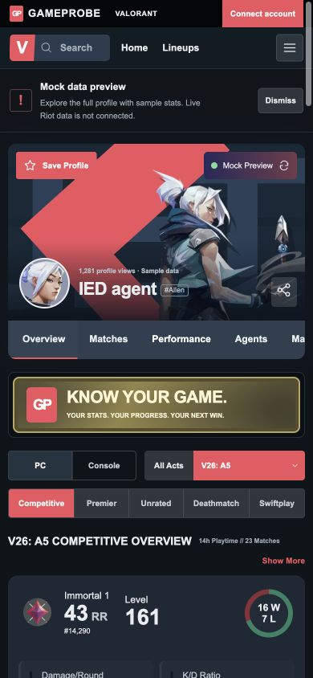
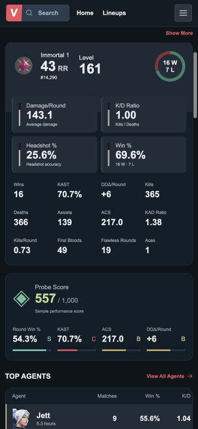
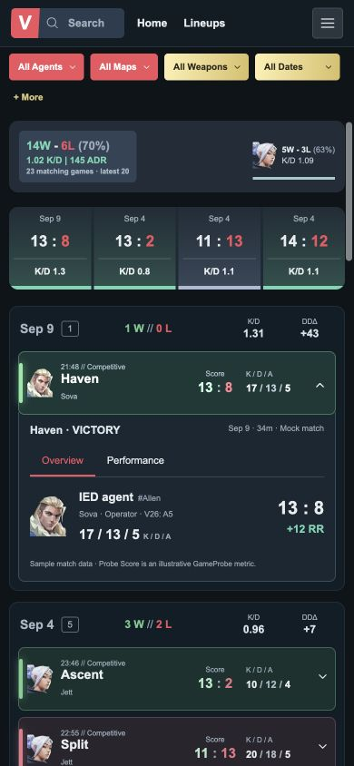

## 실제 브라우저 검증

- 기본 PC/Competitive/A5: 23경기, 16승 7패; 최초 20개 → 더 보기 23개.
- Jett + Split + Vandal + Wins + Last 30 days: 2개, 2승 0패로 재집계.
- 위 조건에서 Sova 선택: 0개와 빈 상태. 초기화 → 20개 표시.
- A4 선택: 3개. Console/Competitive: 2개. Console/Premier: 빈 상태.
- Deathmatch: 승률 50%, 라운드 지표 대신 경기 지표 표시. 100% 초과 오류 수정 확인.
- Overview/Matches/Performance/Agents/Maps/Weapons 탐색, 요원/무기/맵에서 경기 필터 연결.
- 경기 펼침 및 상세 Overview/Performance 전환, 모바일 펼침 확인.
- 공유: `Profile link copied.` 확인. 프로필 저장 후 새로고침에도 저장 상태 유지,
  검증 후 저장 해제.
- 1440px 및 390px: 문서 scrollWidth와 viewport width 동일. 768px 경기 행도
  scrollWidth와 clientWidth 동일, 상세와 우측 펼침 버튼 정상.
- 실제 프로필 링크로 `/lineups` 클라이언트 이동 후 공용 헤더 표시 복원.
  기존 API 실패 안내 및 Mock fallback 10개 유지, 모바일 가로 넘침 없음.

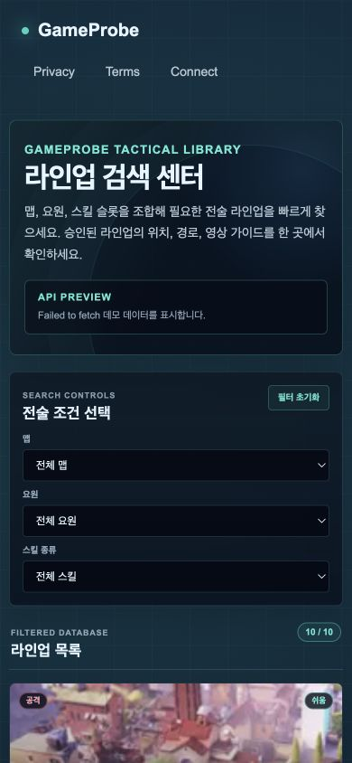

## 시각 검토 결과와 차이

PASS — 주요 배치·폭·밀도를 대조했고 모바일 글자 겹침·잘림·페이지 넘침이 없다.
별도 읽기 전용 리뷰에서도 주요 시각 결함 없음으로 확인했다.

GameProbe 브랜드, 기존 Jett 자산/아바타, 로컬 글꼴을 사용한다. Tracker의 전용 배경,
유료/광고/앱 설치 콘텐츠 및 인구 백분위는 복사하지 않고 Mock 기능과 안내로 구성했다.
Mock 수치·요원 3명·맵 3개는 실제 계정 기록과 다르다. 픽셀 단위 동일성을 주장하지 않는다.
Encounters/Customs/Crosshairs 및 사이트 전체 기능은 이번 Overview 중심 프로필 범위에
포함하지 않았고, 별도 경기의 팀 10명·라운드 이벤트 화면도 이번에 추가하지 않았다.
큰 컴포넌트 분리는 사용자 지시대로 후속 리팩터링 Task에서 진행한다.
