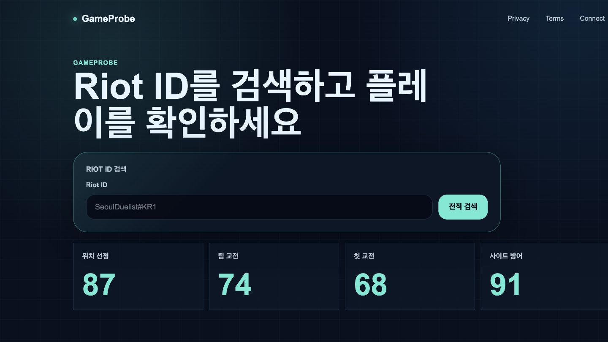
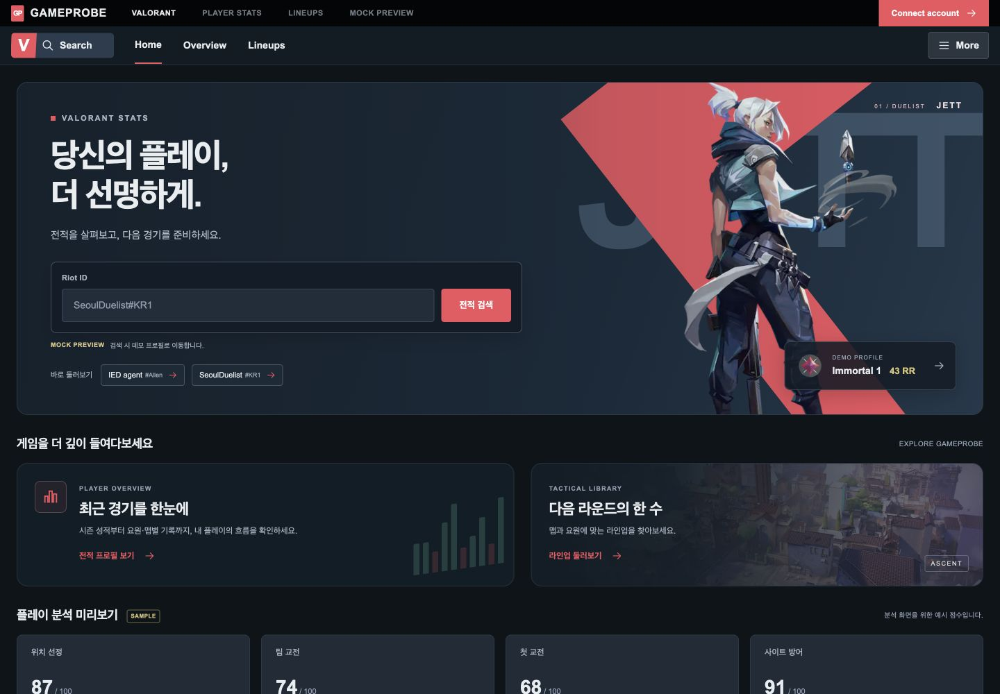
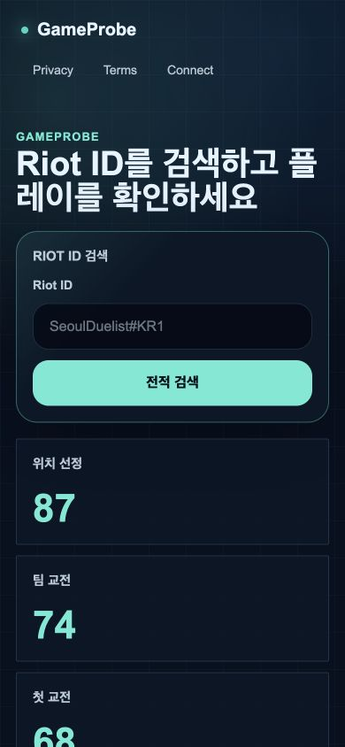
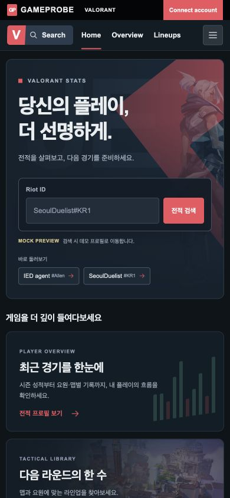
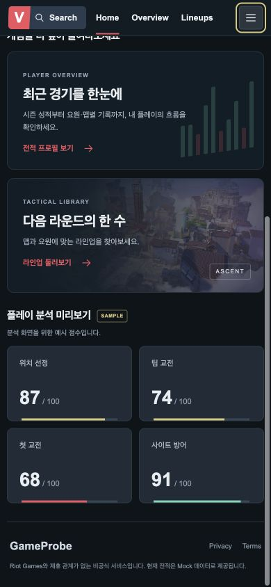

# TASK-FE-003 Visual QA

검증일: 2026-09-16. 기준: TASK-FE-002로 구현한 프로필 테마.
Playwright locator로 화면과 동작을 검증하고 브라우저 screenshot API로 JPEG를 저장했다.
데스크톱 Before는 실제 반환 크기 1440×810, After는 1440×1000이다.
모바일 Before/After는 모두 390×844다.

## 변경 전후

| 영역 | Before | After |
|---|---|---|
| 헤더 | 민트 로고, Privacy/Terms/Connect | 프로필과 같은 검정 브랜드 바·짙은 내비게이션·코랄 강조 |
| 배경/서체 | 격자 배경, 큰 제목, 민트 강조 | 프로필 CSS Module의 팔레트·글꼴 재사용, 차콜/네이비 배경 |
| 검색 | 둥근 민트 버튼·큰 검색 패널 | 짙은 입력창·코랄 버튼·Mock 이동 안내 |
| 진입 경로 | 검색 중심 | 기존 검색 + 두 데모 프로필 + 라인업 바로가기 |
| 분석 예시 | 민트 숫자 4개 | 동일 점수 87/74/68/91, 프로필 카드와 같은 색상·작은 보조 라벨 |
| 모바일 | 큰 제목과 검색 | 검색과 데모 링크를 우선 배치, 탐색 카드 1열·분석 카드 2열 |

### 데스크톱

### 모바일

## 브라우저 검증 결과

- 1440px/390px 문서 scrollWidth = viewport width. 페이지 가로 넘침 없음.
- 데스크톱/모바일 검색 입력과 제출 → 기존 SeoulDuelist 데모 프로필.
- Overview → IED agent 데모 프로필. 프로필 Home → 새 홈 정상 복귀.
- 라인업 카드 → `/lineups` 정상 이동, 기존 공용 헤더 복원 및 모바일 넘침 없음.
- 메뉴 열기/닫기 및 링크에서 Escape → More 버튼으로 포커스 복원.
- 개발 서버 재시작 후 홈·검색·프로필 복귀 중 브라우저 error/warn 0.
- 분석 예시 87/74/68/91 유지, Sample 안내 및 푸터 정상 표시.
- 주요 시각 검토: 프로필과 테마 일관성 PASS, 제목·버튼·카드 겹침 없음.
  독립 읽기 전용 시각 리뷰에서 주요 결함이 없었으며 메뉴 포커스 보완을 반영했다.

## 범위와 주의 사항

홈은 기존 `HomeSearch`와 `AnalysisExampleCards`를 그대로 재사용한다.
검색어에 관계없이 기존 데모로 이동하는 동작을 유지하고 화면에서 안내한다.
프로필 CSS Module을 직접 재사용하므로 향후 테마/헤더 모듈 분리 시 두 화면을
함께 옮기면 된다. 현재 전역 CSS, 기존 컴포넌트, 프로필, 라인업, API는 수정하지 않았다.
