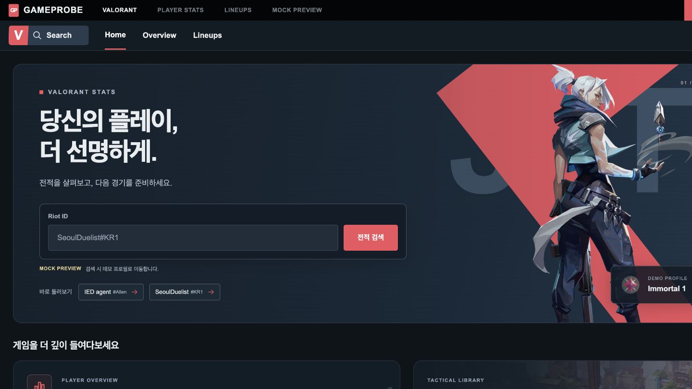
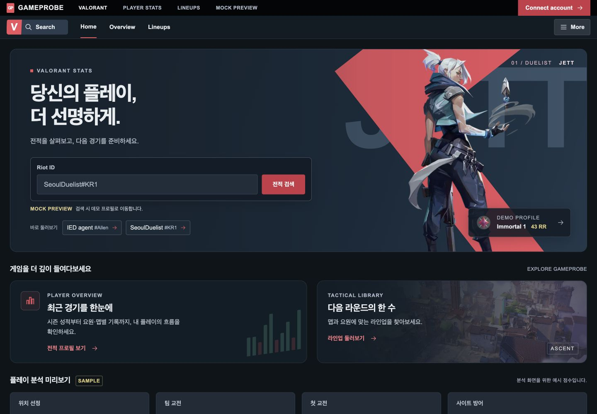
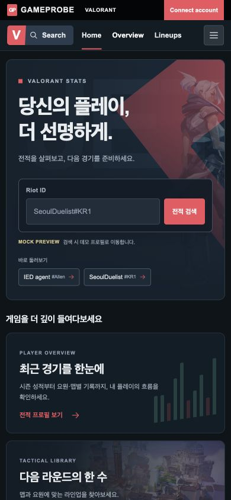
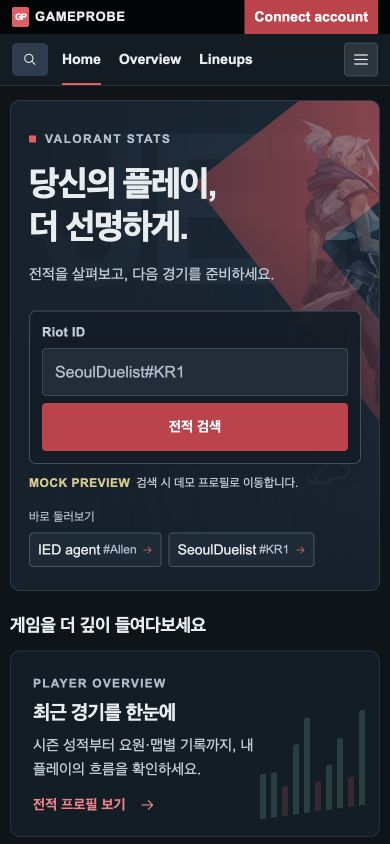
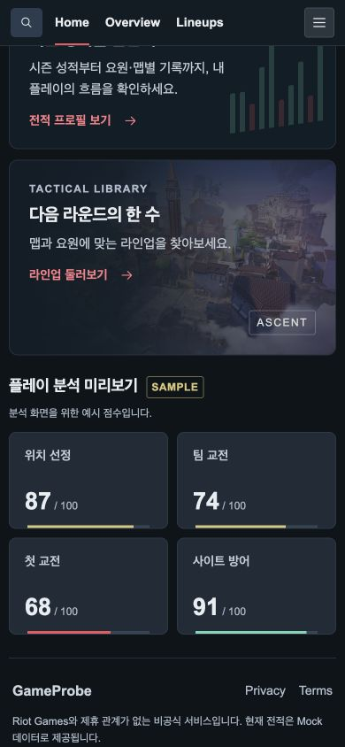

# TASK-FE-004 Visual QA — 홈 글자 가독성

검증일: 2026-09-16. 기준: 홈 테마 커밋 `7d66a7f`.
Playwright locator와 computed style로 확인하고 브라우저 screenshot API로 캡처했다.

## 원인과 수정

홈 본문·보조 정보는 8~12px가 많았고 모바일에서는 입력창도 12px였다.
실제 텍스트에 blur/transform이 적용된 근거는 없었다. 뷰포트 배율은 1이었다.
폰트 family와 큰 제목은 유지하고 글자 크기·텍스트 색상·버튼 대비를 보완했다.
운영체제별 폰트 렌더링 차이 자체를 해결했다고 주장하지 않는다.

| 항목 | Before 데스크톱 / 모바일 | After 데스크톱 / 모바일 |
|---|---|---|
| 큰 제목 | 48 / 35px | 유지 |
| 검색 입력 | 14 / 12px | 16 / 16px |
| 검색 버튼 | 13 / 11px | 14 / 14px |
| 설명 | 15 / 12px | 16 / 15px |
| 카드 설명 | 12 / 11px | 15 / 15px |
| Mock 고지 | 9~10 / 8~9px | 12px |
| 데모 링크 / 태그 | 11 / 9px (모바일 10 / 8px) | 14 / 12px |
| 분석 제목 | 12 / 11px | 14px |
| 모바일 푸터 설명 | 9px | 12px |
| 검색 버튼 대비 | 3.45:1 | 5.12:1 (hover 6.16:1) |

대비는 sRGB 상대 휘도로 계산했다. 검색 버튼 흰색 글자 기준으로 기본 배경은
`#c93648`, hover는 `#b52d3e`다. 어두운 카드 `#111d26` 위 본문 `#c1cbd6`는
10.41:1, 카드 링크 `#ff7b87`은 6.87:1이다. 입력 배경 `#202d3a` 위 placeholder
`#b0bece`는 7.41:1이다. 이 수치를 이미지 위 모든 픽셀의 대비 검증으로 확장하지 않는다.

## 화면 비교

데스크톱 Before는 실제 캡처 1440×810, After는 1440×1000이다.
모바일은 모두 390×844다. 서로 같은 폭에서 글자와 배치를 비교했다.

## 확인 결과

- 320/390/768/1440px에서 문서 scrollWidth와 viewport width 일치.
- 입력창 16px, 버튼·내비게이션 링크 14px. 모바일 보이는 텍스트 중
  로고 `GP`를 제외하면 12px 미만 없음.
- 480px 이하 검색 입력/버튼 세로 배치와 검색 바로가기 아이콘 적용.
  검색 바로가기는 접근성 이름을 가지며 클릭하면 Riot ID 입력창으로 포커스 이동.
- 모바일 지도 태그를 문서 흐름 안에 배치해 커진 CTA와 겹치지 않음.
- 홈 검색 → SeoulDuelist, Overview → IED agent, Home 복귀 정상.
- 라인업 카드 → 기존 라인업 페이지 정상. 기존 헤더 복원 및 가로 넘침 없음.
- More 열기/닫기 및 Escape 후 버튼 포커스 복원 정상.
- 독립 코드·시각 리뷰 PASS. 제목·버튼·카드·모바일 푸터에 겹침 없음.

## 범위

홈 CSS와 홈에만 적용하는 스타일 클래스·검색 바로가기 접근성 이름을 변경했다.
프로필/라인업/공통 CSS/Mock 데이터/의존성은 변경하지 않았다.
폰트 파일 추가, smoothing·stroke·blur 보정은 사용하지 않았다.
