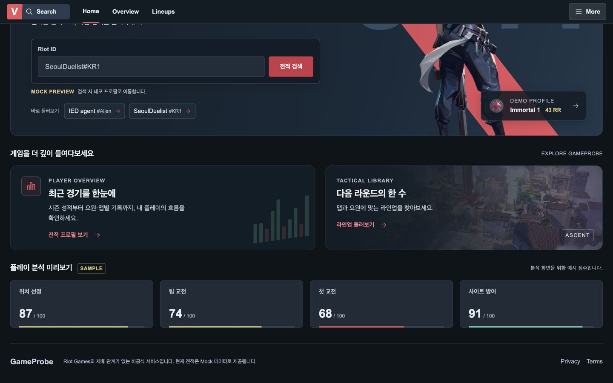
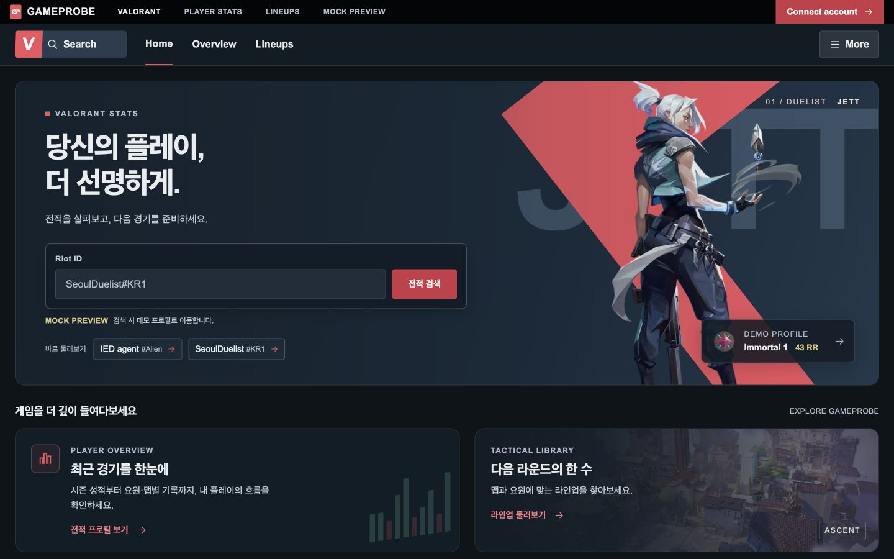
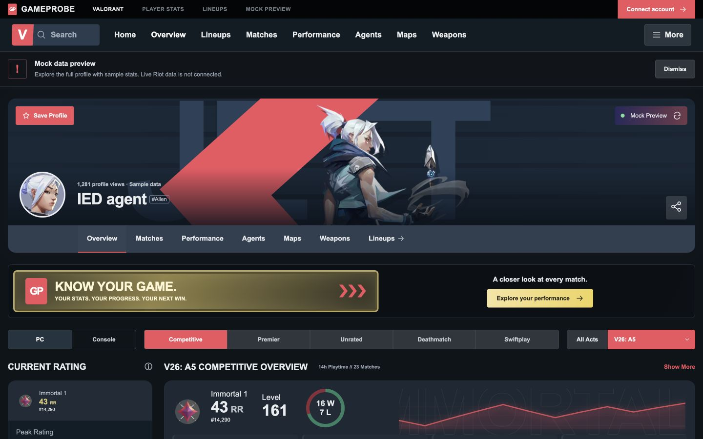
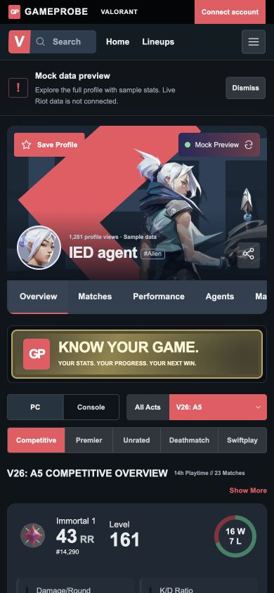
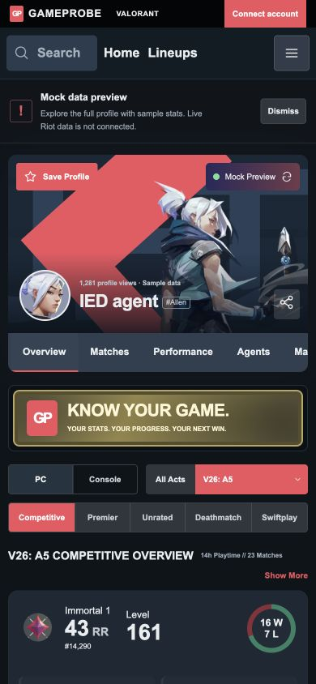

# TASK-FE-005 Visual QA — 상단 내비게이션 크기

검증일: 2026-09-16. TASK-FE-004의 미커밋 홈 변경을 보존한 상태에서
홈/프로필 상단 내비게이션만 비교했다. Playwright locator와 computed style,
브라우저 screenshot API로 확인했다.

## 비교

| 항목 | Before | After |
|---|---|---|
| 데스크톱 바 높이 | 56px | 68px |
| 모바일 바 높이 | 52px | 64px |
| 데스크톱 메뉴 글자 | 14px | 16px |
| 모바일 메뉴 글자 | 프로필 12px / 홈 14px | 16px |
| 검색 영역 높이 | 데스크톱36px / 모바일33px | 44px |
| More 높이 | 데스크톱 약39px / 모바일 약34px | 44px 이상 |
| 검색 입력 | 데스크톱14px / 모바일12px | 16px |

본문 글자, 최상단 브랜드 바, 프로필 내부 섹션 탭 크기는 이 Task에서 변경하지 않았다.
페이지 zoom/transform 확대 없이 관련 CSS 크기와 간격만 조정했다.

### 홈

데스크톱 1440×900, 모바일 390×844. 홈 데스크톱 Before는 스크롤되어
내비게이션이 상단에 고정된 상태이고 After는 페이지 맨 위다. 내비 크기는
비교할 수 있으나 본문 위치가 이동한 것을 이번 변경의 결과로 해석하지 않는다.

### 프로필

## 브라우저 검증

- 홈/프로필 각각320/390/768/1100/1440px에서 문서 가로 넘침 없음.
- 검색·탐색 링크·More 영역의 bounding rectangle 겹침 없음.
- 320px 홈: 검색44px, 메뉴 약197px, More44px. 안쪽 여백8px/영역 간격8px.
- 320px 프로필: 검색112px, 링크 약116px, More44px. 모바일 검색의 장식 로고를
  숨겨 실제 입력 영역을 확보했다.
- 768px 프로필 메뉴 영역만 client404px/scroll411px. 메뉴 내부 가로 스크롤을
  허용하며 링크 키보드 포커스는 컨테이너 안쪽에 표시한다.
- 데스크톱 Matches/Overview 클릭 후 Profile sections의 현재 탭 변경 확인.
- 프로필 검색 입력/Enter 시 기존 데모 안내 정상.
- More 열기/닫기 정상. 모바일 메뉴는 버튼 아래8px 간격, 화면 오른쪽 안에 위치.
- 홈 More Escape 포커스 복원, 검색 바로가기 입력창 포커스 이동 정상.
- 프로필 스크롤 후 내비게이션 top0/height68px: sticky 유지.
- 독립 코드 및 Before/After 8장 시각 리뷰 PASS.

## 영향 범위

프로필 CSS Module 사용처는 TrackerProfile.tsx와 HomeLanding.tsx 두 곳이다.
전역 `:has` 규칙, 공통 CSS, 라인업 코드를 변경하지 않았다. 이전 FE-004 수정은
보존했으며 이번에 Overview 이름/목적이나 메뉴의 기능은 변경하지 않았다.
