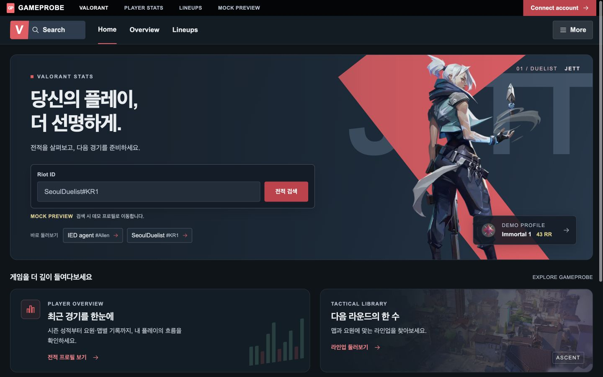
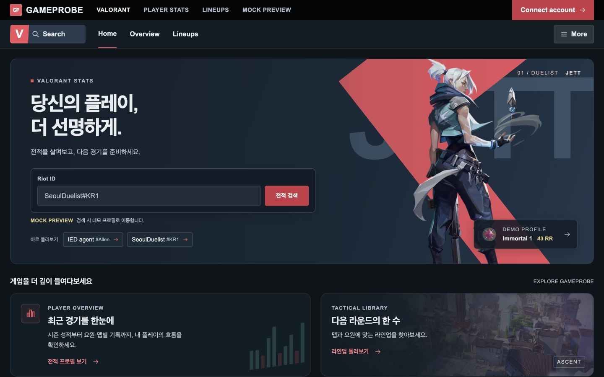
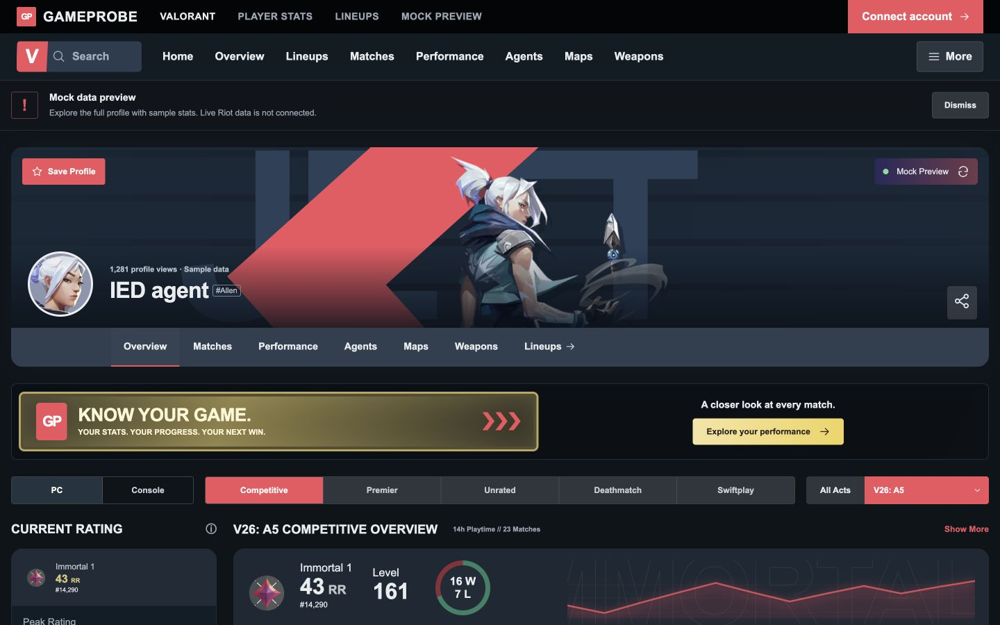
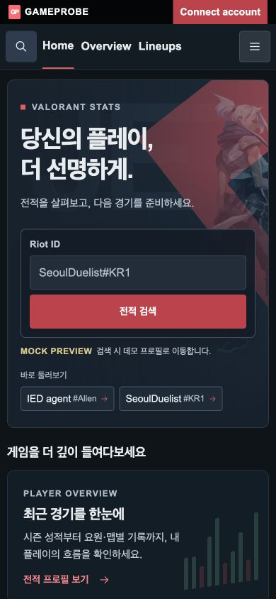
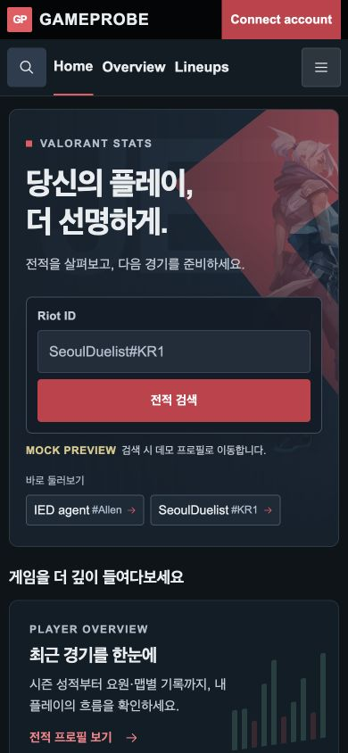
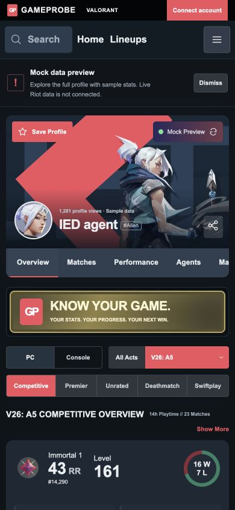
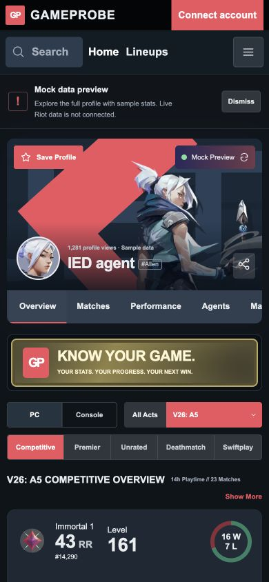

# TASK-FE-006 Visual QA — 최상단 브랜드 바 확대

2026-09-16, Docker 프론트 개발 서버, 홈 `/` 및 프로필
`/players/ied-agent-allen`. Before는 기존 FE-004/005 변경이 적용된 상태다.
이번 변경은 두 화면의 브랜드 바 CSS에 한정한다.

## Before / After

| 화면 | Before | After |
| --- | --- | --- |
| 홈 1440×900 |  |  |
| 프로필 1440×900 |  |  |
| 홈 390×844 |  |  |
| 프로필 390×844 |  |  |

## 확인 결과

- 데스크톱: 바 48px, 서비스명 20px, 보조 라벨 14px, 계정 버튼 16px.
- 700px 이하: 바 44px, 서비스명 18px, 계정 버튼 14px.
- 800px 이하: VALORANT 라벨만 유지. 480px 이하: 로고·계정 버튼만 표시.
- 홈과 프로필 모두 320/390/700/701/768/1000/1440px에서 문서 가로 넘침 및
  브랜드 바 요소 겹침 없음. 320px에서는 양끝 여백 8px 확보.
- 아래 내비게이션은 기존 68px/모바일 64px 유지.
- 홈 Connect account는 기존 `/connect` 안내 화면으로 이동한다.
  프로필 브랜드 로고는 홈으로 이동한다. JSX와 링크 목적은 무변경.
- 독립 리뷰에서 CSS 변경 범위, 데스크톱/모바일 정렬·읽기 크기 확인: PASS.
- 타입 검사, Lint(경고·오류 0), production build: PASS.

## 범위와 제한

라인업·전역 파일·본문·내비게이션은 이번 작업에서 변경하지 않았다.
홈 계정 버튼의 기존 색상과 프로필 계정 버튼의 기존 색상은 유지한다.
계정 연결은 기존 안내 UI이며 실제 인증/API는 검증 대상이 아니다.

초기 브라우저 자동화의 연속 이동·뒤로 가기 대기에서 시간 초과가 발생했다.
각 링크를 개별 클릭하고 도착 화면을 확인하는 방식으로 검증을 마쳤다.
앱 수정이나 검증 생략 없이 링크 동작을 확인했다.
