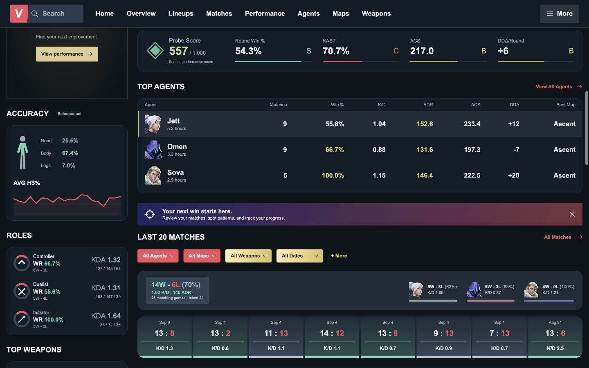
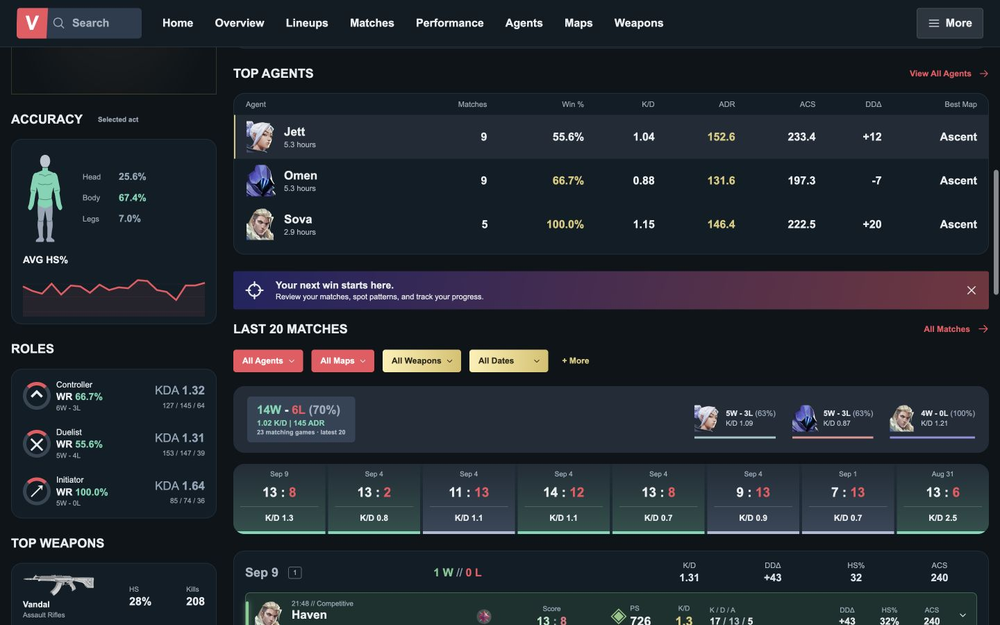
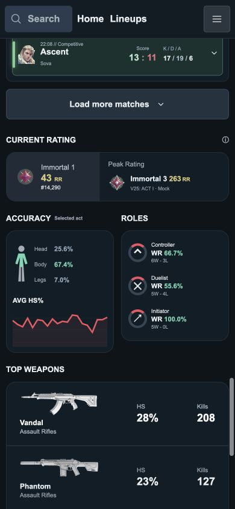
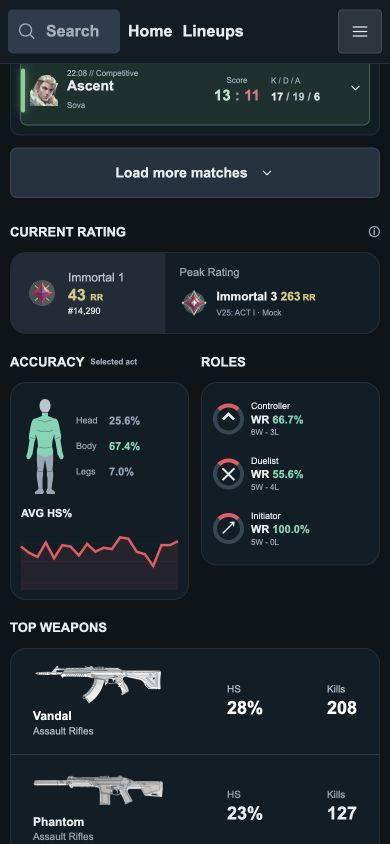

# TASK-FE-007 Visual QA — 명중 부위 인체 그림

2026-09-16, Docker 개발 서버 `/players/ied-agent-allen`.
Before에는 FE-004/005/006의 미커밋 변경이 포함되어 있다.

## 화면 비교

| 크기 | Before | After |
| --- | --- | --- |
| 1440×900 |  |  |
| 390×844 |  |  |

데스크톱 캡처는 스크롤 위치가 다르므로 ACCURACY 카드 자체를 기준으로 비교한다.
원·직선 막대 형상을 어깨·허리·팔꿈치·손·무릎·발이 드러나는 마네킹으로 교체했다.
원본 SVG는 직접 작성한 벡터이며 외부 이미지/라이브러리/3D 렌더러를 사용하지 않는다.

## 검증 결과

- 데스크톱 64×132px, 모바일 48×100px. SVG 비율을 유지하고 축소에 의한 찌그러짐 방지.
- 320/390/768/1440px 문서 가로 넘침과 그림·명중률 텍스트 겹침 없음.
- 기존 머리/다리 회색·몸통 민트 유지. 그림의 색은 명중률 히트맵을 의미하지 않는다.
- 그림은 `aria-hidden`/`focusable=false`로 처리하고 옆의 Head/Body/Legs 값을 유지.
- A5: 25.6/67.4/7.0%, A4 변경: 29.1/63.9/7.0%, A5 복원: 원래 수치.
- 별도 시각 검토 PASS: 인체 비율·관절·손발이 구별되며 작은 화면에서도 디테일이 과하지 않다.
- TSX 변경은 인체 SVG 내부, CSS 변경은 그림 크기·색상 클래스에 한정.
  통계 계산·Mock·라인업·홈·공통 파일 변경 없음.

## 남은 범위

실사 인물이나 회전 가능한 3D 모델이 아닌 정면 인체 벡터 실루엣이다.
프로필 전체의 작은 회색 글자 가독성과 경기 상세 확장은 이번 변경에 포함하지 않는다.
