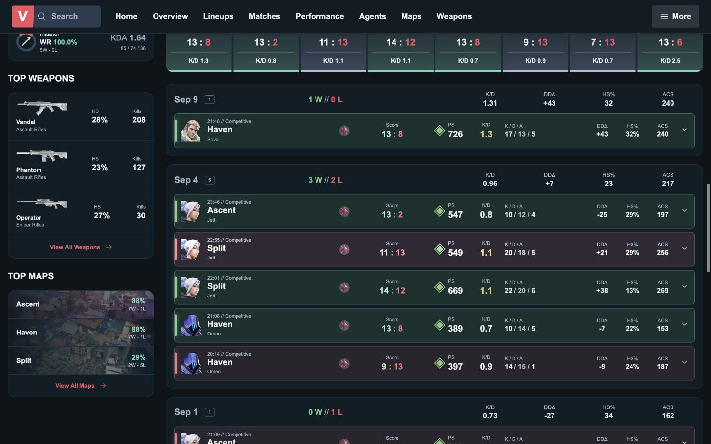
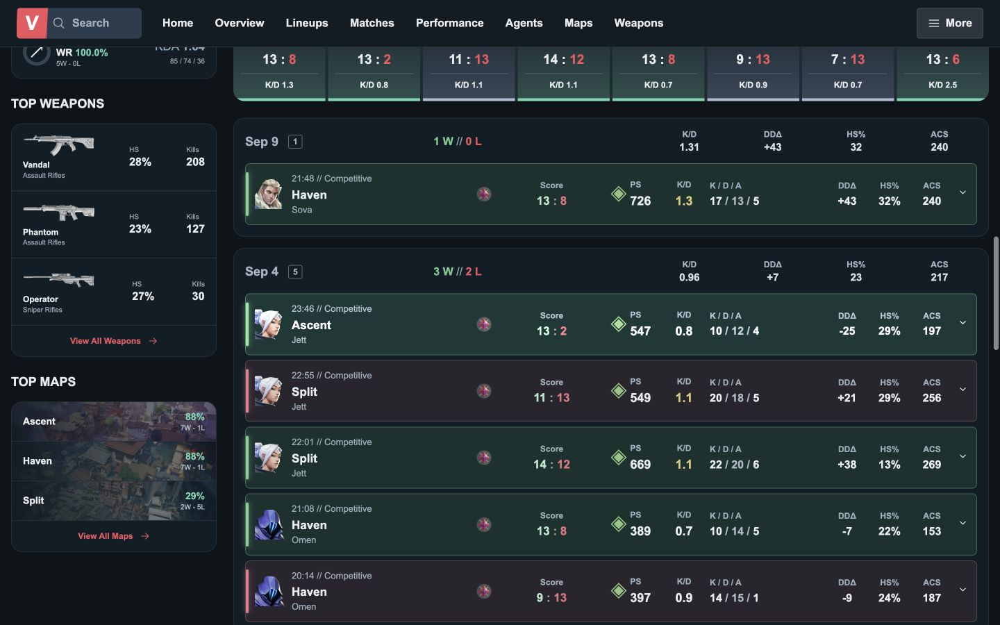
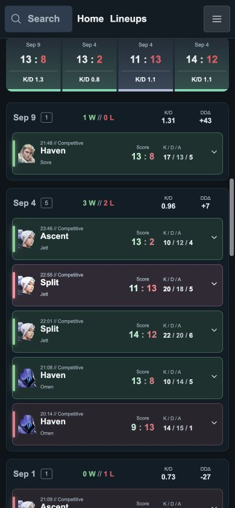
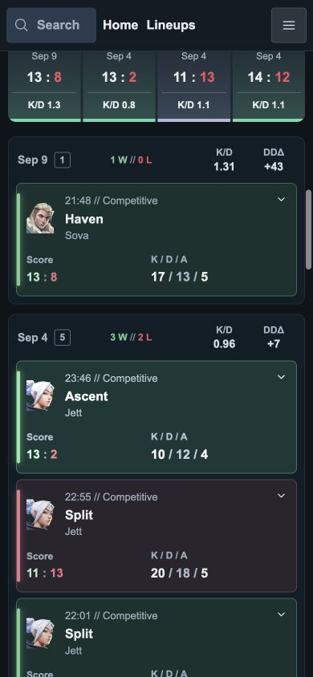

# TASK-FE-008 Visual QA — 경기 목록 가독성

2026-09-16, Docker 개발 서버 `/players/ied-agent-allen`.
Before는 FE-004~007의 미커밋 변경을 포함한다. 각 화면에서 첫 날짜 그룹을
같은 높이에 놓고 비교했다. 글꼴(Arial)과 색상은 유지했다.

## Before / After

| 화면 | Before | After |
| --- | --- | --- |
| 1440×900 |  |  |
| 390×844 |  |  |

## 확인 결과

- 경기 시간·요원명 13px, 지표 라벨 12px/700. 시간·요원명의 일반 굵기는 유지해
  맵명·주요 수치와 위계를 구분했다. K/D/A·개별 경기 지표 수치는 16px.
- 날짜별 라벨·날짜 스트립·최근 경기 요약 보조 글자 최소 12px.
- 작은 글자를 만드는 기존 모바일 override 제거. 850px 이하에서는 요원/시간을
  첫 줄, 점수·K/D/A를 둘째 줄로 배치한다. 701~850px의 기존 ACS 표시 유지.
- 320/390/700/701/768/850/851/1000/1001/1250/1251/1280/1440/1920px에서
  문서 가로 넘침 없음. 표시된 경기 행 요소 간 겹침·행 밖 넘침·요원 정보 글자
  넘침 없음. 최근 경기 요약도 내부 넘침 없이 필요한 경우 줄바꿈한다.
- 위 너비 모두 실제 computed size: 시간 13px, 지표 라벨 12px/700.
- 경기 펼침/닫기 정상. 패배 필터에서 7개 경기(모두 Defeat), 요약 0W/7L 확인.
  All Results 복원 후 20개 경기 표시, 열린 경기 없음.
- 별도 코드·시각 검토 PASS. 데스크톱 정렬과 수치 구분을 유지하고 모바일에서
  두 줄의 역할이 명확하다. 기존 FE-004~007 변경 보존.

## 차이와 범위

경기 행은 데스크톱 약 89px, 모바일 약 141px로 높아져 모바일 한 화면에 보이는
경기 수가 줄었다. 글자 축소 없이 읽을 수 있도록 한 변경이다.
브랜드 바·내비게이션·인체 그림·홈·라인업·전역 스타일·데이터는 변경하지 않았다.
경기 상세 내부와 프로필 다른 영역의 글자 크기는 이번 범위 밖이다.
