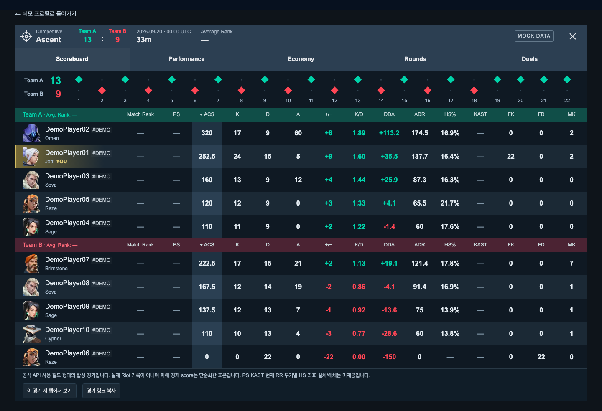
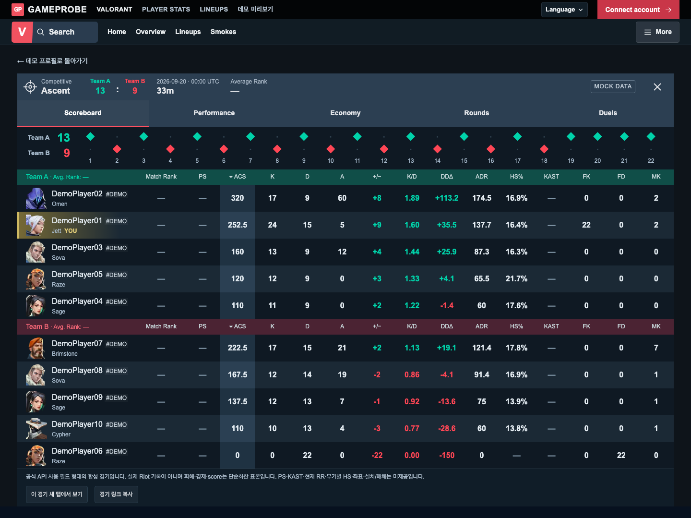
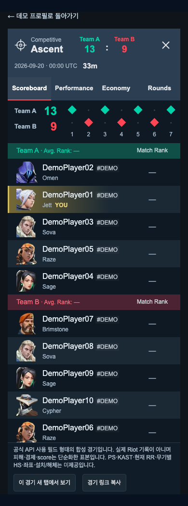
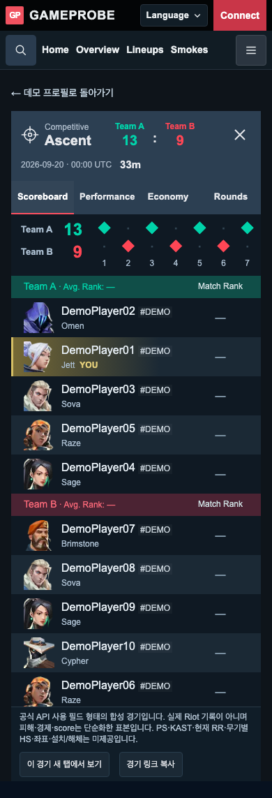
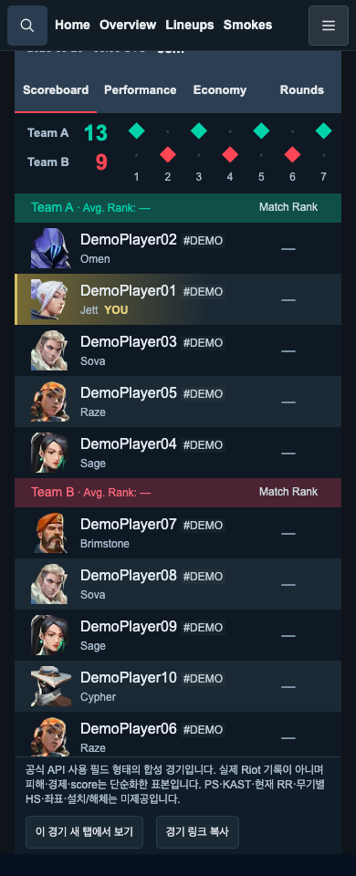

# TASK-FE-031 — 단독 경기 공통 메뉴 시각 검증

## 범위와 기준
- 기준: PR24 병합 `6f3e131`. 변경 파일은 `SyntheticMatchPage.tsx` 한 개다.
- 레퍼런스: 기존 홈/보조 페이지 `StatsHeader`의 브랜드·Search·공통 메뉴. 별도 디자인을 만들지 않고 동일 컴포넌트를 사용한다.
- 실제 URL: `/matches/demo-match-001?viewer=demo-player-01`. 프로필 모달의 새 탭 링크에서 발견한 주소를 사용한다.
- `verify.cjs` 결과를 읽어 이 보고서의 검사 표를 생성했다. Before 제품 수정 전, After 제품 수정 후 각각 8조건 캡처 및 공유 접근 확인 1장(총17장).

## 캡처 결과
| 화면 | 폭 | 공통 메뉴 개수 | 문서 가로 넘침 |
|---|---|---|---|
| modal | 1440px | 1 | 없음 |
| modal | 390px | 1 | 없음 |
| standalone | 1440px | 1 | 없음 |
| standalone | 820px | 1 | 없음 |
| standalone | 390px | 1 | 없음 |
| alternate-viewer | 1440px | 1 | 없음 |
| missing | 390px | 1 | 없음 |
| legacy | 1440px | 1 | 없음 |

- 데스크톱/태블릿/모바일 단독 화면의 경기 패널 위에 브랜드 바와 Home → Overview → Lineups → Smokes가 표시된다.
- 본문 폭·글자·데이터 표는 유지된다. 모바일 표와 경기 탭은 기존 내부 가로 스크롤을 사용한다.
- 메뉴 추가만큼 페이지가 길어지지만, 모바일 공유 버튼까지 문서 스크롤로 접근 가능하다. 모달 패널의 높이 정책은 수정하지 않았다.
- 기존 프로필 모달(1440/390), 없는 경기 안내(390), 구 데모 단독 경기(1440) Before/After PNG 4쌍은 바이트 단위로 동일하다.

## 화면 대조
### 데스크톱
Before: 
After: 

### 모바일
Before: 
After: 
공유 버튼 접근: 

## 동작 검증
- 실제 모달의 ‘이 경기 새 탭에서 보기’ 실행 → 같은 경기/선수 URL과 공통 메뉴 표시, 원래 모달 유지.
- 각 폭에서 5탭 내용이 Before와 동일하다. 다른 선수(viewer=demo-player-02) 내용·공유 링크도 유지된다.
- Home/Overview/Lineups/Smokes/Search 링크를 실제 클릭하여 목적지 확인.
- Overview 기본 목적지는 기존 디자인 데모, 복귀 링크/닫기는 새 데이터 데모를 유지한다.
- More 열기 → Privacy 초점 → Escape 닫기와 버튼 초점 복원 PASS.
- 키보드로 Language 열기 → English/한국어 변경 및 main의 lang 변경 PASS.
- 단독 화면 main 1개, 메뉴 1개. 없는 경기 안내의 메뉴 중복 없음. 페이지 예외 0.

## 검증 명령
- `node docs/visual-qa/assets/TASK-FE-031/verify.cjs before/after`: 각각 PASS.
- `docker compose -f docker/compose.frontend.yml exec -T frontend npx tsc --noEmit`: PASS.
- 같은 compose의 `npm run lint`: PASS, ESLint 경고·오류 0.
- 개발 서버 stop → 일회성 컨테이너 `npm run build` → up -d: PASS, 정적12페이지 생성.
- 개발 서버 복원 후 1440/390px HTTP200·공통 메뉴1개·브라우저 예외0 확인 PASS (`post-build.json`).
- `git diff --check`: PASS.
- 컨테이너 버전 확인 단계에 기존 `git: not found` 출력이 있지만 lint/build 종료코드 0, 타입/컴파일 검증 정상 완료.

## 검증 범위와 제한
- 외부 API는 로컬 QA에서 차단했고 실제 관리자/운영 자료를 변경하지 않았다.
- Playwright 브라우저의 최초 샌드박스 실행은 OS 권한으로 실패하여 승인된 실행 환경으로 전환했다.
- 최초 캡처는 화면 밖 lazy 이미지 decode 대기로 중단했다. 로딩 대기에 상한을 둔 뒤 Before/After 전체 캡처를 완료했다. 제품 오류가 아니며 검사 항목을 제거하지 않았다.
- 직접 화면 대조 및 독립 에이전트 시각/코드 리뷰 PASS: 글자 겹침·문서 가로 넘침·새 메뉴/패널 겹침 없음. Cursor 별도 검증을 수행한 것은 아니다.
