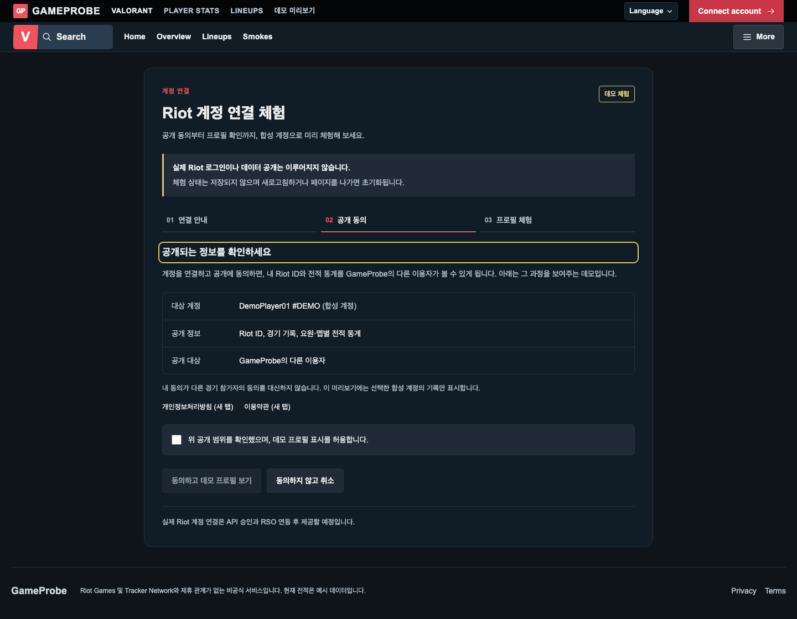
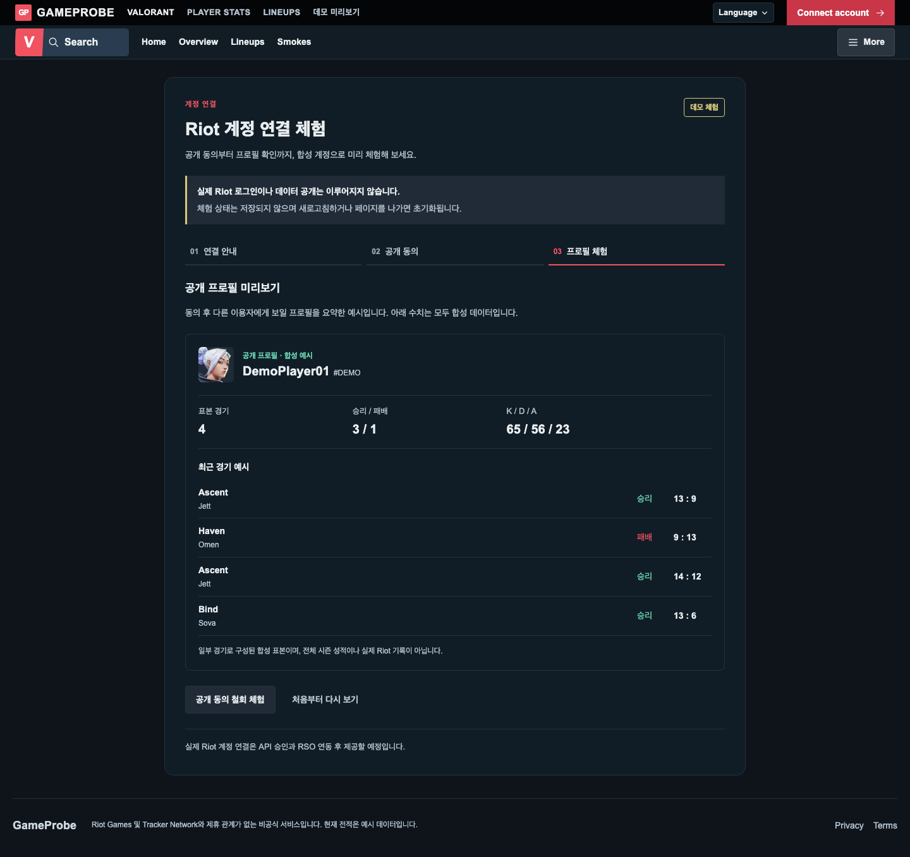
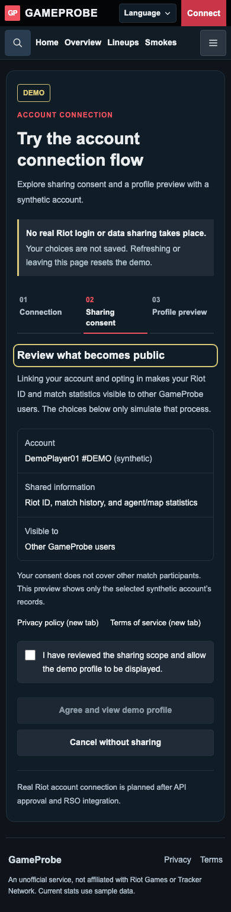
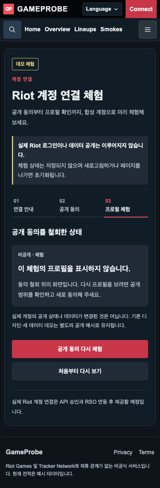

# TASK-FE-032 Visual QA — 계정 연결·공개 동의 데모

## 기준·방법

- 기준: adfbc3e의 /connect, 기존 홈·프로필 테마. 별도 신규 외부 레퍼런스 자산 없음.
- Playwright Chromium, viewport 높이960, 배율1. 1440/820/390/320px, 1440/390px는 한국어·영어 모두 확인.
- 제품 변경 전 Before9장. After33장(초기화면6·취소/동의/프로필/철회24·회귀3), 총42장.
- 고정 메뉴가 스크롤 위치에 따라 캡처 중간에 나타나는 촬영 현상을 피하기 위해 After는 상단으로 이동 후 fullPage 촬영. 실제 단계 제목 초점은 메뉴 아래에 보이는지 별도 검사.

## Before / After 대조

| 화면 | 폭 / 언어 | Before | After |
|---|---|---|---|
| connect | 1440 / ko | [Before](assets/TASK-FE-032/before-1440-connect-ko.png) | [After](assets/TASK-FE-032/after-1440-connect-ko.png) |
| connect | 1440 / en | [Before](assets/TASK-FE-032/before-1440-connect-en.png) | [After](assets/TASK-FE-032/after-1440-connect-en.png) |
| connect | 820 / ko | [Before](assets/TASK-FE-032/before-820-connect-ko.png) | [After](assets/TASK-FE-032/after-820-connect-ko.png) |
| connect | 390 / ko | [Before](assets/TASK-FE-032/before-390-connect-ko.png) | [After](assets/TASK-FE-032/after-390-connect-ko.png) |
| connect | 390 / en | [Before](assets/TASK-FE-032/before-390-connect-en.png) | [After](assets/TASK-FE-032/after-390-connect-en.png) |
| connect | 320 / ko | [Before](assets/TASK-FE-032/before-320-connect-ko.png) | [After](assets/TASK-FE-032/after-320-connect-ko.png) |
| home | 1440 / ko | [Before](assets/TASK-FE-032/before-1440-home-ko.png) | [After](assets/TASK-FE-032/after-1440-home-ko.png) |
| legacy | 1440 / ko | [Before](assets/TASK-FE-032/before-1440-legacy-ko.png) | [After](assets/TASK-FE-032/after-1440-legacy-ko.png) |
| synthetic | 1440 / ko | [Before](assets/TASK-FE-032/before-1440-synthetic-ko.png) | [After](assets/TASK-FE-032/after-1440-synthetic-ko.png) |

## 구현자 시각 평가

- 공통 SupportPage 프레임·표면색·버튼 색·글자 크기 유지. 상단 데모 배지와 실제 로그인/공개가 아님을 알리는 안내가 모든 단계에 남는다.
- 비활성 동의 버튼과 취소 버튼의 높이/여백을 맞췄다. 기존 보조 페이지의 li 여백 상속으로 단계 표시가 어긋난 부분은 시연 전용 CSS로 수정했다.
- 모바일에서는 공개 범위 표와 버튼을 세로로 배치하고 프로필 통계 K/D/A를 별도 행으로 표시한다. 강제 축소나 문서 가로 넘침 없이 읽을 수 있다.
- 4개 표본 경기·요약65/56/23·3승1패를 기존 Mock 공급자에서 가져오며 미동의 참가자 이름은 추가하지 않았다.
- 홈·기존 디자인 프로필·새 데이터 프로필의 Before/After PNG는 각각 byte 동일.

### 주요 상태

## 자동 검증 결과

- Policy opens in new tab and keeps selection
- 1440px/ko: keyboard, unchecked guard, cancel, sample totals, locale, withdrawal, re-consent, reset, reload, route return, no storage changes
- 1440px/en: keyboard, unchecked guard, cancel, sample totals, locale, withdrawal, re-consent, reset, reload, route return, no storage changes
- 820px/ko: keyboard, unchecked guard, cancel, sample totals, locale, withdrawal, re-consent, reset, reload, route return, no storage changes
- 390px/ko: keyboard, unchecked guard, cancel, sample totals, locale, withdrawal, re-consent, reset, reload, route return, no storage changes
- 390px/en: keyboard, unchecked guard, cancel, sample totals, locale, withdrawal, re-consent, reset, reload, route return, no storage changes
- 320px/ko: keyboard, unchecked guard, cancel, sample totals, locale, withdrawal, re-consent, reset, reload, route return, no storage changes
- home: identical screenshot; default demo preserved
- legacy: identical screenshot; default demo preserved
- synthetic: identical screenshot; default demo preserved
- 브라우저 예외 0, API 요청 0, 문서 가로 넘침 0, 모든 캡처 main 1개.
- checkbox Space/버튼 Enter, 단계 제목 초점·고정 메뉴 겹침, 동의 취소/철회 후 초기 checkbox, 언어 변경 중 프로필 유지, 새로고침·페이지 이동 후 초기화, localStorage/sessionStorage/cookie 변경 없음 확인.

## 제한

- 실제 RSO/동의 저장/서버 접근 제어·실제 데이터 삭제 검증이 아니다. 현재 페이지에서의 합성 시연 상태만 다룬다.
- 기본 Mock는 정상 표본이다. 비동기 취소·오류/재시도 방어 코드는 검토했으나 실제 Riot 장애/인증 만료 응답은 재현하지 않았다.
- 독립 에이전트 코드·시각 검토 결과와 최종 빌드 결과는 Task 문서에 기록한다. 별도 Cursor 리뷰를 수행했다고 주장하지 않는다.

## 최종 검증

- 독립 에이전트 코드 및 데스크톱/390px영어/320px한국어 시각 검토 PASS, 필수 수정 없음.
- 상태 테스트5/5·TypeScript·Lint·production build PASS. 서버 복원 후 1440/390px 동의/철회 PASS([결과](assets/TASK-FE-032/post-build.json)).
